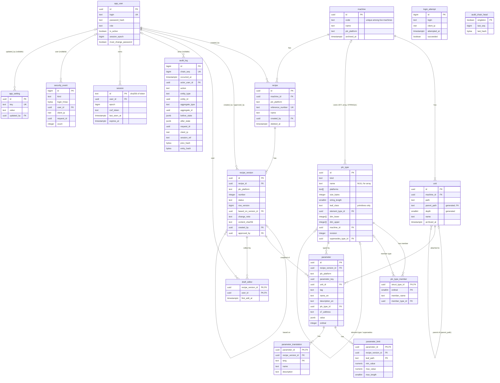

# Data Model

Status: Accepted (design stage, revised after review 2026-10-12)
Source of requirements: `general-draft.txt`
Related: `domain-model.md`, `overview.md`, `reliability.md`, `api.md`, ADR-0005 to ADR-0022

This document defines the PostgreSQL 16 schema. SQL names come from this document. Rust names come from `domain-model.md`. Section 1.2 maps one to the other.

## 1. Conventions

### 1.1 Rules

- Identifiers are `snake_case`. No quoted identifiers.
- Entity tables use `id UUID PRIMARY KEY DEFAULT gen_random_uuid()`. The domain uses UUID identity types.
- Log tables (`audit_log`, `security_event`, `login_attempt`) use `BIGINT GENERATED ALWAYS AS IDENTITY`. Gaps in the sequence are normal.
- Time columns are `TIMESTAMPTZ`. `now()` is the transaction start time. All rows of one transaction get the same timestamp.
- Strings are `TEXT` with a `CHECK` on length or pattern. No `VARCHAR(n)`.
- Enumerated values are `TEXT` with a `CHECK (... IN (...))`. No `CREATE TYPE ... AS ENUM`.
- Every foreign key column has an index, unless a unique constraint or a primary key already starts with that column.
- Entity tables have `created_at TIMESTAMPTZ NOT NULL DEFAULT now()`. Tables that the application updates in place also have `updated_at`, set by trigger.
- Soft delete uses a nullable `deleted_at` or `archived_at` column (ADR-0021).
- Every function sets `search_path = pg_catalog, public, pg_temp`. A `SECURITY DEFINER` function also schema-qualifies every table and function name (ADR-0022).
- Isolation is `READ COMMITTED`. Commands lock rows in one order: `machine` → `recipe` → `recipe_version` → `unit` → children. Section 6 gives the sequence per command.
- Expected scale is Assumption A19. Size budgets are Assumption A26. No table is partitioned.
- The schema is `public`. Roles are in section 5.

Allowed `plc_platform` values: `CodesysIec`, `TwinCat3`, `S7_1200`, `S7_1500`, `S7_300`.

Exceptions to the rules above:

| Table | Exception | Reason |
|---|---|---|
| `security_event`, `audit_log` | `occurred_at` instead of `created_at`. No `updated_at`, although an aggregated `security_event` row gets a new `count` | Append-only event rows. The only update is `security_event.count` (section 3.8) |
| `login_attempt` | `attempted_at` instead of `created_at`. No `updated_at`, although `Login` T2 updates the row | Counter row. The only update sets `succeeded` once (section 6) |
| `session` | `id` is the SHA-256 of the cookie token, not a UUID. No `updated_at`, although the application updates the row | The raw token never reaches the database. `last_seen_at` records the last request |
| `parameter` | No `updated_at`, although draft commands update the row | Every draft command sets `recipe_version.updated_at` through the touch statement (section 6). The version row records the last change |
| `parameter_limit`, `parameter_translation` | Composite primary key, no `id`. No `updated_at`, although `ReplaceLimits` and `UpsertTranslation` change the rows | Child rows of one parameter. The touch statement of section 6 records the last change on the version row |
| `plc_type` | `created_at` cannot be set by `recipe_app` (column-level INSERT grant) | Trigger 4.6 uses `created_at = now()` to detect the creating transaction |
| `audit_chain_head` | One row with the key `singleton BOOLEAN`. No `id`, no `created_at` | The row holds the end of the audit hash chain (4.9) |

### 1.2 Name mapping (Rust ↔ SQL)

| Rust (`domain-model.md`) | SQL (this document) |
|---|---|
| `Machine.code` | `machine.code` |
| `Unit.parent: Option<UnitId>` | derived from `unit.parent_path` (no `parent_id` column) |
| `PlcType.supersedes` | `plc_type.supersedes_type_id` |
| `PlcType.element_type` | `plc_type.element_type_id` |
| `PlcType.dimensions[i].lower / upper` | `plc_type.dim_lower[i] / dim_upper[i]` |
| `PlcType.leaf_class` (`Numeric`, `String`, `Bool`, `Char`, `Duration`, `Instant`) | `plc_type.leaf_class` (`numeric`, `string`, `bool`, `char`, `duration`, `instant`) |
| `TypeMember.type_id` | `plc_type_member.member_type_id` |
| `Parameter.key` | `parameter.parameter_key` |
| `Parameter.plc_type` | `parameter.plc_type_id` |
| `Parameter.unit` | `parameter.unit_id` |
| `RecipeVersion.number` | `recipe_version.number` |
| `RecipeVersion.content_sha256` | `recipe_version.content_sha256` |
| `AuditEntry.actor` | `audit_log.actor_user_id` |
| `AuditEntry.before / after` | `audit_log.before_state / after_state` |
| `AuditEntry.aggregate_type / aggregate_id` | `audit_log.aggregate_type / aggregate_id` |
| `AuditEntry.chain_seq` | `audit_log.chain_seq` |
| `User.login` | `app_user.login` |
| `User.role` (`Administrator`, `ProcessEngineer`, `Operator`) | `app_user.role` (`administrator`, `process_engineer`, `operator`) |
| `VersionStatus` (`Draft`, `Approved`, `Retired`) | `recipe_version.status` (`draft`, `approved`, `retired`) |
| `SecurityEventKind` variants | `security_event.kind` values in snake_case |
| `u32` fields: `RecipeVersion.number`, `PlcType.revision`, `PlcType.size_bytes`, `Parameter.ordinal` | `INTEGER` (`i32`). The adapter converts with `i32::try_from` and `u32::try_from` and returns an error for a value outside the `INTEGER` range. It never uses `as` |
| `u16` fields: `PlcType.string_length`, `ProcessLimit.max_length` | `SMALLINT` (`i16`). The adapter converts with `i16::try_from` and `u16::try_from` and returns an error for a value outside the `SMALLINT` range. It never uses `as` |

### 1.3 Text limits

| Column | Limit |
|---|---|
| `machine.name`, `unit.name`, `recipe.name`, `parameter.name_en`, `parameter_translation.name` | 1 to 200 characters |
| `parameter.description_en`, `parameter_translation.description`, `recipe_version.change_note` | `description_en` and `change_note`: 1 to 4 000. `parameter_translation.description`: 0 to 4 000 |
| `parameter.tag` | 1 to 64, pattern `^[A-Z][A-Z0-9_]{0,63}$` |
| `app_user.login`, `login_attempt.login` | 3 to 64 for a valid login. `login_attempt.login` accepts 1 to 64 |
| `parameter.value` | `pg_column_size` at most 1 048 576 bytes |
| `security_event.user_agent` | at most 256 characters (`http.user_agent_max`, `reliability.md` 7.11) |
| `audit_log.session_ref` | 16 hex characters (`log.session_ref_length`, `reliability.md` 7.11) |

### 1.4 Advisory locks

Every advisory lock of the application uses the two-key form `pg_advisory_xact_lock(class, key)`. The class keeps the key spaces apart.

| Class | Use | Key |
|---|---|---|
| 1 | `Login` T1 (section 6) | `hashtext($login)` of the normalized login |
| 2 | `DefineUdt` and the other callers of `EnsureDerivedType` (`domain-model.md` 5.1) | `hashtext(machine_id::text \|\| ':' \|\| name)`. `name` is the struct name, `STRING`, `WSTRING`, or `ARRAY` |
| 3 | Reserved for the audit head. No code takes it now | - |

Order of the class-2 keys. A command that can insert `plc_type` rows first parses every `TypeExpr` that it carries. `RebindTypeRevision` computes the array shape of every moved parameter instead. The command collects the class-2 keys that the resolution needs and sorts them in this order: the struct name, `STRING`, `WSTRING`, `ARRAY`. It takes all these locks in that order before its first `plc_type` insert. Two commands therefore never take two class-2 keys in opposite orders. The commands are `DefineUdt`, `AddParameter`, `UpdateParameterDefinition`, and `RebindTypeRevision` (section 6).

The one-key form `pg_advisory_lock(bigint)` is a different key space. Only the `sqlx` migrator uses it (`reliability.md` 5).

## 2. Entity relationship diagram



## 3. Tables (DDL)

The DDL is in dependency order. Each block belongs to `0001_schema.sql`. Comments explain the constraint that is not obvious.

### 3.0 Shared functions

```sql
CREATE FUNCTION set_updated_at() RETURNS trigger
LANGUAGE plpgsql SET search_path = pg_catalog, public, pg_temp AS $$
BEGIN
    NEW.updated_at := now();
    RETURN NEW;
END;
$$;
```

### 3.1 `machine`

```sql
CREATE TABLE machine (
    id            UUID PRIMARY KEY DEFAULT gen_random_uuid(),
    code          TEXT NOT NULL,
    name          TEXT NOT NULL,
    plc_platform  TEXT NOT NULL,
    archived_at   TIMESTAMPTZ,
    created_at    TIMESTAMPTZ NOT NULL DEFAULT now(),
    updated_at    TIMESTAMPTZ NOT NULL DEFAULT now(),
    CONSTRAINT machine_code_format CHECK (code ~ '^M[1-9][0-9]{0,6}$'),
    CONSTRAINT machine_name_length CHECK (length(name) BETWEEN 1 AND 200),
    CONSTRAINT machine_platform_value CHECK (
        plc_platform IN ('CodesysIec', 'TwinCat3', 'S7_1200', 'S7_1500', 'S7_300')
    ),
    -- Target for the composite FK that propagates the platform (I5).
    CONSTRAINT machine_id_platform_unique UNIQUE (id, plc_platform)
);
-- I11, Assumption A32: a code is unique among live machines. An archived machine frees its code.
CREATE UNIQUE INDEX machine_code_live_unique ON machine (code) WHERE archived_at IS NULL;
CREATE TRIGGER machine_set_updated_at
    BEFORE UPDATE ON machine FOR EACH ROW EXECUTE FUNCTION set_updated_at();
```

`machine_code_live_unique` is a partial unique index. A code is unique among live machines. An archived machine frees its code, and a new machine can use it (Assumption A32, ADR-0021). `/machines/{code}` resolves to the live machine. The history of an archived machine stays reachable at `/machines/by-id/{uuid}` (`api.md` 2.2). Trigger 4.8 still freezes the code of a machine that a non-draft version references.

### 3.2 `unit`

```sql
CREATE TABLE unit (
    id           UUID PRIMARY KEY DEFAULT gen_random_uuid(),
    machine_id   UUID NOT NULL REFERENCES machine (id),
    path         TEXT NOT NULL,
    -- Parent path. NULL for a main unit. Generated, so it can never disagree with path.
    parent_path  TEXT GENERATED ALWAYS AS (substring(path FROM '^(.*)\.[0-9]+$')) STORED,
    -- Number of segments. Generated.
    depth        SMALLINT GENERATED ALWAYS AS
                     (array_length(string_to_array(path, '.'), 1)) STORED,
    name         TEXT NOT NULL,
    archived_at  TIMESTAMPTZ,
    created_at   TIMESTAMPTZ NOT NULL DEFAULT now(),
    updated_at   TIMESTAMPTZ NOT NULL DEFAULT now(),
    -- 1 to 5 segments. Each segment is 1..64 (I9, Assumptions A6 and A30, ADR-0022).
    CONSTRAINT unit_path_format CHECK (
        path ~ '^U([1-9]|[1-5][0-9]|6[0-4])(\.([1-9]|[1-5][0-9]|6[0-4])){0,4}$'
    ),
    CONSTRAINT unit_depth_range CHECK (depth BETWEEN 1 AND 5),
    CONSTRAINT unit_name_length CHECK (length(name) BETWEEN 1 AND 200),
    CONSTRAINT unit_path_unique UNIQUE (machine_id, path),
    -- Target for parameter scope checks.
    CONSTRAINT unit_machine_id_unique UNIQUE (machine_id, id),
    -- The parent exists in the same machine (I10). A unit cannot exist without its parent.
    CONSTRAINT unit_parent_exists
        FOREIGN KEY (machine_id, parent_path) REFERENCES unit (machine_id, path)
);
CREATE INDEX unit_parent_path_idx ON unit (machine_id, parent_path);
CREATE TRIGGER unit_set_updated_at
    BEFORE UPDATE ON unit FOR EACH ROW EXECUTE FUNCTION set_updated_at();
```

`unit_path_unique` starts with `machine_id`, so no separate index on `machine_id` is needed. The parent of `U1.2.4` is `U1.2`. The database enforces this through `parent_path`.

### 3.3 `plc_type`

```sql
-- NULL-safe. A NULL input or a NULL element gives false, not NULL.
CREATE FUNCTION dims_valid(lower_b INTEGER[], upper_b INTEGER[]) RETURNS BOOLEAN
LANGUAGE sql IMMUTABLE SET search_path = pg_catalog, public, pg_temp AS $$
    SELECT COALESCE(
        array_ndims(lower_b) = 1 AND array_ndims(upper_b) = 1
        AND cardinality(lower_b) = cardinality(upper_b)
        -- At most 3 dimensions (Assumption A38).
        AND cardinality(lower_b) BETWEEN 1 AND 3
        AND array_position(lower_b, NULL) IS NULL
        AND array_position(upper_b, NULL) IS NULL
        AND NOT EXISTS (
            SELECT 1 FROM generate_subscripts(lower_b, 1) AS i
            WHERE lower_b[i] > upper_b[i]
               OR upper_b[i]::bigint - lower_b[i] >= 65536
        ),
        false);
$$;

CREATE TABLE plc_type (
    id                  UUID PRIMARY KEY DEFAULT gen_random_uuid(),
    kind                TEXT NOT NULL,
    -- Primitive and struct rows have a name. Array rows have no name.
    -- The domain renders an array as 'ARRAY[1..3] OF INT'.
    name                TEXT,
    platforms           TEXT[] NOT NULL,
    -- S7 size of one primitive element in bytes. BOOL is 1, its storage unit. NULL for
    -- arrays and structs: the domain computes their layout size and does not store it.
    size_bytes          INTEGER,
    -- Only for STRING and WSTRING. Number of characters. The range per platform is the
    -- StringLength table of domain-model.md 2.1. This CHECK is the widest range.
    string_length       SMALLINT,
    -- LeafClass of domain-model.md 2.1. Set on every primitive row, NULL on every other row.
    -- Section 7 gives the class of each primitive.
    leaf_class          TEXT,
    element_type_id     UUID REFERENCES plc_type (id),
    dim_lower           INTEGER[],
    dim_upper           INTEGER[],
    -- NULL for the global primitive catalog. Set for a UDT, an array type,
    -- and a machine-specific STRING(n) / WSTRING(n).
    machine_id          UUID REFERENCES machine (id),
    revision            INTEGER NOT NULL DEFAULT 1,
    supersedes_type_id  UUID REFERENCES plc_type (id),
    created_at          TIMESTAMPTZ NOT NULL DEFAULT now(),
    CONSTRAINT plc_type_kind_value CHECK (kind IN ('primitive', 'array', 'struct')),
    CONSTRAINT plc_type_name_present CHECK ((kind = 'array') = (name IS NULL)),
    CONSTRAINT plc_type_name_format CHECK (name IS NULL OR name ~ '^[A-Za-z_][A-Za-z0-9_]{0,63}$'),
    CONSTRAINT plc_type_platforms_value CHECK (
        cardinality(platforms) >= 1
        AND platforms <@ ARRAY['CodesysIec', 'TwinCat3', 'S7_1200', 'S7_1500', 'S7_300']
    ),
    CONSTRAINT plc_type_revision_positive CHECK (revision >= 1),
    -- STRING and WSTRING always carry a length. No other type does.
    CONSTRAINT plc_type_string_length_required CHECK (
        (kind = 'primitive' AND name IN ('STRING', 'WSTRING')) = (string_length IS NOT NULL)
    ),
    CONSTRAINT plc_type_string_length_range CHECK (
        string_length IS NULL OR string_length BETWEEN 1 AND 16382
    ),
    -- A primitive has a leaf class. A struct and an array have none.
    CONSTRAINT plc_type_leaf_class_present CHECK ((kind = 'primitive') = (leaf_class IS NOT NULL)),
    CONSTRAINT plc_type_leaf_class_value CHECK (
        leaf_class IS NULL
        OR leaf_class IN ('numeric', 'string', 'bool', 'char', 'duration', 'instant')
    ),
    -- The class 'string' and a string length always come together.
    CONSTRAINT plc_type_leaf_class_string CHECK (
        COALESCE(leaf_class = 'string', false) = (string_length IS NOT NULL)
    ),
    -- Shape per kind.
    CONSTRAINT plc_type_primitive_shape CHECK (
        kind <> 'primitive'
        OR (element_type_id IS NULL AND dim_lower IS NULL AND dim_upper IS NULL
            AND size_bytes IS NOT NULL AND size_bytes >= 1
            AND (machine_id IS NULL OR name IN ('STRING', 'WSTRING')))
    ),
    CONSTRAINT plc_type_array_shape CHECK (
        kind <> 'array'
        OR (element_type_id IS NOT NULL AND dims_valid(dim_lower, dim_upper)
            AND size_bytes IS NULL AND string_length IS NULL AND machine_id IS NOT NULL)
    ),
    CONSTRAINT plc_type_struct_shape CHECK (
        kind <> 'struct'
        OR (element_type_id IS NULL AND dim_lower IS NULL AND dim_upper IS NULL
            AND size_bytes IS NULL AND string_length IS NULL AND machine_id IS NOT NULL)
    ),
    CONSTRAINT plc_type_supersedes_only_struct CHECK (
        supersedes_type_id IS NULL OR kind = 'struct'
    )
);

-- Identity of named types: UDT (machine, name, revision) and global primitives
-- (NULL machine counts as one value). STRING(n) rows are excluded.
CREATE UNIQUE INDEX plc_type_named_unique
    ON plc_type (machine_id, name, revision) NULLS NOT DISTINCT
    WHERE kind <> 'array' AND string_length IS NULL;
-- Identity of STRING(n) and WSTRING(n): one row per machine, name, and length.
CREATE UNIQUE INDEX plc_type_string_unique
    ON plc_type (machine_id, name, string_length) NULLS NOT DISTINCT
    WHERE string_length IS NOT NULL;
-- Identity of array types: one row per machine, element type, and bounds.
CREATE UNIQUE INDEX plc_type_array_unique
    ON plc_type (machine_id, element_type_id, dim_lower, dim_upper)
    WHERE kind = 'array';

CREATE INDEX plc_type_element_type_id_idx ON plc_type (element_type_id);
CREATE INDEX plc_type_machine_id_idx ON plc_type (machine_id);
CREATE INDEX plc_type_supersedes_type_id_idx ON plc_type (supersedes_type_id);
```

`EnsureDerivedType` (internal operation, `domain-model.md` 5.1) resolves a `TypeExpr` of `domain-model.md` 2.1, the innermost element first. It creates a missing `STRING(n)`, `WSTRING(n)`, or array row with `INSERT ... ON CONFLICT DO NOTHING` on the matching unique index, then re-selects the row. Two concurrent calls get the same row. A new `STRING(n)` or `WSTRING(n)` row has `leaf_class = 'string'`. A new struct, array, `STRING(n)`, or `WSTRING(n)` row has `platforms = ARRAY[machine.plc_platform]`, the one platform of its machine. Before the first insert, the calling command takes every class-2 advisory lock that it needs, in the order of section 1.4. `DefineUdt` also takes the key of its struct name. No command takes a row lock on `plc_type`, because `recipe_app` has no `UPDATE` grant on it.

The domain checks the absence of cycles (I8), the platform of all members, and the string length per platform (the `StringLength` table of `domain-model.md` 2.1). The database does not check these rules.

### 3.4 `plc_type_member`

```sql
CREATE TABLE plc_type_member (
    struct_type_id  UUID NOT NULL REFERENCES plc_type (id),
    ordinal         SMALLINT NOT NULL,
    member_name     TEXT NOT NULL,
    member_type_id  UUID NOT NULL REFERENCES plc_type (id),
    created_at      TIMESTAMPTZ NOT NULL DEFAULT now(),
    PRIMARY KEY (struct_type_id, ordinal),
    -- At most 1024 members (type.max_members, reliability.md 7.11).
    CONSTRAINT plc_type_member_ordinal_range CHECK (ordinal BETWEEN 1 AND 1024),
    CONSTRAINT plc_type_member_name_format CHECK (member_name ~ '^[A-Za-z_][A-Za-z0-9_]{0,63}$'),
    CONSTRAINT plc_type_member_name_unique UNIQUE (struct_type_id, member_name),
    CONSTRAINT plc_type_member_no_self CHECK (struct_type_id <> member_type_id)
);
CREATE INDEX plc_type_member_member_type_id_idx ON plc_type_member (member_type_id);
```

### 3.5 `app_user`

```sql
CREATE TABLE app_user (
    id                    UUID PRIMARY KEY DEFAULT gen_random_uuid(),
    login                 TEXT NOT NULL,
    -- Argon2id PHC string. Never returned to the UI. Never logged.
    password_hash         TEXT NOT NULL,
    role                  TEXT NOT NULL,
    is_active             BOOLEAN NOT NULL DEFAULT true,
    -- Incremented on deactivate, password reset, own password change, and role change.
    -- A session with an older epoch is invalid (ADR-0014).
    session_epoch         BIGINT NOT NULL DEFAULT 0,
    -- Set by create-admin, CreateUser, and ResetPassword. Until cleared, the
    -- session can reach only the routes listed in api.md 7.4.
    must_change_password  BOOLEAN NOT NULL DEFAULT false,
    deactivated_at        TIMESTAMPTZ,
    created_at            TIMESTAMPTZ NOT NULL DEFAULT now(),
    updated_at            TIMESTAMPTZ NOT NULL DEFAULT now(),
    CONSTRAINT app_user_login_format CHECK (login ~ '^[a-z0-9._-]{3,64}$'),
    CONSTRAINT app_user_login_unique UNIQUE (login),
    CONSTRAINT app_user_role_value CHECK (
        role IN ('administrator', 'process_engineer', 'operator')
    ),
    CONSTRAINT app_user_hash_format CHECK (password_hash LIKE '$argon2id$%'),
    CONSTRAINT app_user_active_consistent CHECK (is_active = (deactivated_at IS NULL)),
    CONSTRAINT app_user_epoch_nonnegative CHECK (session_epoch >= 0)
);
CREATE TRIGGER app_user_set_updated_at
    BEFORE UPDATE ON app_user FOR EACH ROW EXECUTE FUNCTION set_updated_at();
```

The application lowercases the login before every query. The `CHECK` rejects uppercase, so the unique constraint is case-insensitive.

### 3.6 `session`

The application owns this table. `recipe-db` implements the session store. No session library writes to this table. `recipe-web` sets the cookie from the result of the use case (ADR-0014).

```sql
CREATE TABLE session (
    -- SHA-256 of the cookie token, lower-case hex. The raw token exists only in the cookie.
    id             TEXT PRIMARY KEY,
    user_id        UUID NOT NULL REFERENCES app_user (id),
    -- Copy of app_user.session_epoch at login. Compared on every request.
    epoch          BIGINT NOT NULL,
    csrf_token     TEXT NOT NULL,
    created_at     TIMESTAMPTZ NOT NULL DEFAULT now(),
    last_seen_at   TIMESTAMPTZ NOT NULL DEFAULT now(),
    -- Idle deadline. The absolute deadline is created_at + session.absolute_timeout
    -- (reliability.md 7.11), computed by the application.
    expires_at     TIMESTAMPTZ NOT NULL,
    CONSTRAINT session_id_format CHECK (id ~ '^[0-9a-f]{64}$'),
    CONSTRAINT session_csrf_format CHECK (csrf_token ~ '^[0-9a-f]{64}$')
);
CREATE INDEX session_user_id_idx ON session (user_id);
CREATE INDEX session_expires_at_idx ON session (expires_at);
```

On every request the application runs one query: `SELECT s.user_id, s.epoch, s.created_at, s.csrf_token, u.role, u.is_active, u.session_epoch, u.must_change_password FROM session s JOIN app_user u ON u.id = s.user_id WHERE s.id = $1 AND s.expires_at > now() AND s.created_at > now() - $absolute_timeout`. `$absolute_timeout` is `session.absolute_timeout`. The request is unauthenticated when the row is missing, `is_active` is false, or `s.epoch <> u.session_epoch`. The supervised job `cleanup` deletes rows with `expires_at < now()` or `created_at < now() - session.absolute_timeout` through the port `MaintenanceStore`. It runs every `session.cleanup_interval` (`reliability.md` 7.11).

### 3.7 `login_attempt`

Counter for the login throttle (`api.md` section 7.4, Assumption A22, ADR-0014). The counter lives in the database so that a restart of the application does not reset it.

```sql
CREATE TABLE login_attempt (
    id            BIGINT GENERATED ALWAYS AS IDENTITY PRIMARY KEY,
    -- Normalized login value as typed. It may not match an account.
    login         TEXT NOT NULL,
    client_ip     INET NOT NULL,
    attempted_at  TIMESTAMPTZ NOT NULL DEFAULT now(),
    succeeded     BOOLEAN NOT NULL,
    CONSTRAINT login_attempt_login_length CHECK (length(login) BETWEEN 1 AND 64)
);
CREATE INDEX login_attempt_login_ip_idx ON login_attempt (login, client_ip, attempted_at);
CREATE INDEX login_attempt_ip_idx ON login_attempt (client_ip, attempted_at);
-- The batched delete of the job cleanup reads the oldest rows first.
CREATE INDEX login_attempt_attempted_at_idx ON login_attempt (attempted_at);
```

The `Login` use case counts the failures and inserts its attempt row with `succeeded = false` in T1. T1 runs under `SELECT pg_advisory_xact_lock(1, hashtext($login))` (section 1.4) and commits before the password check. T1 inserts no row when the per-IP budget is already reached. The 429 response then comes from the count alone, so a flood from one address adds no rows. T2 sets `succeeded = true` after a correct password (section 6). In read-only mode (Assumption A24), T1 and T2 run in the same way. The port `LoginAttemptStore` runs T1 and the attempt statement of T2. `recipe_app` can update the column `succeeded` only (section 5.2). The supervised job `cleanup` deletes rows older than `login.attempt_retention` every `login.attempt_cleanup_interval` through the port `MaintenanceStore` (`reliability.md` 7.11). It deletes at most `login_attempt.purge_batch` rows per statement, the oldest first, and repeats the statement while it deletes a full batch (section 6). `UnlockLogin` deletes the rows of one login.

### 3.8 `security_event`

Security events that are not changes of business data. They are written in their own short transaction, also when the request fails.

```sql
CREATE TABLE security_event (
    id           BIGINT GENERATED ALWAYS AS IDENTITY PRIMARY KEY,
    occurred_at  TIMESTAMPTZ NOT NULL DEFAULT now(),
    kind         TEXT NOT NULL,
    -- HMAC-SHA256 of the login value with the key of the Docker secret login_hmac_key
    -- (security.login_hmac_key_file, reliability.md 7.11). Set when no account matches,
    -- and always for login_throttled.
    login_hmac   BYTEA,
    -- Set when an account matches.
    user_id      UUID REFERENCES app_user (id),
    -- NULL only for an event without a request: audit_chain_broken.
    client_ip    INET,
    -- First characters of the User-Agent header (http.user_agent_max, reliability.md 7.11).
    user_agent   TEXT,
    request_id   UUID NOT NULL,
    detail       JSONB,
    -- Number of events in the row. Rows of login_failed, login_throttled, and csrf_rejected
    -- aggregate per (client_ip, kind, minute). Every other row holds one event.
    count        INTEGER NOT NULL DEFAULT 1,
    CONSTRAINT security_event_kind_value CHECK (kind IN (
        'login_failed', 'login_rejected_inactive', 'login_throttled',
        'csrf_rejected', 'forbidden', 'unlock', 'audit_chain_broken'
    )),
    CONSTRAINT security_event_subject CHECK (login_hmac IS NOT NULL OR user_id IS NOT NULL
        OR kind IN ('csrf_rejected', 'audit_chain_broken')),
    CONSTRAINT security_event_client_ip_present CHECK (client_ip IS NOT NULL
        OR kind = 'audit_chain_broken'),
    CONSTRAINT security_event_user_agent_length CHECK (user_agent IS NULL OR length(user_agent) <= 256),
    CONSTRAINT security_event_count_positive CHECK (count >= 1),
    CONSTRAINT security_event_count_aggregated CHECK (
        count = 1 OR kind IN ('login_failed', 'login_throttled', 'csrf_rejected')
    )
);
CREATE INDEX security_event_user_id_idx ON security_event (user_id, id);
CREATE INDEX security_event_kind_idx ON security_event (kind, id);
CREATE INDEX security_event_client_ip_idx ON security_event (client_ip, id);
-- One aggregated row per (client_ip, kind, minute in UTC). The writer upserts on this index.
CREATE UNIQUE INDEX security_event_aggregate_unique
    ON security_event (client_ip, kind, date_trunc('minute', occurred_at AT TIME ZONE 'UTC'))
    WHERE kind IN ('login_failed', 'login_throttled', 'csrf_rejected');
```

`audit_owner` owns this table. `recipe_app` has INSERT, SELECT, and the column grant `UPDATE (count)`. Rows of the kinds `login_failed`, `login_throttled`, and `csrf_rejected` aggregate per `(client_ip, kind, minute)`. The port `SecurityEventSink` writes them with `INSERT ... ON CONFLICT ... DO UPDATE SET count = security_event.count + 1` on `security_event_aggregate_unique`. The row keeps the `login_hmac`, `user_id`, `user_agent`, and `request_id` of the first event of the minute. A flood from one address therefore adds at most one row per kind and minute. Apart from `count`, the table is append-only for `recipe_app`. Rows are kept 400 days (ADR-0022). The function `security_event_purge()` (section 4.12), owned by `audit_owner`, deletes older rows in batches. The supervised job `cleanup` calls it (`reliability.md` 2.4).

### 3.9 `recipe`

```sql
CREATE TABLE recipe (
    id                UUID PRIMARY KEY DEFAULT gen_random_uuid(),
    machine_id        UUID NOT NULL,
    -- Copy of machine.plc_platform. Kept correct by the composite FK.
    plc_platform      TEXT NOT NULL,
    reference_number  TEXT NOT NULL,
    name              TEXT NOT NULL,
    deleted_at        TIMESTAMPTZ,
    created_by        UUID NOT NULL REFERENCES app_user (id),
    created_at        TIMESTAMPTZ NOT NULL DEFAULT now(),
    updated_at        TIMESTAMPTZ NOT NULL DEFAULT now(),
    CONSTRAINT recipe_machine_platform
        FOREIGN KEY (machine_id, plc_platform) REFERENCES machine (id, plc_platform),
    CONSTRAINT recipe_reference_format CHECK (reference_number ~ '^[A-Z0-9][A-Z0-9_-]{0,49}$'),
    -- Plain unique. A reference number is never reused (ADR-0021).
    CONSTRAINT recipe_reference_unique UNIQUE (reference_number),
    CONSTRAINT recipe_name_length CHECK (length(name) BETWEEN 1 AND 200),
    CONSTRAINT recipe_id_platform_unique UNIQUE (id, plc_platform)
);
CREATE INDEX recipe_machine_id_idx ON recipe (machine_id, name) WHERE deleted_at IS NULL;
CREATE INDEX recipe_machine_id_all_idx ON recipe (machine_id);
CREATE INDEX recipe_created_by_idx ON recipe (created_by);
CREATE TRIGGER recipe_set_updated_at
    BEFORE UPDATE ON recipe FOR EACH ROW EXECUTE FUNCTION set_updated_at();
```

### 3.10 `recipe_version`

```sql
CREATE TABLE recipe_version (
    id                   UUID PRIMARY KEY DEFAULT gen_random_uuid(),
    recipe_id            UUID NOT NULL,
    plc_platform         TEXT NOT NULL,
    number               INTEGER NOT NULL,
    status               TEXT NOT NULL DEFAULT 'draft',
    -- Optimistic lock token (I12, ADR-0008). Bumped by trigger 4.4 on every UPDATE.
    row_version          BIGINT NOT NULL DEFAULT 1,
    based_on_version_id  UUID,
    change_note          TEXT NOT NULL,
    -- SHA-256 (hex) of the canonical export body. Set at approval. Frozen (ADR-0019).
    content_sha256       TEXT,
    created_by           UUID NOT NULL REFERENCES app_user (id),
    created_at           TIMESTAMPTZ NOT NULL DEFAULT now(),
    updated_at           TIMESTAMPTZ NOT NULL DEFAULT now(),
    approved_by          UUID REFERENCES app_user (id),
    approved_at          TIMESTAMPTZ,
    retired_at           TIMESTAMPTZ,
    deleted_at           TIMESTAMPTZ,
    CONSTRAINT recipe_version_recipe_platform
        FOREIGN KEY (recipe_id, plc_platform) REFERENCES recipe (id, plc_platform),
    CONSTRAINT recipe_version_number_positive CHECK (number >= 1),
    CONSTRAINT recipe_version_number_unique UNIQUE (recipe_id, number),
    -- Target for based_on: a version can be based only on a version of the same recipe.
    CONSTRAINT recipe_version_recipe_id_id_unique UNIQUE (recipe_id, id),
    CONSTRAINT recipe_version_based_on_same_recipe
        FOREIGN KEY (recipe_id, based_on_version_id) REFERENCES recipe_version (recipe_id, id),
    CONSTRAINT recipe_version_status_value CHECK (status IN ('draft', 'approved', 'retired')),
    CONSTRAINT recipe_version_change_note_length CHECK (length(change_note) BETWEEN 1 AND 4000),
    CONSTRAINT recipe_version_row_version_positive CHECK (row_version >= 1),
    CONSTRAINT recipe_version_hash_format CHECK (content_sha256 IS NULL OR content_sha256 ~ '^[0-9a-f]{64}$'),
    -- Status, timestamps, and hash agree.
    CONSTRAINT recipe_version_status_fields CHECK (
        (status = 'draft' AND approved_at IS NULL AND approved_by IS NULL
            AND retired_at IS NULL AND content_sha256 IS NULL)
        OR (status = 'approved' AND approved_at IS NOT NULL AND approved_by IS NOT NULL
            AND retired_at IS NULL AND content_sha256 IS NOT NULL)
        OR (status = 'retired' AND approved_at IS NOT NULL AND approved_by IS NOT NULL
            AND retired_at IS NOT NULL AND content_sha256 IS NOT NULL)
    ),
    -- Only a draft can be discarded.
    CONSTRAINT recipe_version_deleted_only_draft CHECK (deleted_at IS NULL OR status = 'draft'),
    CONSTRAINT recipe_version_id_platform_unique UNIQUE (id, plc_platform)
) WITH (fillfactor = 70);
CREATE INDEX recipe_version_based_on_idx ON recipe_version (based_on_version_id);
CREATE INDEX recipe_version_created_by_idx ON recipe_version (created_by);
CREATE INDEX recipe_version_approved_by_idx ON recipe_version (approved_by);
-- I1: at most one approved version per recipe.
CREATE UNIQUE INDEX recipe_version_one_approved
    ON recipe_version (recipe_id) WHERE status = 'approved';
-- Assumption A7: at most one live draft per recipe.
CREATE UNIQUE INDEX recipe_version_one_live_draft
    ON recipe_version (recipe_id) WHERE status = 'draft' AND deleted_at IS NULL;
```

`recipe_version_number_unique` starts with `recipe_id`, so no separate index on `recipe_id` is needed. `fillfactor = 70` leaves room for in-place updates of the hot token row.

### 3.11 `draft_editor`

Users who changed a draft. Used by the separation-of-duties rule at approval (ADR-0022, section 6).

```sql
CREATE TABLE draft_editor (
    recipe_version_id  UUID NOT NULL REFERENCES recipe_version (id),
    user_id            UUID NOT NULL REFERENCES app_user (id),
    first_edit_at      TIMESTAMPTZ NOT NULL DEFAULT now(),
    PRIMARY KEY (recipe_version_id, user_id)
);
CREATE INDEX draft_editor_user_id_idx ON draft_editor (user_id);
```

A draft command is one of the eight parameter commands of `domain-model.md` 2.2. Every draft command runs `INSERT INTO draft_editor (recipe_version_id, user_id) VALUES ($v, $u) ON CONFLICT DO NOTHING`. No other command writes `draft_editor`.

### 3.12 `parameter`

```sql
CREATE TABLE parameter (
    id                 UUID PRIMARY KEY DEFAULT gen_random_uuid(),
    recipe_version_id  UUID NOT NULL,
    plc_platform       TEXT NOT NULL,
    -- Stable identity across versions (Assumption A40). AddParameter generates it on the server.
    -- CreateVersion copies it.
    parameter_key      UUID NOT NULL DEFAULT gen_random_uuid(),
    unit_id            UUID NOT NULL REFERENCES unit (id),
    tag                TEXT NOT NULL,
    name_en            TEXT NOT NULL,
    description_en     TEXT NOT NULL,
    plc_type_id        UUID NOT NULL REFERENCES plc_type (id),
    s7_address         TEXT,
    -- JSON tree with the shape of the type tree. Numeric, duration, and instant leaves are
    -- canonical decimals (domain-model.md 2.2). See section 9.
    value              JSONB COMPRESSION lz4 NOT NULL,
    -- Sort order of the UI inside the unit. Not unique. UI only, not exported
    -- (api.md 6.3). At most parameter.ordinal_max (reliability.md 7.11).
    ordinal            INTEGER NOT NULL DEFAULT 0,
    created_at         TIMESTAMPTZ NOT NULL DEFAULT now(),
    CONSTRAINT parameter_version_platform
        FOREIGN KEY (recipe_version_id, plc_platform)
        REFERENCES recipe_version (id, plc_platform),
    -- Target for the child tables. A child row always names its version.
    CONSTRAINT parameter_id_version_unique UNIQUE (id, recipe_version_id),
    CONSTRAINT parameter_tag_format CHECK (tag ~ '^[A-Z][A-Z0-9_]{0,63}$'),
    CONSTRAINT parameter_tag_unique UNIQUE (recipe_version_id, tag),
    CONSTRAINT parameter_key_unique UNIQUE (recipe_version_id, parameter_key),
    CONSTRAINT parameter_name_length CHECK (length(name_en) BETWEEN 1 AND 200),
    -- The description is required (Assumption A36, ADR-0022).
    CONSTRAINT parameter_description_length CHECK (length(description_en) BETWEEN 1 AND 4000),
    -- DB<n>.DBX<off>.<bit> or DB<n>.DB{B,W,D}<off>. Bit only with X.
    CONSTRAINT parameter_s7_address_format CHECK (
        s7_address IS NULL
        OR s7_address ~ '^DB[1-9][0-9]{0,4}\.DB(X[0-9]{1,5}\.[0-7]|[BWD][0-9]{1,5})$'
    ),
    -- I5, Assumption A31: required on S7_300, optional on S7_1200 and S7_1500,
    -- not allowed on CodesysIec and TwinCat3.
    CONSTRAINT parameter_s7_address_platform CHECK (
        (plc_platform = 'S7_300' AND s7_address IS NOT NULL)
        OR plc_platform IN ('S7_1200', 'S7_1500')
        OR (plc_platform IN ('CodesysIec', 'TwinCat3') AND s7_address IS NULL)
    ),
    CONSTRAINT parameter_ordinal_range CHECK (ordinal BETWEEN 0 AND 100000),
    CONSTRAINT parameter_value_size CHECK (pg_column_size(value) <= 1048576)
);
CREATE INDEX parameter_version_unit_ordinal_idx ON parameter (recipe_version_id, unit_id, ordinal);
CREATE INDEX parameter_unit_id_idx ON parameter (unit_id);
CREATE INDEX parameter_plc_type_id_idx ON parameter (plc_type_id);
CREATE INDEX parameter_key_idx ON parameter (parameter_key);
```

The domain checks the numeric range of `db` and `offset` (both at most 65535) and the width letter against the type size. It also checks the alignment and overlap rules of `S7Address` in `domain-model.md` 2.1. The regular expression checks the shape only. `parameter_s7_address_platform` enforces the platform rule (I5).

### 3.13 `parameter_limit`

```sql
CREATE TABLE parameter_limit (
    parameter_id       UUID NOT NULL,
    recipe_version_id  UUID NOT NULL,
    -- '' means the parameter itself (primitive type). '[*]' means every element
    -- of an array at that level. The LeafPath grammar of domain-model.md 2.1 is the
    -- definition. An index segment has 1 to 3 indices and never contains '*'. An index
    -- has at most 10 digits. The domain bounds its value to the INTEGER range.
    leaf_path          TEXT NOT NULL DEFAULT '',
    min_value          NUMERIC,
    max_value          NUMERIC,
    max_length         SMALLINT,
    created_at         TIMESTAMPTZ NOT NULL DEFAULT now(),
    PRIMARY KEY (parameter_id, leaf_path),
    CONSTRAINT parameter_limit_parameter
        FOREIGN KEY (parameter_id, recipe_version_id)
        REFERENCES parameter (id, recipe_version_id) ON DELETE CASCADE,
    CONSTRAINT parameter_limit_path_format CHECK (
        leaf_path ~ '^(\.[A-Za-z_][A-Za-z0-9_]{0,63}|\[(\*|-?[0-9]{1,10}(,-?[0-9]{1,10}){0,2})\])*$'
    ),
    CONSTRAINT parameter_limit_min_le_max CHECK (
        min_value IS NULL OR max_value IS NULL OR min_value <= max_value
    ),
    CONSTRAINT parameter_limit_not_empty CHECK (
        min_value IS NOT NULL OR max_value IS NOT NULL OR max_length IS NOT NULL
    ),
    -- The leaf class sets the kind: min and max for numeric, duration, and instant leaves,
    -- max_length for string leaves. Never both. Duration and instant limits are counts of
    -- the base unit (domain-model.md 2.1).
    CONSTRAINT parameter_limit_one_kind CHECK (
        max_length IS NULL OR (min_value IS NULL AND max_value IS NULL)
    ),
    CONSTRAINT parameter_limit_max_length_range CHECK (
        max_length IS NULL OR max_length BETWEEN 1 AND 16382
    )
);
CREATE INDEX parameter_limit_version_idx ON parameter_limit (recipe_version_id);
```

`ON DELETE CASCADE` is safe. Trigger 4.1 allows a `DELETE` on `parameter` only in a live draft, and it returns `OLD` for a cascaded child row whose parent is already gone. The domain rejects a `[*]` row and an indexed row for the same array level.

### 3.14 `parameter_translation`

```sql
CREATE TABLE parameter_translation (
    parameter_id       UUID NOT NULL,
    recipe_version_id  UUID NOT NULL,
    lang               TEXT NOT NULL,
    name               TEXT NOT NULL,
    description        TEXT NOT NULL DEFAULT '',
    created_at         TIMESTAMPTZ NOT NULL DEFAULT now(),
    PRIMARY KEY (parameter_id, lang),
    CONSTRAINT parameter_translation_parameter
        FOREIGN KEY (parameter_id, recipe_version_id)
        REFERENCES parameter (id, recipe_version_id) ON DELETE CASCADE,
    -- One LangCode grammar for the whole system: language subtag, optional region.
    -- English is the base text in parameter.name_en, so 'en' is not a translation.
    CONSTRAINT parameter_translation_lang_format CHECK (
        lang ~ '^[a-z]{2,3}(-[A-Z]{2})?$' AND lang <> 'en'
    ),
    CONSTRAINT parameter_translation_name_length CHECK (length(name) BETWEEN 1 AND 200),
    CONSTRAINT parameter_translation_description_length CHECK (length(description) <= 4000)
);
CREATE INDEX parameter_translation_version_idx ON parameter_translation (recipe_version_id);
```

### 3.15 `audit_log`

```sql
CREATE TABLE audit_log (
    id             BIGINT GENERATED ALWAYS AS IDENTITY PRIMARY KEY,
    -- Position in the hash chain. Set by trigger 4.9 from audit_chain_head. No gaps.
    chain_seq      BIGINT NOT NULL,
    occurred_at    TIMESTAMPTZ NOT NULL DEFAULT now(),
    -- NULL only for create-admin, the startup settings comparison, and a data migration
    -- that changes catalog rows (section 10).
    actor_user_id  UUID REFERENCES app_user (id),
    action         TEXT NOT NULL,
    entity_type    TEXT NOT NULL,
    entity_id      UUID NOT NULL,
    -- Root of the aggregate (section 10): recipe for parameters and versions, machine for
    -- units and types, app_user for users, app_setting for settings, plc_type for a global
    -- primitive row that a data migration changes.
    aggregate_type TEXT NOT NULL,
    -- Gives "history of recipe R" in one index scan.
    aggregate_id   UUID NOT NULL,
    -- A diff object or the full row, by action (state rule of section 10).
    before_state   JSONB COMPRESSION lz4,
    after_state    JSONB COMPRESSION lz4,
    request_id     UUID NOT NULL,
    client_ip      INET,
    -- First 16 hex characters of session.id. Never the full id.
    session_ref    TEXT,
    -- Hash chain (ADR-0022). Set by trigger 4.9. prev_hash is NULL for the first row.
    prev_hash      BYTEA,
    entry_hash     BYTEA NOT NULL,
    CONSTRAINT audit_log_action_format CHECK (action ~ '^[A-Z][A-Za-z]{2,63}$'),
    CONSTRAINT audit_log_entity_type_format CHECK (entity_type ~ '^[a-z_]{2,64}$'),
    CONSTRAINT audit_log_aggregate_type_value CHECK (
        aggregate_type IN ('machine', 'recipe', 'app_user', 'app_setting', 'plc_type')
    ),
    CONSTRAINT audit_log_chain_seq_unique UNIQUE (chain_seq),
    CONSTRAINT audit_log_has_state CHECK (before_state IS NOT NULL OR after_state IS NOT NULL),
    CONSTRAINT audit_log_session_ref_format CHECK (session_ref IS NULL OR session_ref ~ '^[0-9a-f]{16}$'),
    CONSTRAINT audit_log_hash_length CHECK (length(entry_hash) = 32 AND (prev_hash IS NULL OR length(prev_hash) = 32))
);
CREATE INDEX audit_log_aggregate_idx ON audit_log (aggregate_id, id);
CREATE INDEX audit_log_entity_idx ON audit_log (entity_type, entity_id, id);
CREATE INDEX audit_log_actor_idx ON audit_log (actor_user_id, id);
-- The /audit filters action, from, and to (api.md 2.9).
CREATE INDEX audit_log_action_idx ON audit_log (action, id);
CREATE INDEX audit_log_occurred_at_brin ON audit_log USING brin (occurred_at);
```

`action` values are the `AuditAction` names of section 10. `aggregate_type` and `entity_type` follow the rules of section 10. Every entry has a state object. Section 10 gives the state rule per action. Paging uses the primary key: `WHERE id < $cursor ORDER BY id DESC LIMIT $n`. `audit_owner` owns this table.

### 3.16 `audit_chain_head`

The end of the audit hash chain (ADR-0022). The table has exactly one row. Trigger function 4.9 locks the row with `FOR UPDATE` and moves it forward on every audit insert. `audit_owner` owns the table (section 5.2). `0001_schema.sql` inserts the row.

```sql
CREATE TABLE audit_chain_head (
    -- Always true. With the primary key, the table can hold one row only.
    singleton  BOOLEAN PRIMARY KEY DEFAULT true,
    -- chain_seq of the last audit_log row. 0 before the first row.
    last_seq   BIGINT NOT NULL DEFAULT 0,
    -- entry_hash of the last audit_log row. NULL before the first row.
    last_hash  BYTEA,
    CONSTRAINT audit_chain_head_one_row CHECK (singleton),
    CONSTRAINT audit_chain_head_seq_nonnegative CHECK (last_seq >= 0),
    CONSTRAINT audit_chain_head_hash_length CHECK (last_hash IS NULL OR length(last_hash) = 32)
);
INSERT INTO audit_chain_head (singleton, last_seq, last_hash) VALUES (true, 0, NULL);
```

### 3.17 `app_setting`

The effective value of every configuration key that the server reads (`reliability.md` 7.12). At startup the server compares its configuration with these rows. For each difference it writes the audit action `SettingChanged` and updates the row (ADR-0022).

```sql
CREATE TABLE app_setting (
    id          UUID PRIMARY KEY DEFAULT gen_random_uuid(),
    -- Key of reliability.md section 7.11, for example 'approval.separation_of_duties'.
    key         TEXT NOT NULL,
    -- Canonical text of the effective value. At most setting.value_max characters
    -- (reliability.md 7.11).
    value       TEXT NOT NULL,
    -- NULL when the startup comparison writes the row.
    updated_by  UUID REFERENCES app_user (id),
    created_at  TIMESTAMPTZ NOT NULL DEFAULT now(),
    updated_at  TIMESTAMPTZ NOT NULL DEFAULT now(),
    CONSTRAINT app_setting_key_unique UNIQUE (key),
    CONSTRAINT app_setting_key_format CHECK (key ~ '^[a-z][a-z0-9_]*(\.[a-z][a-z0-9_]*)+$'),
    CONSTRAINT app_setting_value_length CHECK (length(value) <= 1000)
);
CREATE INDEX app_setting_updated_by_idx ON app_setting (updated_by);
CREATE TRIGGER app_setting_set_updated_at
    BEFORE UPDATE ON app_setting FOR EACH ROW EXECUTE FUNCTION set_updated_at();
```

The table has an `id` column, because `audit_log.entity_id` and `audit_log.aggregate_id` are UUIDs. A `SettingChanged` entry has `aggregate_type = 'app_setting'` and `entity_type = 'app_setting'`. Its `before_state` and `after_state` hold the full row with the old and the new value (section 10).

Three keys are state, not configuration: `audit.last_check_seq`, `audit.last_check_at`, and `heartbeat.last_at` (`reliability.md` 7.11). The job `audit_chain_check` writes the first two through the port `MaintenanceStore` after each completed check (4.9). The job `heartbeat` writes `heartbeat.last_at` every `heartbeat.interval`, so the WAL stream never stays idle for long (`reliability.md` 7.7). Both jobs write with `updated_by = NULL` and no audit entry. The startup comparison skips the three keys.

## 4. Triggers and functions

All trigger functions are `LANGUAGE plpgsql` with `SET search_path = pg_catalog, public, pg_temp`. The `SECURITY DEFINER` functions of 4.9 and 4.12 also schema-qualify every name. Each one raises with `ERRCODE = 'check_violation'` (SQLSTATE 23514) and a message that starts with an error code from the trigger ranges of `reliability.md` section 1.2. `recipe-db` maps the code to `StorageError::Constraint { code, message }` of `recipe-app`. A trigger fires only when the domain check was bypassed. It is a defence in depth, not the first line.

### 4.1 `enforce_version_mutable` (I3)

Rows of `parameter`, `parameter_limit`, and `parameter_translation` can change only while the version is a live draft. The function locks the version row with `FOR SHARE`, so a concurrent `ApproveVersion` (which holds `FOR UPDATE`) and a parameter write cannot interleave. A cascaded child delete whose parent is already gone returns `OLD`.

```sql
CREATE FUNCTION enforce_version_mutable() RETURNS trigger
LANGUAGE plpgsql SET search_path = pg_catalog, public, pg_temp AS $$
DECLARE
    v_old UUID;
    v_new UUID;
    v     UUID;
BEGIN
    IF TG_TABLE_NAME = 'parameter' THEN
        IF TG_OP <> 'INSERT' THEN v_old := OLD.recipe_version_id; END IF;
        IF TG_OP <> 'DELETE' THEN v_new := NEW.recipe_version_id; END IF;
    ELSE
        -- Child tables carry recipe_version_id. No parent lookup is needed.
        IF TG_OP <> 'INSERT' THEN
            v_old := OLD.recipe_version_id;
            IF TG_OP = 'DELETE'
               AND NOT EXISTS (SELECT 1 FROM parameter p WHERE p.id = OLD.parameter_id) THEN
                RETURN OLD;   -- cascade from a parent DELETE that already passed this check
            END IF;
        END IF;
        IF TG_OP <> 'DELETE' THEN v_new := NEW.recipe_version_id; END IF;
    END IF;

    IF TG_OP = 'UPDATE' AND v_old IS DISTINCT FROM v_new THEN
        RAISE EXCEPTION 'E-RCP-030 row cannot move to another version'
            USING ERRCODE = 'check_violation';
    END IF;

    FOREACH v IN ARRAY ARRAY[v_old, v_new] LOOP
        CONTINUE WHEN v IS NULL;
        PERFORM 1 FROM recipe_version
        WHERE id = v AND status = 'draft' AND deleted_at IS NULL
        FOR SHARE;
        IF NOT FOUND THEN
            RAISE EXCEPTION 'E-RCP-031 version % is not a live draft', v
                USING ERRCODE = 'check_violation';
        END IF;
    END LOOP;
    RETURN COALESCE(NEW, OLD);
END;
$$;

CREATE TRIGGER parameter_mutable
    BEFORE INSERT OR UPDATE OR DELETE ON parameter
    FOR EACH ROW EXECUTE FUNCTION enforce_version_mutable();
CREATE TRIGGER parameter_limit_mutable
    BEFORE INSERT OR UPDATE OR DELETE ON parameter_limit
    FOR EACH ROW EXECUTE FUNCTION enforce_version_mutable();
CREATE TRIGGER parameter_translation_mutable
    BEFORE INSERT OR UPDATE OR DELETE ON parameter_translation
    FOR EACH ROW EXECUTE FUNCTION enforce_version_mutable();
```

### 4.2 `enforce_type_platform` (I6)

```sql
CREATE FUNCTION enforce_type_platform() RETURNS trigger
LANGUAGE plpgsql SET search_path = pg_catalog, public, pg_temp AS $$
DECLARE
    v_platforms      TEXT[];
    v_type_machine   UUID;
    v_recipe_machine UUID;
BEGIN
    SELECT t.platforms, t.machine_id INTO v_platforms, v_type_machine
    FROM plc_type t WHERE t.id = NEW.plc_type_id;

    IF NOT (NEW.plc_platform = ANY (v_platforms)) THEN
        RAISE EXCEPTION 'E-PLT-031 type % does not exist on platform %',
            NEW.plc_type_id, NEW.plc_platform USING ERRCODE = 'check_violation';
    END IF;

    SELECT r.machine_id INTO v_recipe_machine
    FROM recipe_version v JOIN recipe r ON r.id = v.recipe_id
    WHERE v.id = NEW.recipe_version_id;

    IF v_type_machine IS NOT NULL AND v_type_machine <> v_recipe_machine THEN
        RAISE EXCEPTION 'E-PLT-032 type % belongs to another machine', NEW.plc_type_id
            USING ERRCODE = 'check_violation';
    END IF;
    RETURN NEW;
END;
$$;

CREATE TRIGGER parameter_type_platform
    BEFORE INSERT OR UPDATE OF plc_type_id, plc_platform ON parameter
    FOR EACH ROW EXECUTE FUNCTION enforce_type_platform();
```

### 4.3 `enforce_unit_machine` (I15)

```sql
CREATE FUNCTION enforce_unit_machine() RETURNS trigger
LANGUAGE plpgsql SET search_path = pg_catalog, public, pg_temp AS $$
DECLARE
    v_unit_machine   UUID;
    v_recipe_machine UUID;
BEGIN
    SELECT u.machine_id INTO v_unit_machine FROM unit u WHERE u.id = NEW.unit_id;
    SELECT r.machine_id INTO v_recipe_machine
    FROM recipe_version v JOIN recipe r ON r.id = v.recipe_id
    WHERE v.id = NEW.recipe_version_id;

    IF v_unit_machine IS DISTINCT FROM v_recipe_machine THEN
        RAISE EXCEPTION 'E-RCP-032 unit % is not in the machine of the recipe', NEW.unit_id
            USING ERRCODE = 'check_violation';
    END IF;
    RETURN NEW;
END;
$$;

CREATE TRIGGER parameter_unit_machine
    BEFORE INSERT OR UPDATE OF unit_id, recipe_version_id ON parameter
    FOR EACH ROW EXECUTE FUNCTION enforce_unit_machine();
```

### 4.4 `bump_row_version` (I12)

```sql
CREATE FUNCTION bump_row_version() RETURNS trigger
LANGUAGE plpgsql SET search_path = pg_catalog, public, pg_temp AS $$
BEGIN
    NEW.row_version := OLD.row_version + 1;
    NEW.updated_at := now();
    RETURN NEW;
END;
$$;

CREATE TRIGGER recipe_version_a_bump
    BEFORE UPDATE ON recipe_version
    FOR EACH ROW EXECUTE FUNCTION bump_row_version();
```

The application never sets `row_version`. The use case locks the version row `FOR UPDATE` and compares `row_version` with the expected value. A mismatch is `ConcurrentEdit`. Then the touch statement of section 6 updates the row, and this trigger increments `row_version`. Triggers of one event fire in name order. `recipe_version_a_bump` therefore fires before `recipe_version_b_transition`, because `a_bump` sorts before `b_transition`.

### 4.5 `machine_platform_frozen`

The composite FK of 3.9 already blocks a platform change when a recipe exists. This trigger gives a clear error code instead of a generic FK violation.

```sql
CREATE FUNCTION machine_platform_frozen() RETURNS trigger
LANGUAGE plpgsql SET search_path = pg_catalog, public, pg_temp AS $$
BEGIN
    IF NEW.plc_platform <> OLD.plc_platform
       AND EXISTS (SELECT 1 FROM recipe WHERE machine_id = OLD.id) THEN
        RAISE EXCEPTION 'E-PLT-030 machine % has recipes, platform is frozen', OLD.code
            USING ERRCODE = 'check_violation';
    END IF;
    RETURN NEW;
END;
$$;

CREATE TRIGGER machine_platform_frozen
    BEFORE UPDATE OF plc_platform ON machine
    FOR EACH ROW EXECUTE FUNCTION machine_platform_frozen();
```

### 4.6 `plc_type_immutable` (ADR-0006)

A type row and its members never change. Members can be inserted only in the transaction that created the struct row. `now()` is the transaction start time, so `created_at = now()` is true only inside that transaction. The column-level INSERT grant of section 5 excludes `created_at`, so the application cannot set it. A deferred constraint trigger requires at least one member at commit.

```sql
CREATE FUNCTION plc_type_immutable() RETURNS trigger
LANGUAGE plpgsql SET search_path = pg_catalog, public, pg_temp AS $$
DECLARE
    v_kind    TEXT;
    v_created TIMESTAMPTZ;
BEGIN
    IF TG_OP IN ('UPDATE', 'DELETE') THEN
        RAISE EXCEPTION 'E-PLT-033 % rows are immutable', TG_TABLE_NAME
            USING ERRCODE = 'check_violation';
    END IF;
    -- INSERT on plc_type_member only.
    SELECT kind, created_at INTO v_kind, v_created FROM plc_type WHERE id = NEW.struct_type_id;
    IF v_kind <> 'struct' THEN
        RAISE EXCEPTION 'E-PLT-035 type % is not a struct', NEW.struct_type_id
            USING ERRCODE = 'check_violation';
    END IF;
    IF v_created <> now() THEN
        RAISE EXCEPTION 'E-PLT-034 members of type % are closed', NEW.struct_type_id
            USING ERRCODE = 'check_violation';
    END IF;
    RETURN NEW;
END;
$$;

CREATE TRIGGER plc_type_immutable
    BEFORE UPDATE OR DELETE ON plc_type
    FOR EACH ROW EXECUTE FUNCTION plc_type_immutable();
CREATE TRIGGER plc_type_member_immutable
    BEFORE INSERT OR UPDATE OR DELETE ON plc_type_member
    FOR EACH ROW EXECUTE FUNCTION plc_type_immutable();

-- A struct has at least one member at commit.
CREATE FUNCTION plc_type_struct_has_member() RETURNS trigger
LANGUAGE plpgsql SET search_path = pg_catalog, public, pg_temp AS $$
BEGIN
    IF NEW.kind = 'struct'
       AND NOT EXISTS (SELECT 1 FROM plc_type_member WHERE struct_type_id = NEW.id) THEN
        RAISE EXCEPTION 'E-PLT-036 struct % has no member', NEW.id
            USING ERRCODE = 'check_violation';
    END IF;
    RETURN NULL;
END;
$$;

CREATE CONSTRAINT TRIGGER plc_type_struct_has_member
    AFTER INSERT ON plc_type
    DEFERRABLE INITIALLY DEFERRED
    FOR EACH ROW EXECUTE FUNCTION plc_type_struct_has_member();
```

### 4.7 `recipe_version_transition` (I4, state machine of `domain-model.md` section 4)

Allowed updates: `draft → draft` (edits, token bump), `draft → approved`, `approved → retired`, and `deleted_at` set on a draft. Identity columns and approval columns are frozen once set. A discarded draft and a retired version never change.

```sql
CREATE FUNCTION recipe_version_transition() RETURNS trigger
LANGUAGE plpgsql SET search_path = pg_catalog, public, pg_temp AS $$
BEGIN
    IF OLD.deleted_at IS NOT NULL
       OR OLD.status = 'retired'
       OR (NEW.id, NEW.recipe_id, NEW.plc_platform, NEW.number, NEW.based_on_version_id,
           NEW.created_by, NEW.created_at)
          IS DISTINCT FROM
          (OLD.id, OLD.recipe_id, OLD.plc_platform, OLD.number, OLD.based_on_version_id,
           OLD.created_by, OLD.created_at)
       OR NOT (   (OLD.status = 'draft'    AND NEW.status IN ('draft', 'approved'))
               OR (OLD.status = 'approved' AND NEW.status = 'retired'))
       OR (OLD.status <> 'draft'
           AND (NEW.approved_by, NEW.approved_at, NEW.change_note, NEW.content_sha256)
               IS DISTINCT FROM
               (OLD.approved_by, OLD.approved_at, OLD.change_note, OLD.content_sha256))
       OR (OLD.status = 'approved' AND NEW.deleted_at IS NOT NULL)
    THEN
        RAISE EXCEPTION 'E-RCP-033 illegal change of version %', OLD.id
            USING ERRCODE = 'check_violation';
    END IF;
    RETURN NEW;
END;
$$;

CREATE TRIGGER recipe_version_b_transition
    BEFORE UPDATE ON recipe_version
    FOR EACH ROW EXECUTE FUNCTION recipe_version_transition();
```

### 4.8 `freeze_identifiers`

Identifiers that appear in an export document cannot change while a non-draft version references the row. The column grants of section 5 already withhold `UPDATE` on these columns from `recipe_app`. This trigger protects against every other role.

```sql
CREATE FUNCTION freeze_identifiers() RETURNS trigger
LANGUAGE plpgsql SET search_path = pg_catalog, public, pg_temp AS $$
DECLARE
    v_referenced BOOLEAN;
BEGIN
    IF TG_TABLE_NAME = 'machine' THEN
        IF NEW.code <> OLD.code THEN
            SELECT EXISTS (
                SELECT 1 FROM recipe r JOIN recipe_version v ON v.recipe_id = r.id
                WHERE r.machine_id = OLD.id AND v.status <> 'draft'
            ) INTO v_referenced;
            IF v_referenced THEN
                RAISE EXCEPTION 'E-PLT-037 code of machine % is frozen', OLD.code
                    USING ERRCODE = 'check_violation';
            END IF;
        END IF;
    ELSIF TG_TABLE_NAME = 'unit' THEN
        IF NEW.path <> OLD.path OR NEW.machine_id <> OLD.machine_id THEN
            SELECT EXISTS (
                SELECT 1 FROM parameter p JOIN recipe_version v ON v.id = p.recipe_version_id
                WHERE p.unit_id = OLD.id AND v.status <> 'draft'
            ) INTO v_referenced;
            IF v_referenced THEN
                RAISE EXCEPTION 'E-PLT-038 path of unit % is frozen', OLD.path
                    USING ERRCODE = 'check_violation';
            END IF;
        END IF;
    ELSIF TG_TABLE_NAME = 'recipe' THEN
        IF NEW.reference_number <> OLD.reference_number OR NEW.machine_id <> OLD.machine_id THEN
            SELECT EXISTS (
                SELECT 1 FROM recipe_version v WHERE v.recipe_id = OLD.id AND v.status <> 'draft'
            ) INTO v_referenced;
            IF v_referenced THEN
                RAISE EXCEPTION 'E-RCP-034 reference of recipe % is frozen', OLD.reference_number
                    USING ERRCODE = 'check_violation';
            END IF;
        END IF;
    END IF;
    RETURN NEW;
END;
$$;

CREATE TRIGGER machine_freeze_identifiers
    BEFORE UPDATE OF code ON machine FOR EACH ROW EXECUTE FUNCTION freeze_identifiers();
CREATE TRIGGER unit_freeze_identifiers
    BEFORE UPDATE OF path, machine_id ON unit FOR EACH ROW EXECUTE FUNCTION freeze_identifiers();
CREATE TRIGGER recipe_freeze_identifiers
    BEFORE UPDATE OF reference_number, machine_id ON recipe FOR EACH ROW EXECUTE FUNCTION freeze_identifiers();
```

### 4.9 `audit_hash_chain` (ADR-0022)

Every `audit_log` row carries `chain_seq`, `prev_hash`, and `entry_hash`. The trigger function locks the single row of `audit_chain_head` (3.16) with `FOR UPDATE`. This row lock serializes every insert into `audit_log`. A second writer waits for the commit of the first writer and then reads the committed head. The function sets `chain_seq = last_seq + 1` and `entry_hash = sha256(prev_hash || canonical)`. Then it moves the head to the new row. A rollback also rolls back the head, so `chain_seq` has no gaps.

`canonical` is the text of a JSON object with a constant list of columns. Timestamps are epoch microseconds, so the text does not depend on the session `TimeZone`. The function `audit_canonical` builds the text. The trigger and the nightly check both call it.

`audit_owner` owns both functions and `audit_chain_head` (section 5.2). `SECURITY DEFINER` lets `recipe_app` run the trigger without a grant on `audit_chain_head`. A SERIALIZABLE command (`SetUserRole`, `DeactivateUser`) that meets a concurrent head update gets `40001` and retries once (`reliability.md` 1.1).

```sql
-- Canonical text of one audit row. The trigger and the check call the same function.
-- Timestamps are epoch microseconds. The text does not depend on TimeZone or DateStyle.
CREATE FUNCTION audit_canonical(a public.audit_log) RETURNS TEXT
LANGUAGE sql STABLE SET search_path = pg_catalog, public, pg_temp AS $$
    SELECT pg_catalog.jsonb_build_object(
        'chain_seq',      a.chain_seq,
        'occurred_at_us', (pg_catalog.extract('epoch', a.occurred_at)
                           OPERATOR(pg_catalog.*) 1000000::pg_catalog.numeric)::bigint,
        'actor_user_id',  a.actor_user_id,
        'action',         a.action,
        'aggregate_type', a.aggregate_type,
        'aggregate_id',   a.aggregate_id,
        'entity_type',    a.entity_type,
        'entity_id',      a.entity_id,
        'before_state',   a.before_state,
        'after_state',    a.after_state,
        'request_id',     a.request_id,
        'client_ip',      a.client_ip,
        'session_ref',    a.session_ref
    )::text;
$$;

CREATE FUNCTION audit_hash_chain() RETURNS trigger
LANGUAGE plpgsql SECURITY DEFINER
SET search_path = pg_catalog, public, pg_temp AS $$
DECLARE
    v_seq  BIGINT;
    v_prev BYTEA;
BEGIN
    -- The row lock serializes all audit inserts. It waits for the commit of the previous writer.
    SELECT h.last_seq, h.last_hash INTO STRICT v_seq, v_prev
    FROM public.audit_chain_head AS h
    WHERE h.singleton
    FOR UPDATE;

    NEW.chain_seq  := v_seq + 1;
    NEW.prev_hash  := v_prev;
    NEW.entry_hash := pg_catalog.sha256(
        COALESCE(v_prev, '\x'::bytea)
        || pg_catalog.convert_to(public.audit_canonical(NEW), 'UTF8'));

    UPDATE public.audit_chain_head
    SET last_seq = NEW.chain_seq, last_hash = NEW.entry_hash
    WHERE singleton;
    RETURN NEW;
END;
$$;
REVOKE EXECUTE ON FUNCTION audit_hash_chain() FROM PUBLIC;

CREATE TRIGGER audit_log_hash_chain
    BEFORE INSERT ON audit_log
    FOR EACH ROW EXECUTE FUNCTION audit_hash_chain();
```

The application sends `chain_seq`, `prev_hash`, and `entry_hash` as NULL. The trigger sets all three. No login role holds `UPDATE` or `DELETE` on `audit_log` (section 5). After `0003_grants.sql`, `recipe_migrator` holds no privilege on the audit objects. It can get them only through `SET ROLE audit_owner` (section 5.1). The chain can therefore break only through the superuser or through a migration. The nightly check detects both.

The supervised job `audit_chain_check` runs the check every night at `audit.check_time` (`reliability.md` 7.11). It keeps no long snapshot, so it does not hold back VACUUM:

1. In one short transaction the job reads the head (`last_seq`, `last_hash`). This run checks only the rows with `chain_seq <= $head_seq`. Later rows wait for the next run.
2. The job reads these rows in `chain_seq` order in batches. A batch ends at `audit.check_batch` rows or at `audit.check_batch_bytes` of `before_state` and `after_state`, whichever comes first. A batch holds at least one row.
3. Each batch is one statement in its own short `READ ONLY` transaction. `SET LOCAL statement_timeout` sets `audit.check_statement_timeout` for each batch.
4. The job carries the last `chain_seq` and the last `entry_hash` of a batch forward into the next batch.

```sql
-- Step 1, one short transaction: the end of the range of this run.
SELECT h.last_seq, h.last_hash FROM public.audit_chain_head AS h WHERE h.singleton;

-- Step 2, one short transaction per batch.
-- $after_seq and $after_hash are the last chain_seq and entry_hash of the previous batch
-- (0 and NULL for the first batch). $head_seq is last_seq of step 1.
-- $batch is audit.check_batch. $batch_bytes is audit.check_batch_bytes.
-- first_break is the first row that breaks the chain (E-AUD-002), or NULL.
BEGIN ISOLATION LEVEL READ COMMITTED READ ONLY;
SET LOCAL TimeZone = 'UTC';
SET LOCAL statement_timeout = '60s';   -- audit.check_statement_timeout
WITH sized AS (
    -- pg_column_size reads the stored size. It does not decompress the value.
    SELECT a.chain_seq,
           sum(COALESCE(pg_catalog.pg_column_size(a.before_state), 0)
               + COALESCE(pg_catalog.pg_column_size(a.after_state), 0))
               OVER (ORDER BY a.chain_seq) AS running_bytes
    FROM public.audit_log AS a
    WHERE a.chain_seq > $after_seq AND a.chain_seq <= $head_seq
    ORDER BY a.chain_seq
    LIMIT $batch
), bounds AS (
    -- The last row inside the byte bound. The first row always belongs to the batch.
    SELECT COALESCE(max(s.chain_seq) FILTER (WHERE s.running_bytes <= $batch_bytes),
                    min(s.chain_seq)) AS last_in_batch
    FROM sized AS s
), batch AS (
    SELECT a.chain_seq, a.prev_hash, a.entry_hash,
           pg_catalog.sha256(COALESCE(a.prev_hash, '\x'::bytea)
               || pg_catalog.convert_to(public.audit_canonical(a), 'UTF8')) AS recomputed
    FROM public.audit_log AS a CROSS JOIN bounds AS b
    WHERE a.chain_seq > $after_seq AND a.chain_seq <= b.last_in_batch
), chain AS (
    SELECT b.*,
           lag(b.chain_seq, 1, $after_seq)          OVER w AS previous_seq,
           lag(b.entry_hash, 1, $after_hash::bytea) OVER w AS previous_hash
    FROM batch AS b
    WINDOW w AS (ORDER BY b.chain_seq)
)
SELECT min(chain_seq) FILTER (
           WHERE chain_seq IS DISTINCT FROM previous_seq + 1
              OR prev_hash IS DISTINCT FROM previous_hash
              OR entry_hash IS DISTINCT FROM recomputed)   AS first_break,
       count(*)                                            AS row_count,
       max(chain_seq)                                      AS last_seq,
       (array_agg(entry_hash ORDER BY chain_seq DESC))[1]  AS last_hash
FROM chain;
COMMIT;
```

The job repeats the batch statement while `first_break` is NULL, `row_count` is above 0, and `last_seq` is below `$head_seq`. The unique index `audit_log_chain_seq_unique` serves each batch as a range scan. After the last batch the job compares the last `chain_seq` and `entry_hash` with `last_seq` and `last_hash` of step 1. For an empty table both pairs are 0 and NULL. A difference is a break. On a break the job stops, writes a `security_event` row of kind `audit_chain_broken`, and logs `E-AUD-002` (`AuditError::ChainBroken`). The alerts job raises the alert (`reliability.md` 3.7).

A check is completed when it reaches the head of step 1 or a break. Then the job records `audit.last_check_seq` (the last `chain_seq` before a break, or the head) and `audit.last_check_at` in `app_setting` through the port `MaintenanceStore` (3.17). The alerts job raises an alert when `audit.last_check_at` is older than `audit.max_check_age` (`reliability.md` 3.7).

### 4.10 `version_size_budget` (Assumption A26)

Statement-level triggers that count rows per version after an `INSERT`. Leaves per parameter are counted in the domain, because the count needs the resolved type tree.

```sql
CREATE FUNCTION version_size_budget() RETURNS trigger
LANGUAGE plpgsql SET search_path = pg_catalog, public, pg_temp AS $$
DECLARE
    v_version UUID;
    v_count   BIGINT;
BEGIN
    FOR v_version IN SELECT DISTINCT recipe_version_id FROM inserted LOOP
        IF TG_TABLE_NAME = 'parameter' THEN
            SELECT count(*) INTO v_count FROM parameter WHERE recipe_version_id = v_version;
            IF v_count > 4000 THEN
                RAISE EXCEPTION 'E-RCP-035 version % has more than 4000 parameters', v_version
                    USING ERRCODE = 'check_violation';
            END IF;
        ELSE
            SELECT count(*) INTO v_count FROM parameter_limit WHERE recipe_version_id = v_version;
            IF v_count > 32768 THEN
                RAISE EXCEPTION 'E-RCP-036 version % has more than 32768 limit rows', v_version
                    USING ERRCODE = 'check_violation';
            END IF;
        END IF;
    END LOOP;
    RETURN NULL;
END;
$$;

CREATE TRIGGER parameter_size_budget
    AFTER INSERT ON parameter
    REFERENCING NEW TABLE AS inserted
    FOR EACH STATEMENT EXECUTE FUNCTION version_size_budget();
CREATE TRIGGER parameter_limit_size_budget
    AFTER INSERT ON parameter_limit
    REFERENCING NEW TABLE AS inserted
    FOR EACH STATEMENT EXECUTE FUNCTION version_size_budget();
```

### 4.11 Trigger error codes

`reliability.md` section 1.2 is the registry of every error code. This table maps each trigger code to its function.

| Code | Function | Condition | HTTP |
|---|---|---|---|
| `E-PLT-030` | 4.5 | Platform change on a machine with recipes | 409 |
| `E-PLT-031` | 4.2 | Type does not exist on the platform of the version | 422 |
| `E-PLT-032` | 4.2 | Type belongs to another machine | 422 |
| `E-PLT-033` | 4.6 | UPDATE or DELETE on `plc_type` or `plc_type_member` | 409 |
| `E-PLT-034` | 4.6 | Member insert outside the creating transaction | 409 |
| `E-PLT-035` | 4.6 | Member insert on a non-struct type | 422 |
| `E-PLT-036` | 4.6 | Struct committed without a member | 422 |
| `E-PLT-037` | 4.8 | Machine code change while referenced by a non-draft version | 409 |
| `E-PLT-038` | 4.8 | Unit path or machine change while referenced | 409 |
| `E-RCP-030` | 4.1 | Row moved to another version | 409 |
| `E-RCP-031` | 4.1 | Write to a version that is not a live draft | 409 |
| `E-RCP-032` | 4.3 | Unit is not in the machine of the recipe | 422 |
| `E-RCP-033` | 4.7 | Illegal version transition or frozen column changed | 409 |
| `E-RCP-034` | 4.8 | Reference number or machine change while referenced | 409 |
| `E-RCP-035` | 4.10 | More than 4 000 parameters in a version | 422 |
| `E-RCP-036` | 4.10 | More than 32 768 limit rows in a version | 422 |
| `E-AUD-002` | check of 4.9 | Hash chain break | 500. Raised by the nightly job `audit_chain_check`. Never returned to a user request |

### 4.12 `security_event_purge` (ADR-0022)

`recipe_app` cannot delete `security_event` rows (section 3.8). The rows are kept 400 days (`security_event.retention`, `reliability.md` 7.11). This function deletes older rows, at most 5 000 rows per call (`security_event.purge_batch`). `audit_owner` owns it, and `recipe_app` can only execute it. The retention and the batch size are constants inside the function, so `recipe_app` cannot delete a recent row. A change of either value needs a migration.

The supervised job `cleanup` calls the function every `security_event.purge_interval` (`reliability.md` 2.4). Each call is one statement in its own transaction. The job calls the function again while it returns 5 000. No single statement therefore runs into `db.statement_timeout`.

```sql
CREATE FUNCTION security_event_purge() RETURNS BIGINT
LANGUAGE plpgsql SECURITY DEFINER
SET search_path = pg_catalog, public, pg_temp AS $$
DECLARE
    v_deleted BIGINT;
BEGIN
    -- One batch: security_event.retention 400 days, security_event.purge_batch 5000 rows.
    -- The primary key gives the oldest rows first.
    DELETE FROM public.security_event
    WHERE id IN (
        SELECT e.id FROM public.security_event AS e
        WHERE e.occurred_at < pg_catalog.now() - INTERVAL '400 days'
        ORDER BY e.id
        LIMIT 5000);
    GET DIAGNOSTICS v_deleted = ROW_COUNT;
    RETURN v_deleted;
END;
$$;
REVOKE EXECUTE ON FUNCTION security_event_purge() FROM PUBLIC;
```


## 5. Roles and grants

### 5.1 Roles

Roles are cluster-wide. Migrations never create roles. The `db` container creates them once at first start from Docker secrets through `deploy/db/initdb/01-roles.sh`, which runs as the PostgreSQL superuser:

```sql
-- deploy/db/initdb/01-roles.sh (SQL body; passwords come from /run/secrets/*)
-- ADR-0031: a failed statement writes no password into the server log.
SET log_statement = 'none';
SET log_min_error_statement = 'panic';
CREATE ROLE recipe_migrator   LOGIN PASSWORD :'migrator_password';     -- owner of the schema
CREATE ROLE recipe_app        LOGIN PASSWORD :'app_password';          -- runtime, least privilege
CREATE ROLE recipe_backup     LOGIN PASSWORD :'backup_password';       -- pg_dump only
CREATE ROLE recipe_replicator LOGIN REPLICATION
                              PASSWORD :'replicator_password';         -- walarchive only
CREATE ROLE audit_owner       NOLOGIN;                                  -- owner of audit tables
GRANT pg_read_all_data TO recipe_backup;
-- The job alerts reads the replication lag of recipe_replicator in pg_stat_replication
-- (reliability.md 3.7). SET FALSE: recipe_app cannot SET ROLE to it.
GRANT pg_read_all_stats TO recipe_app WITH INHERIT TRUE, SET FALSE;
-- 0003 transfers the audit objects to audit_owner. ALTER ... OWNER TO needs membership
-- in the new owner. INHERIT FALSE: the migrator inherits no privilege of audit_owner.
GRANT audit_owner TO recipe_migrator WITH INHERIT FALSE;
CREATE DATABASE recipe OWNER recipe_migrator;
REVOKE TEMPORARY ON DATABASE recipe FROM PUBLIC;
REVOKE CONNECT ON DATABASE recipe FROM PUBLIC;
GRANT CONNECT ON DATABASE recipe TO recipe_migrator, recipe_app, recipe_backup;
-- ADR-0032: a normal session of a login role reaches no default database.
REVOKE CONNECT, TEMPORARY ON DATABASE postgres FROM PUBLIC;
REVOKE CONNECT, TEMPORARY ON DATABASE template1 FROM PUBLIC;
-- ADR-0034: only audit_owner can drop an audit object, also through the owner of public.
\connect recipe
CREATE SCHEMA audit_guard;
REVOKE ALL ON SCHEMA audit_guard FROM PUBLIC;
CREATE FUNCTION audit_guard.audit_objects_dropped() RETURNS event_trigger
LANGUAGE plpgsql SET search_path = pg_catalog, pg_temp AS $$
DECLARE
    v_object RECORD;
BEGIN
    FOR v_object IN SELECT * FROM pg_catalog.pg_event_trigger_dropped_objects() LOOP
        IF v_object.object_identity IN (
               'public.audit_log', 'public.audit_chain_head', 'public.security_event',
               'public.audit_canonical(public.audit_log)', 'public.audit_hash_chain()',
               'public.security_event_purge()')
           AND current_user <> 'audit_owner' THEN
            RAISE EXCEPTION 'audit object % can be dropped only by audit_owner',
                v_object.object_identity USING ERRCODE = 'insufficient_privilege';
        END IF;
    END LOOP;
END;
$$;
REVOKE EXECUTE ON FUNCTION audit_guard.audit_objects_dropped() FROM PUBLIC;
CREATE EVENT TRIGGER audit_objects_dropped ON sql_drop
    EXECUTE FUNCTION audit_guard.audit_objects_dropped();
```

The same script then adds one line to `pg_hba.conf`. `COMPOSE_SUBNET` is the subnet of the internal Compose network, set in `deploy/compose.yaml`:

```sh
echo "host replication recipe_replicator ${COMPOSE_SUBNET} scram-sha-256" >> "${PGDATA}/pg_hba.conf"
```

`recipe_replicator` reads the Docker secret `replicator_password` (`secrets.replicator_password_file`, `reliability.md` 7.11). It has the `REPLICATION` attribute, no `CONNECT` grant on the database, and no grant on any table. The service `walarchive` uses it for `pg_receivewal` and for the weekly `pg_basebackup`. The `pg_hba.conf` line accepts it only for replication connections from the Compose subnet.

`recipe_migrator` is a member of `audit_owner` with `INHERIT FALSE`. The membership exists because PostgreSQL 16 allows `ALTER ... OWNER TO audit_owner` only to a member of `audit_owner`. The migrator does not inherit the privileges of `audit_owner`. `0003_grants.sql` runs every grant on the audit objects first, while `recipe_migrator` still owns them. Then it transfers the ownership. The implicit privileges of the old owner move to the new owner, and `audit_owner` becomes the grantor of the earlier grants. After the transfer, `recipe_migrator` holds no privilege on the audit objects. `0003_grants.sql` does not use `SET ROLE`. A later migration runs `SET ROLE audit_owner` for two purposes only. It changes an audit object, or it writes the audit rows of a data migration that changes catalog rows (sections 8 and 10). Only a migration file runs `SET ROLE`, and the same file runs `RESET ROLE`.

`audit_owner` holds no `CREATE` on `public` after `0003`. A statement such as `CREATE INDEX` or `CREATE OR REPLACE FUNCTION` on an audit object needs it. A migration with such a change runs five steps in one file:

1. `GRANT CREATE ON SCHEMA public TO audit_owner` (as `recipe_migrator`, the owner of the schema).
2. `SET ROLE audit_owner`.
3. The change.
4. `RESET ROLE`.
5. `REVOKE CREATE ON SCHEMA public FROM audit_owner`.

A concurrent index on an audit object is a runbook procedure, not a migration. A migration with `CREATE INDEX CONCURRENTLY` holds that one statement only (section 8), so it cannot run the five steps. The operator connects as `recipe_migrator` and runs the five steps in one `psql` session, with `CREATE INDEX CONCURRENTLY` as step 3 (`reliability.md` 7.10). The next migration records the index with `CREATE INDEX IF NOT EXISTS` as step 3 of the five steps.

Residual risk: the migrator credential can still run `SET ROLE audit_owner`. The credential exists only inside the one-shot `migrate` container (ADR-0020). The hash chain of 4.9 and the nightly check expose any rewrite. A restore from backup also re-creates the roles from the globals dump of `reliability.md` section 7.7. That dump holds no password, so the restore sets the passwords from the secret files (ADR-0033). The event trigger `audit_objects_dropped` stops a drop of an audit object by every role except `audit_owner`, also by the owner of `public` (ADR-0034).

### 5.2 Grants (`0003_grants.sql`, runs as `recipe_migrator`)

```sql
REVOKE ALL ON SCHEMA public FROM PUBLIC;
GRANT USAGE ON SCHEMA public TO recipe_app, recipe_backup, audit_owner;

-- Step 1. Every GRANT on the audit objects runs first, while recipe_migrator owns them.
-- Read everything, now and for tables added by later migrations.
-- audit_chain_head gets SELECT only, through this statement.
GRANT SELECT ON ALL TABLES IN SCHEMA public TO recipe_app;
ALTER DEFAULT PRIVILEGES FOR ROLE recipe_migrator IN SCHEMA public
    GRANT SELECT ON TABLES TO recipe_app;
-- Audit tables: INSERT only. The identity columns need no sequence grant.
GRANT INSERT ON audit_log, security_event TO recipe_app;
-- The only path that deletes security_event rows (4.12).
GRANT EXECUTE ON FUNCTION security_event_purge() TO recipe_app;
-- The aggregated security_event rows increment count (3.8). No other column.
GRANT UPDATE (count) ON security_event TO recipe_app;

-- Step 2. Ownership transfer to audit_owner. No SET ROLE. ALTER ... OWNER TO needs
-- CREATE on the schema for the new owner. audit_owner holds CREATE only for these
-- statements. The grants of step 1 stay, and audit_owner becomes their grantor.
GRANT CREATE ON SCHEMA public TO audit_owner;
ALTER TABLE audit_log        OWNER TO audit_owner;
ALTER TABLE audit_chain_head OWNER TO audit_owner;
ALTER TABLE security_event   OWNER TO audit_owner;
ALTER FUNCTION audit_canonical(audit_log) OWNER TO audit_owner;
ALTER FUNCTION audit_hash_chain()         OWNER TO audit_owner;
ALTER FUNCTION security_event_purge()     OWNER TO audit_owner;
REVOKE CREATE ON SCHEMA public FROM audit_owner;
-- No REVOKE from recipe_migrator follows. The implicit privileges of the old owner
-- moved to audit_owner with the ownership.

-- Step 3. Grants on the tables that recipe_migrator keeps.
-- Inserts. Identity columns need no sequence grant.
GRANT INSERT ON machine, unit, plc_type_member, app_user, session, login_attempt,
                recipe, recipe_version, draft_editor, parameter, parameter_limit,
                parameter_translation, app_setting
    TO recipe_app;
-- plc_type: created_at is excluded so that trigger 4.6 can trust it.
GRANT INSERT (id, kind, name, platforms, size_bytes, string_length, leaf_class,
              element_type_id, dim_lower, dim_upper, machine_id, revision, supersedes_type_id)
    ON plc_type TO recipe_app;

-- Updates: column-level. Identifier and structure columns are not updatable.
GRANT UPDATE (name, archived_at, updated_at) ON machine TO recipe_app;
GRANT UPDATE (name, archived_at, updated_at) ON unit TO recipe_app;
GRANT UPDATE (name, deleted_at, updated_at) ON recipe TO recipe_app;
GRANT UPDATE (status, change_note, content_sha256, updated_at, approved_by, approved_at,
              retired_at, deleted_at) ON recipe_version TO recipe_app;
GRANT UPDATE (unit_id, tag, name_en, description_en, plc_type_id, s7_address, value, ordinal)
    ON parameter TO recipe_app;
GRANT UPDATE (min_value, max_value, max_length) ON parameter_limit TO recipe_app;
GRANT UPDATE (name, description) ON parameter_translation TO recipe_app;
GRANT UPDATE (role, password_hash, is_active, deactivated_at, session_epoch,
              must_change_password, updated_at) ON app_user TO recipe_app;
GRANT UPDATE (last_seen_at, expires_at, csrf_token) ON session TO recipe_app;
-- Login T2 marks its attempt as a success (section 6). No other column.
GRANT UPDATE (succeeded) ON login_attempt TO recipe_app;
GRANT UPDATE (value, updated_by, updated_at) ON app_setting TO recipe_app;

-- Deletes: only rows that are not business history.
GRANT DELETE ON session, login_attempt, draft_editor, parameter, parameter_limit,
                parameter_translation
    TO recipe_app;

-- No grant means denied:
--   audit_log, security_event : no UPDATE, no DELETE, no TRUNCATE (append-only for
--                               recipe_app, I13). Exception: UPDATE of security_event.count.
--                               security_event_purge() deletes old security_event rows
--                               as audit_owner (4.12)
--   audit_chain_head          : SELECT only. Trigger function 4.9 updates it as audit_owner
--   app_setting               : no DELETE
--   login_attempt             : UPDATE of succeeded only (Login T2)
--   plc_type, plc_type_member : no UPDATE, no DELETE (immutable)
--   machine, unit             : no DELETE (soft delete via archived_at)
--   app_user                  : no DELETE (soft delete via deactivated_at)
--   recipe, recipe_version    : no DELETE (soft delete via deleted_at, I14)
--   machine.plc_platform      : no UPDATE. No command changes it (I21, trigger 4.5)
--   machine.code, unit.path, recipe.reference_number, recipe.machine_id,
--   recipe_version.number, recipe_version.recipe_id, parameter.recipe_version_id,
--   parameter.parameter_key   : no UPDATE (frozen identifiers)
--   draft_editor              : no UPDATE
```

`recipe_app` has no `CREATE`, `TRUNCATE`, or `REFERENCES` privilege. `DELETE` on `parameter` and its children is allowed because trigger 4.1 limits it to a live draft. `row_version` is not in the UPDATE grant of `recipe_version`. Trigger 4.4 sets it.

### 5.3 Grant test

CI starts a fresh cluster, runs `01-roles.sh`, and applies `0001` to `0004` as `recipe_migrator`. A failed statement in `0003_grants.sql` therefore fails the job. Then a storage test (`reliability.md` section 6) runs as `recipe_app` and compares `information_schema.role_table_grants` and `information_schema.role_column_grants` with a checked-in list in `crates/recipe-db/tests/grants.expected`. The list holds every grant of 5.2, also the column grants `UPDATE (succeeded)` on `login_attempt` and `UPDATE (count)` on `security_event`. It holds no sequence grant. A difference fails the test. The test also reads `pg_auth_members` and checks that `recipe_migrator` is a member of `audit_owner` with `inherit_option = false`. It checks that `audit_owner` owns the audit objects and that `recipe_migrator` holds no privilege on them. It checks that `recipe_app` is not a superuser, owns no table, and cannot `SET ROLE` to any other role. It checks that `audit_owner` holds no `CREATE` on `public`. It checks that the guard list of the event trigger `audit_objects_dropped` names every table and function that `audit_owner` owns, and that a drop by `recipe_migrator` fails (ADR-0034). CI applies a test migration with the five steps of 5.1 and then runs the same check again.

## 6. Transactional operations

Every command runs in exactly one transaction, except `Login`, which uses the two short transactions T1 and T2 (see the row). A `security_event` row has its own short transaction through the port `SecurityEventSink`. The commit path of each operation is in `domain-model.md` section 5. `EnsureDerivedType` is an internal operation and runs inside the transaction of its caller. The use case opens the transaction through `UnitOfWork`. The audit `INSERT` is part of the same transaction. The `COMMIT` either persists everything or nothing (R29).

Rules:

- Isolation is `READ COMMITTED` for every command except `SetUserRole` and `DeactivateUser`, which use `SERIALIZABLE` for the last-administrator count.
- Lock order: `machine` → `recipe` → `recipe_version` → `unit` → children (ADR-0015). A command takes only the locks that it needs, always in this order.
- `RenameMachine`, `ArchiveMachine`, `RenameUnit`, and `ArchiveUnit` start with `SELECT archived_at FROM machine WHERE id = $m FOR NO KEY UPDATE`.
- `AddUnit`, `CreateRecipe`, `RestoreRecipe`, `CreateVersion`, `AddParameter`, `UpdateParameterDefinition`, `RebindTypeRevision`, and `DefineUdt` start with `SELECT archived_at FROM machine WHERE id = $m FOR SHARE`. A recipe command reads `recipe.machine_id` without a lock before this statement. The column never changes.
- Every recipe command then runs `SELECT deleted_at, machine_id FROM recipe WHERE id = $r FOR UPDATE` and requires `deleted_at IS NULL` (`RecipeDeleted`, `E-RCP-012`). A recipe command without a machine lock starts with this statement. There are two exceptions. `CreateRecipe` has no recipe row yet. `RestoreRecipe` takes the same lock and requires `deleted_at IS NOT NULL`.
- An insert into `plc_type` checks the foreign key `machine_id` with `FOR KEY SHARE` on the machine row. Every caller of `EnsureDerivedType` and `DefineUdt` already holds `FOR SHARE` on that row. The insert therefore waits for no other transaction.
- A statement that locks several rows of one table orders them by `id`. This applies to the units of `CreateVersion` and `ArchiveUnit`, the recipes of `ArchiveMachine`, and the versions of `DeleteRecipe`. `app_user` rows are locked `FOR NO KEY UPDATE`. The foreign-key check of an audit or session insert takes `FOR KEY SHARE` on `app_user`, which does not conflict with `FOR NO KEY UPDATE`. The lock order and these rules prevent the four deadlock cycles of ADR-0015.
- `CreateRecipe`, `RestoreRecipe`, and `CreateVersion` also require `machine.archived_at IS NULL` (`MachineArchived`). They read it under the machine lock.
- Every draft command then runs `SELECT ... FROM recipe_version WHERE id = $v FOR UPDATE` and requires `status = 'draft' AND deleted_at IS NULL` (`VersionNotEditable`). It compares `row_version` with the expected value (`ConcurrentEdit` on mismatch). It runs the "touch" statement, which bumps the token through trigger 4.4: `UPDATE recipe_version SET updated_at = now() WHERE id = $v`. It also writes `draft_editor`.
- A draft command with `{key}` in the URL selects the parameter by `parameter_key` in the draft and requires the row (`ParameterNotFound`, `E-RCP-051`). `RemoveTranslation` also requires the translation row (`TranslationNotFound`, `E-RCP-050`).
- `AddParameter` and `UpdateParameterDefinition` then run `SELECT archived_at FROM unit WHERE id = $u FOR SHARE` and require `archived_at IS NULL` (`UnitArchived`). `CreateVersion` runs `SELECT id, archived_at FROM unit WHERE id IN (SELECT unit_id FROM parameter WHERE recipe_version_id = $based_on) ORDER BY id FOR SHARE` after the recipe lock. It requires `archived_at IS NULL` for every row (`ValidationFailed`). `ArchiveUnit` takes `machine FOR NO KEY UPDATE` and then `FOR UPDATE` on the unit rows. These commands hold `machine FOR SHARE`, so they cannot interleave with it (I19). `AddUnit` takes `machine FOR SHARE` before its check of `archived_at`.
- Every draft command can return `VersionNotEditable`, `RecipeDeleted`, and `ConcurrentEdit` from these steps. The guard column of a draft command lists its other errors.
- `SetUserRole` and `DeactivateUser` run SERIALIZABLE and retry once on `40001`, then return `E-DB-001`. Every other command runs READ COMMITTED with no retry. SQLSTATE `40P01` (deadlock) maps to `E-DB-001`, HTTP 503, and is logged at ERROR, because the single lock order makes it a bug.
- Snapshot validation (I7, I8, limit completeness, S7 layout) runs in `spawn_blocking` before the transaction. Inside the transaction the use case checks `row_version` again. It also repeats two checks that can change after the snapshot. `CreateVersion` checks the `archived_at` of the locked units. `ApproveVersion` checks the limit count and the outdated types.
- The audit `before_state` and `after_state` follow the state rule of section 10.

| Command | Isolation | Lock sequence | Statements | Audit action | Guard / errors |
|---|---|---|---|---|---|
| `CreateMachine` | RC | none | `INSERT machine` with `code`, `name`, and `plc_platform`. `INSERT unit` with path `U1` and the `main_unit_name` of the request as `name` | `MachineCreated`, `UnitAdded` | `machine_code_live_unique` → `DuplicateMachineCode` |
| `RenameMachine` | RC | `machine FOR NO KEY UPDATE` | `UPDATE machine SET name` | `MachineRenamed` | `archived_at IS NOT NULL` → `MachineArchived` |
| `ArchiveMachine` | RC | `machine FOR NO KEY UPDATE`, then every recipe of the machine `FOR UPDATE` (`SELECT id FROM recipe WHERE machine_id = $m ORDER BY id FOR UPDATE`) | Require no live draft (`SELECT 1 FROM recipe_version v JOIN recipe r ... WHERE status='draft' AND v.deleted_at IS NULL`). `UPDATE machine SET archived_at = now()`. Recipes stay readable | `MachineArchived` | Draft found → `MachineHasDraft` |
| `AddUnit` | RC | `machine FOR SHARE`, then parent `unit FOR SHARE` | `INSERT unit` with the path from `parent_path` and `segment`, and `name` | `UnitAdded` | `unit_path_unique` → `DuplicateUnitPath`. `UnitPath::parse` of `parent_path` and `segment` → `InvalidUnitPath` (`E-PLT-017`, a malformed text or segment) or `UnitDepthExceeded` (`E-PLT-002`, more than 5 segments). `unit_path_format` and `unit_depth_range` are the last line. No unit with `parent_path` on the machine → `ParentNotFound` (`E-PLT-003`). `unit_parent_exists` → `ParentNotFound` (second line). Parent archived → `UnitArchived`. Machine archived → `MachineArchived` |
| `RenameUnit` | RC | `machine FOR NO KEY UPDATE`, then `unit FOR UPDATE` | `UPDATE unit SET name` | `UnitRenamed` | `UnitArchived` |
| `ArchiveUnit` | RC | `machine FOR NO KEY UPDATE`, then `unit FOR UPDATE` on the unit and its descendants (`WHERE machine_id = $m AND (path = $p OR path LIKE $p \|\| '.%') ORDER BY id`) | Require no parameter of an approved version or a live draft on these units. `UPDATE unit SET archived_at = now()` for the set | `UnitArchived` (one entry per unit) | Draft reference found → `UnitReferencedByDraft`. Approved reference found → `UnitReferencedByApproved`. Last live main unit → `LastMainUnit` |
| `DefineUdt` | RC | `machine FOR SHARE`, then the class-2 advisory locks `pg_advisory_xact_lock(2, hashtext(machine_id::text \|\| ':' \|\| name))` in the order of section 1.4. The struct name comes first, then the `STRING`, `WSTRING`, and `ARRAY` keys that the member types need. All before the first insert. No row lock on `plc_type` | Parse every `members[i].type` first. `INSERT plc_type` (struct `name`, `revision = previous + 1`, `supersedes_type_id`, `platforms = ARRAY[machine.plc_platform]`). The server sets `supersedes_type_id` (the domain field `supersedes`) for a new revision. `EnsureDerivedType` resolves the `TypeExpr` of each `members[i].type`. `INSERT plc_type_member` per entry of `members[]`: `members[i].name` into `member_name`, the resolved type into `member_type_id`. Trigger 4.6 checks at commit | `UdtDefined` | `plc_type_named_unique` → `DuplicateTypeName` (second line behind the advisory lock). `plc_type_member_name_unique` → `DuplicateMemberName` (second line). Domain: `TypeCycle`, `MemberTypeNotOnPlatform`, `DerivedTypeInvalid`, `StructHasNoMembers`, `DuplicateMemberName`, `TypeTooLarge` (more than 1024 members, more than 16 384 leaves, or more than `json.max_depth` levels). A member type that is not on the platform is `MemberTypeNotOnPlatform`, not `DerivedTypeInvalid`. Then the domain marks parameters that use the old revision as outdated (`RebindTypeRevision` is a separate draft command) |
| `EnsureDerivedType` (internal, called inside the transaction of the caller) | of the caller | The locks of the caller, which include `machine FOR SHARE` and every class-2 advisory lock with the name `STRING`, `WSTRING`, or `ARRAY` that the resolution needs. The caller takes them in the order of section 1.4 before the first insert. `EnsureDerivedType` takes no lock of its own. The foreign key `plc_type.machine_id` takes `FOR KEY SHARE` on the machine row that the caller holds | Parse the `TypeExpr` (`domain-model.md` 2.1). Resolve it, the innermost element first. A primitive: `SELECT` by `name` with `machine_id IS NULL`. A struct: `SELECT` by `(machine_id, name, revision)`. A `STRING(n)`, a `WSTRING(n)`, or an array: `INSERT plc_type ... ON CONFLICT DO NOTHING` on `plc_type_string_unique` or `plc_type_array_unique` with `platforms = ARRAY[machine.plc_platform]`, then `SELECT` the row | `DerivedTypeCreated` (one entry per inserted row) | Domain: `DerivedTypeInvalid` (parse error, unknown struct or revision, type not on the platform, more than 3 dimensions). `TypeTooLarge` (more than 16 384 leaves or more than `json.max_depth` levels) |
| `CreateRecipe` | RC | `machine FOR SHARE` on the machine of `machine_code` | `INSERT recipe` with `reference_number` and `name`. `INSERT recipe_version` (number 1, draft, `change_note` from the user) | `RecipeCreated`, `VersionCreated` | `recipe_reference_unique` → `DuplicateReference`. No machine with `machine_code` → `MachineNotFound` (`E-PLT-019`). Only an archived machine with this code → `MachineArchived` |
| `RenameRecipe` | RC | `recipe FOR UPDATE` | `UPDATE recipe SET name` | `RecipeRenamed` | `RecipeDeleted` |
| `DeleteRecipe` | RC | `recipe FOR UPDATE`, then its versions `FOR UPDATE` (`SELECT id FROM recipe_version WHERE recipe_id = $r ORDER BY id FOR UPDATE`) | Require no approved version. For `ProcessEngineer` also require no retired version. `UPDATE recipe_version SET deleted_at = now()` for the live draft. `UPDATE recipe SET deleted_at = now()` | `DraftDiscarded` (when a draft existed), `RecipeDeleted` | Approved found → `RecipeHasApprovedVersion`. Retired found and role is ProcessEngineer → `RecipeHasRetiredVersion` |
| `RestoreRecipe` | RC | `machine FOR SHARE` on the machine of the recipe, then `recipe FOR UPDATE` | Require `deleted_at IS NOT NULL` and `machine.archived_at IS NULL`. `UPDATE recipe SET deleted_at = NULL` | `RecipeRestored` | Not deleted → `RecipeNotDeleted`. Machine archived → `MachineArchived`.|
| `CreateVersion` | RC | `machine FOR SHARE`, `recipe FOR UPDATE`, then `unit FOR SHARE` on the units that the parameters of `based_on` use, ordered by `id` | Check `archived_at IS NULL` on these units again. `SELECT max(number)`. `INSERT recipe_version` (draft, `based_on_version_id`, `change_note`). `INSERT parameter SELECT ... FROM parameter WHERE recipe_version_id = $based_on` (new `id`, same `parameter_key`). `INSERT parameter_limit SELECT ...` and `INSERT parameter_translation SELECT ...` with the new `recipe_version_id`. Before the transaction: check the snapshot (live units, live machine, types on platform, size budgets). A failed check returns `ValidationFailed` with the items and creates no draft. A successful result lists only the outdated parameters | `VersionCreated` | `recipe_version_one_live_draft` → `DraftAlreadyExists`. Snapshot not valid, or a locked unit archived → `ValidationFailed` with the items. No draft is created. Budget exceeded → `SizeBudgetExceeded`. `RecipeDeleted`. Machine archived → `MachineArchived`. Validation timeout → `Timeout` (`E-WEB-009`) |
| `DiscardDraft` | RC | `recipe FOR UPDATE`, `recipe_version FOR UPDATE` | After the lock, the domain compares `row_version` with the expected value and checks the state (ADR-0028). `UPDATE recipe_version SET deleted_at = now() WHERE id = $v AND row_version = $locked`. `$locked` is the row version that the lock statement read (ADR-0030) | `DraftDiscarded` | `VersionNotDraft` or `ConcurrentEdit` before the write. `RecipeDeleted`. Trigger 4.7 → `E-RCP-033`. 0 rows → `E-DB-008` (ADR-0030) |
| `AddParameter` | RC | `machine FOR SHARE`, `recipe FOR UPDATE`, `recipe_version FOR UPDATE` with the `row_version` compare, touch, `unit FOR SHARE` on the unit of `unit_path`. Then the class-2 advisory locks that the `TypeExpr` of `type` needs, in the order of section 1.4, before the first `plc_type` insert | `INSERT draft_editor`. Parse the `TypeExpr` of `type` and collect its class-2 keys. `EnsureDerivedType` resolves it to `plc_type_id`. `INSERT parameter` with `unit_id`, `tag`, `name_en`, `description_en`, `plc_type_id`, `s7_address`, `ordinal`, the `value` of the request, and a new `parameter_key` generated on the server (A40). `INSERT parameter_limit` per entry of `limits[]`: `leaf_path`, `min` into `min_value`, `max` into `max_value`, `max_length`. An empty `limits[]` inserts no row. Triggers 4.1, 4.2, 4.3, 4.10 | `ParameterAdded` | `parameter_tag_unique` → `DuplicateTag`. No unit with `unit_path` on the machine → `UnitNotFound` (`E-PLT-020`). Unit archived → `UnitArchived`. Domain: `S7AddressRequired`, `S7AddressNotAllowed`, `S7AddressWidthMismatch`, `S7AddressOverlap`, `S7AddressMisaligned`, `DerivedTypeInvalid`, `TypeTooLarge`, `ValueShapeMismatch`, `ValueOutOfLimit`, `LimitOutsideTypeRange`, `LeafPathNotFound`, `MinGreaterThanMax`, `LimitNotApplicable`, `SizeBudgetExceeded` |
| `UpdateParameterDefinition` | RC | same as `AddParameter`: `machine FOR SHARE`, `recipe FOR UPDATE`, `recipe_version FOR UPDATE` with the `row_version` compare, touch, then `unit FOR SHARE` on the unit of `unit_path`. Then the class-2 advisory locks that the `TypeExpr` of `type` needs, in the order of section 1.4, before the first `plc_type` insert | `INSERT draft_editor`. Parse the `TypeExpr` of `type` and collect its class-2 keys. `EnsureDerivedType` resolves it to `plc_type_id`. `UPDATE parameter SET unit_id, tag, name_en, description_en, plc_type_id, s7_address, ordinal WHERE id = $p AND recipe_version_id = $v`. When `plc_type_id` changed, the request carries `value` and `limits[]`: `DELETE parameter_limit WHERE parameter_id = $p`, `INSERT parameter_limit` per entry of `limits[]` (`leaf_path`, `min` into `min_value`, `max` into `max_value`, `max_length`), and `UPDATE parameter SET value` to the `value` of the request. When the type did not change and the request carries `value` and `limits[]`, the same statements replace the limits and the value. Without them, the limits and the value stay unchanged (ADR-0029) | `ParameterDefinitionUpdated` | Same as `AddParameter`. A missing `value` after a type change → `ValueShapeMismatch` |
| `SetParameterValue` | RC | `recipe FOR UPDATE`, `recipe_version FOR UPDATE` with the `row_version` compare, touch. No machine lock and no unit lock | `INSERT draft_editor`. `UPDATE parameter SET value WHERE id = $p AND recipe_version_id = $v`. Limit and translation rows are not touched | `ParameterValueSet` | `ValueShapeMismatch`, `ValueOutOfLimit`, `SizeBudgetExceeded` |
| `ReplaceLimits` | RC | same | `INSERT draft_editor`. `DELETE parameter_limit WHERE parameter_id = $p`. `INSERT parameter_limit` per entry of `limits[]`: `leaf_path`, `min` into `min_value`, `max` into `max_value`, `max_length`. Trigger 4.10 | `LimitsReplaced` | `LeafPathNotFound`, `LimitOutsideTypeRange`, `MinGreaterThanMax`, `LimitNotApplicable`, `ValueOutOfLimit` (the current value is outside the new limit), `SizeBudgetExceeded` |
| `UpsertTranslation` | RC | same | `INSERT draft_editor`. `INSERT parameter_translation ... ON CONFLICT (parameter_id, lang) DO UPDATE SET name, description` | `TranslationUpserted` | `InvalidLangCode` |
| `RemoveTranslation` | RC | same | `INSERT draft_editor`. `DELETE parameter_translation WHERE parameter_id = $p AND lang = $l` | `TranslationRemoved` | 0 rows → `TranslationNotFound` |
| `RemoveParameter` | RC | same | `INSERT draft_editor`. `DELETE parameter WHERE id = $p AND recipe_version_id = $v` (cascade to limits and translations) | `ParameterRemoved` | 0 rows → `ParameterNotFound` |
| `RebindTypeRevision` | RC | `machine FOR SHARE`, then as `SetParameterValue`. Then the class-2 advisory lock with the key `ARRAY` when a new array type is needed (section 1.4), before the first `plc_type` insert | `INSERT draft_editor`. Check that `to_type_id` is a newer revision of the struct of `from_type_id` on the same machine. Compute the array shape of every moved parameter first. For every parameter of the draft whose type uses `from_type_id` (as the parameter type or as an array element type): `UPDATE parameter SET plc_type_id = $new, value = $mapped`. `EnsureDerivedType` gives each new array type. `DELETE` and `INSERT parameter_limit` with the mapped leaf paths. The domain maps by member name and checks every parameter before the first write. The request carries `new_member_values`, a map from `(parameter_key, leaf_path)` to a JSON number, a JSON string, or a JSON bool (ADR-0029). Each new member leaf takes its value from this map | `TypeRevisionRebound` (one entry per parameter) | `RebindTargetInvalid`. `RebindNeedsValue` (a new member leaf without an entry in `new_member_values`) and `RebindDropsLimit`, one list entry per failing parameter. `ValueShapeMismatch`, `SizeBudgetExceeded`, `S7AddressOverlap` (a larger revision, ADR-0028). `TypeTooLarge` (`E-PLT-018`) from `EnsureDerivedType` for a new array type |
| `ApproveVersion` | RC | `recipe FOR UPDATE`, `recipe_version FOR UPDATE` on the draft, then `recipe_version FOR UPDATE` on the approved version for its row image before the change (ADR-0029) | Require `status = 'draft'` and `row_version = $expected`. Idempotent case: status already approved and `row_version = $expected + 1` → return `AlreadyApproved`, write nothing. Separation of duties: `SELECT 1 FROM draft_editor WHERE recipe_version_id = $v AND user_id = $approver` and `created_by = $approver` must both be empty when `approval.separation_of_duties` is on. Before the transaction: limit completeness, S7 overlap and alignment, and outdated types. A parameter with an outdated type stops the command unless the request carries `allow_outdated = true`. Inside the transaction, after the locks, the use case checks the limit count and the outdated types again. The row version compare proves that the locked draft equals the checked draft, so the limit check uses that draft (ADR-0029). A revision that commits after the first check therefore also stops the command. `UPDATE recipe_version SET status = 'retired', retired_at = now() WHERE id = $old AND row_version = $locked_old`, where `$old` is the approved version of the second lock. `UPDATE recipe_version SET status = 'approved', approved_by = $u, approved_at = now(), content_sha256 = $hash WHERE id = $v AND row_version = $locked`. Each `$locked` value is the row version that the lock statement of that row read. 0 rows → `E-DB-008` (ADR-0030) | `VersionRetired` (when a row was retired), `VersionApproved` (`after_state` is the full row plus `allow_outdated`, section 10) | `VersionNotDraft`, `DraftHasNoParameters`, `RecipeDeleted`, `ApproverEditedDraft`, `LimitMissing`, `ValidationFailed`, `S7AddressOverlap`, `S7AddressMisaligned`, `TypeRevisionOutdated` (only when `allow_outdated` is false), `ConcurrentEdit`. The module `export` cannot build the hashed body → `Serialize` (`E-EXP-004`). Validation timeout → `Timeout` (`E-WEB-009`). `recipe_version_one_approved` is the backstop for I1 |
| `RetireVersion` | RC | `recipe FOR UPDATE`, `recipe_version FOR UPDATE` | After the lock, the domain compares `row_version` with the expected value and checks the state (ADR-0028). `UPDATE recipe_version SET status = 'retired', retired_at = now() WHERE id = $v AND row_version = $locked` (ADR-0030) | `VersionRetired` | `VersionNotApproved` or `ConcurrentEdit` before the write. `RecipeDeleted`. Trigger 4.7 → `E-RCP-033`. 0 rows → `E-DB-008` (ADR-0030) |
| `CreateUser` | RC | none | The request has no password. Generate a one-time password and hash it (Argon2, outside the transaction). `INSERT app_user` with `login`, `role`, this hash, and `must_change_password = true`. The one-time password is shown once | `UserCreated` (after state without hash) | `app_user_login_unique` → `DuplicateLogin`. Argon2 permit timeout → `Timeout` (`E-WEB-009`) |
| `SetUserRole` | SER | `app_user FOR NO KEY UPDATE` | `SELECT count(*) FROM app_user WHERE role = 'administrator' AND is_active`. `UPDATE app_user SET role, session_epoch = session_epoch + 1`. `DELETE session WHERE user_id = $u` | `UserRoleSet` | Count would become 0 → `LastAdministrator` |
| `DeactivateUser` | SER | `app_user FOR NO KEY UPDATE` | Same count check. `UPDATE app_user SET is_active = false, deactivated_at = now(), session_epoch = session_epoch + 1`. `DELETE session WHERE user_id = $u` | `UserDeactivated` | `LastAdministrator` |
| `ActivateUser` | RC | `app_user FOR NO KEY UPDATE` | `UPDATE app_user SET is_active = true, deactivated_at = NULL` | `UserActivated` | Already active → `UserAlreadyActive` |
| `ResetPassword` | RC | `app_user FOR NO KEY UPDATE` | `UPDATE app_user SET password_hash = $h, must_change_password = true, session_epoch = session_epoch + 1`. `DELETE session WHERE user_id = $u` (all sessions of the target user) | `PasswordReset` (the full row without `password_hash`, section 10) | Hash format `CHECK`. The server generates the one-time password, so no policy error exists. The one-time password is shown once. Argon2 permit timeout → `Timeout` (`E-WEB-009`) |
| `ChangeOwnPassword` | RC | `app_user FOR NO KEY UPDATE` | Check `current_password` (Argon2, outside the transaction). Hash the new `password`. `UPDATE app_user SET password_hash = $h, must_change_password = false, session_epoch = session_epoch + 1`. `DELETE session WHERE user_id = $u`. `INSERT session` for the current request with a new id, the new `session_epoch`, and a new `csrf_token`. The use case returns the new token, and `recipe-web` sets the cookie | `OwnPasswordChanged` | Wrong current password → `InvalidCurrentPassword` (422). A failed check also inserts a `login_attempt` row through `LoginAttemptStore`. New password outside the policy → `PasswordPolicy`. Argon2 permit timeout → `Timeout` (`E-WEB-009`) |
| `UnlockLogin` | RC | none | `DELETE login_attempt WHERE login = $l`. Commit with `LoginUnlocked`. After the commit, `SecurityEventSink` writes `security_event (kind = 'unlock')` | `LoginUnlocked` | — |
| `Login` | RC, two transactions T1 and T2 (ADR-0014) | Before T1: one Argon2 permit (`argon2.acquire_timeout`, else `E-WEB-009`). T1: `pg_advisory_xact_lock(1, hashtext($login))` (section 1.4) | T1 through `LoginAttemptStore`: count the failures for `(login, client_ip)` and for `client_ip` in the throttle window → `n`. When the per-IP budget is already reached, T1 inserts nothing. Otherwise `INSERT login_attempt (succeeded = false) RETURNING id`, also in read-only mode. Commit. When `now() < last_failure + delay(n)` or the per-IP budget is exhausted, the attempt is throttled. `SecurityEventSink` writes `security_event (login_throttled)` with the `login_hmac` of the typed login, aggregated per minute (section 3.8). The use case releases the permit and returns 429 with `Retry-After`. Otherwise, outside a transaction: `SELECT app_user WHERE login`, Argon2 check of `password` (a dummy hash when the login is unknown or inactive), release the permit. T2 on success, through `UnitOfWork`: `UPDATE login_attempt SET succeeded = true WHERE id = $attempt` (`LoginAttemptStore`). `DELETE session WHERE id = $old` when the request carries a session cookie. `INSERT session (id = sha256(token), epoch = app_user.session_epoch, csrf_token)`. Commit with `UserLoggedIn`. The use case returns the token, and `recipe-web` sets the cookie. T2 on failure: `SecurityEventSink` writes `security_event (login_failed` or `login_rejected_inactive)`. `login_failed` is aggregated per minute (section 3.8). In read-only mode (Assumption A24) every step of this row runs as in normal mode. A failed or throttled login therefore still writes its `login_attempt` and `security_event` rows. These writes are small and stay inside the reserved margin of `reliability.md` 7.8. The use case returns 401 with the same body and timing | `UserLoggedIn` (T2 on success). `entity_type = 'app_user'`, `entity_id` = user id, `after_state = {"session_ref": ...}` | `InvalidCredentials`, `UserInactive` (same response to the client), `LoginThrottled` (429), Argon2 permit timeout → `Timeout` (`E-WEB-009`) |
| `Logout` | RC | none | Through `UnitOfWork`: `DELETE session WHERE id = $current`. Commit with `UserLoggedOut`. `recipe-web` clears the cookie | `UserLoggedOut`. `entity_type = 'app_user'`, `entity_id` = user id, `before_state = {"session_ref": ...}` | — |
| `ExportVersion` | RC | `recipe_version FOR SHARE` | `SELECT` version, parameters, limits, types. `/approved` requires status approved. `/versions/{n}` accepts approved or retired. Rebuild the hashed body with the module `export` of `recipe-domain` and the array orders of `api.md` 6.3. `parameters[]` is ordered by `unit_path`, segment by segment as integers (the first segment without its `U` prefix), then by `tag` in byte order. `parameter.ordinal` is not exported and not hashed. Compare the SHA-256 of the hashed body with the stored `content_sha256`. The comparison is the same for an approved and a retired version | `VersionExported` (`after_state` holds version id, schema version, `content_sha256`) | No approved version → `NoApprovedVersion` (404). Draft or discarded → `VersionNotExportable` (409). Recipe deleted → `RecipeDeleted` (409, `/versions/{n}` only). Hash mismatch → `ContentHashMismatch` (`E-EXP-002`, 500). The alert condition "one or more `E-EXP-002` in `alerts.interval`" of `reliability.md` 3.7 raises the alert. Serializer error → `Serialize` (`E-EXP-004`, 500). Export timeout → `Timeout` (`E-WEB-009`). The rebuild runs in `spawn_blocking`, and a failed task → `TaskFailed` (`E-WEB-011`, ADR-0029) |
| `cleanup` (supervised job, not a command) | RC, one short transaction per statement | none | Through `MaintenanceStore`: `DELETE session WHERE expires_at < now() OR created_at < now() - $absolute_timeout`. `DELETE FROM login_attempt WHERE id IN (SELECT id FROM login_attempt WHERE attempted_at < now() - $retention ORDER BY attempted_at LIMIT 5000)`, each statement in its own transaction, repeated while it deletes 5 000 rows (`login_attempt.purge_batch`). The index `login_attempt_attempted_at_idx` serves it. `SELECT security_event_purge()` once per batch, each call in its own transaction, while the call returns 5 000 (`security_event.purge_batch`, section 4.12) | none | The job logs an error once at its loop boundary (`reliability.md` 2.4) |

`delay(n)` is `0` for `n < 3`, otherwise `min(2^(n-3), 60)` seconds (`reliability.md` section 7.11).

## 7. PLC primitive type matrix (Assumption A3)

The draft says "required" types without a list. This matrix is the seed content of `plc_type` for `kind = 'primitive'`. A migration can add a row. To delete a row, a migration disables the trigger `plc_type_immutable` of 4.6, deletes the row, and enables the trigger again. The application can do neither. A migration after `0004` that adds or deletes a row writes one audit row per changed row (sections 8 and 10). "S7 size" is the size of the type on S7 in bytes. It sets the width letter of an address on every platform with an address: `X` for `BOOL`, `B` for 1 byte, `W` for 2 bytes, `D` for 4 bytes. A larger type uses `B` and the address of its first byte. "Class" is the value of `plc_type.leaf_class` (`LeafClass` of `domain-model.md` 2.1). "Unit" is the base unit of a `duration` or `instant` leaf (Assumption A43). The base-unit table of `domain-model.md` 2.1 gives the range of each count.

| Type | Class | Unit | S7 size | S7 width | CodesysIec | TwinCat3 | S7_1200 | S7_1500 | S7_300 |
|---|---|---|---|---|---|---|---|---|---|
| `BOOL` | `bool` | - | 1 (one bit used) | X | yes | yes | yes | yes | yes |
| `BYTE` | `numeric` | - | 1 | B | yes | yes | yes | yes | yes |
| `WORD` | `numeric` | - | 2 | W | yes | yes | yes | yes | yes |
| `DWORD` | `numeric` | - | 4 | D | yes | yes | yes | yes | yes |
| `LWORD` | `numeric` | - | 8 | B | yes | yes | no | yes | no |
| `SINT` | `numeric` | - | 1 | B | yes | yes | yes | yes | no |
| `USINT` | `numeric` | - | 1 | B | yes | yes | yes | yes | no |
| `INT` | `numeric` | - | 2 | W | yes | yes | yes | yes | yes |
| `UINT` | `numeric` | - | 2 | W | yes | yes | yes | yes | no |
| `DINT` | `numeric` | - | 4 | D | yes | yes | yes | yes | yes |
| `UDINT` | `numeric` | - | 4 | D | yes | yes | yes | yes | no |
| `LINT` | `numeric` | - | 8 | B | yes | yes | no | yes | no |
| `ULINT` | `numeric` | - | 8 | B | yes | yes | no | yes | no |
| `REAL` | `numeric` | - | 4 | D | yes | yes | yes | yes | yes |
| `LREAL` | `numeric` | - | 8 | B | yes | yes | yes | yes | no |
| `STRING` | `string` | - | n + 2 | B | yes | yes | yes | yes | yes |
| `WSTRING` | `string` | - | 2n + 4 | B | yes | yes | yes | yes | no |
| `CHAR` | `char` | - | 1 | B | no | no | yes | yes | yes |
| `WCHAR` | `char` | - | 2 | W | no | no | yes | yes | no |
| `TIME` | `duration` | ms | 4 | D | yes | yes | yes | yes | yes |
| `LTIME` | `duration` | ns | 8 | B | yes | yes | no | yes | no |
| `DATE` | `instant` | day since 1970-01-01 | 2 | W | yes | yes | yes | yes | yes |
| `LDATE` | `instant` | ns since 1970-01-01 | 8 | B | yes | yes | no | no | no |
| `TIME_OF_DAY` | `instant` | ms since midnight | 4 | D | yes | yes | yes | yes | yes |
| `LTOD` | `instant` | ns since midnight | 8 | B | yes | yes | no | yes | no |
| `DATE_AND_TIME` | `instant` | s since 1970-01-01 | 8 | B | yes | yes | no | yes | yes |
| `LDT` | `instant` | ns since 1970-01-01 | 8 | B | yes | yes | no | yes | no |
| `DTL` | `instant` | ns since 1970-01-01 | 12 | B | no | no | yes | yes | no |
| `S5TIME` | `duration` | ms | 2 | W | no | no | no | yes | yes |

Notes:

- One name per type in every document. `LDT` stands for `LDATE_AND_TIME` on CODESYS and TwinCAT 3. `LTOD` stands for `LTIME_OF_DAY`. `TIME_OF_DAY` and `DATE_AND_TIME` are never written as `TOD` or `DT`. The prefixes `TOD#` and `DT#` of `IecLiteral` (`domain-model.md` 2.1) are literal syntax, not type names.
- A value of a `duration` or `instant` leaf is the integer count of the "Unit" column. The UI shows it as an IEC literal. The "S7 size" column does not change the count.
- `DATE` is 4 bytes on CODESYS and TwinCAT 3. `size_bytes` holds the S7 size because every platform with an address needs an address width. The domain holds the IEC sizes in code.
- String length ranges per platform: the `StringLength` table of `domain-model.md` 2.1 is the definition. The domain checks them. `plc_type_string_length_range` allows 1 to 16382 on every platform.
- `STRING` has two seed rows, both with `machine_id = NULL`. One row has `string_length = 254` and the platforms `S7_300`, `S7_1200` and `S7_1500`. The other row has `string_length = 80` and the platforms `CodesysIec` and `TwinCat3`. `STRING` without a length in a `TypeExpr` means the seed row of the platform of the machine (`domain-model.md` 2.1). A `STRING(20)` for one machine is a `primitive` row with `machine_id` set, `name = 'STRING'`, `string_length = 20`, and `platforms = ARRAY[machine.plc_platform]`, created by `EnsureDerivedType`. The same rule applies to `WSTRING(n)`.
- `WSTRING` has two seed rows, both with `machine_id = NULL`. One row has `string_length = 254` and the platforms `S7_1200` and `S7_1500`. The other row has `string_length = 80` and the platforms `CodesysIec` and `TwinCat3`. `WSTRING` without a length in a `TypeExpr` means the seed row of the platform of the machine.
- S7 layout rules: `S7Address` and `S7Layout` in `domain-model.md` 2.1 define alignment, `BOOL` packing, and overlap. The domain checks them for every parameter with an address (`S7AddressOverlap`, `E-RCP-022`, `S7AddressMisaligned`, `E-RCP-023`). The "S7 size" column is the storage unit of a primitive. The domain computes the layout size of structs and arrays from it and does not store that size.
- Types that are not in scope: IEC `ENUM`, subrange, and alias (Assumption A39), and `POINTER`, `REFERENCE`, `ANY`. A plant that needs another primitive type adds one migration row.
- `S5TIME` exists on S7-1500 for compatibility. The matrix follows the vendor manuals as of the design date.

## 8. Migrations

- Tool: `sqlx migrate`. Files live in `migrations/` at the repository root. The crate `recipe-db` embeds them with `sqlx::migrate!("../../migrations")`.
- Name: `NNNN_description.sql`, four digits, forward-only. There is no down migration. A mistake is corrected by a new migration. A shipped migration is never edited. `sqlx` verifies the checksum of every applied migration at start and refuses to run when a file changed.
- Files of the first release:
  - `0001_schema.sql`: functions of 3.0 and 3.3, tables and indexes of section 3, and the one row of `audit_chain_head`.
  - `0002_triggers.sql`: functions and triggers of section 4.
  - `0003_grants.sql`: grants and ownership transfer of section 5.2, in the order given there.
  - `0004_seed_plc_types.sql`: the rows of section 7 with UUIDs that never change, so the domain can reference them as constants. Each row carries its `leaf_class`. The insert uses `ON CONFLICT DO NOTHING`, and `sqlx` never re-runs an applied migration.
- Migrations never create roles (section 5.1) and never seed a user. The first administrator is created by `recipe-server create-admin` (ADR-0020). It reads the password from stdin or from a secret file and hashes it with Argon2id. It inserts the row with `must_change_password = true`. It does nothing when an active administrator exists.
- Runner: the one-shot Compose service `migrate` runs `recipe-server migrate` as `recipe_migrator` after `db` is healthy and before `app` starts. The `app` container never holds the migrator credential. Every migration runs in one transaction. `sqlx::migrate!` gives no hook inside that transaction, so a `SET LOCAL` is not possible. The runner therefore sets `lock_timeout` to `migrate.lock_timeout` at session level on its connection, before the first migration. On `55P03` (lock not available) the runner retries up to `migrate.retries` times with a pause of `migrate.retry_pause`, then exits non-zero (`reliability.md` 7.11). The upgrade stops and `app` keeps the old image.
- A migration that needs `CREATE INDEX CONCURRENTLY` starts with the line `-- no-transaction` and contains only that statement. A concurrent index on an audit object is not a migration. Section 5.1 gives the runbook procedure and the migration that records the index.
- CI rejects a migration that rewrites a table or scans it under an exclusive lock (`ALTER TABLE ... TYPE`, `ADD COLUMN ... DEFAULT` with a volatile default, `SET NOT NULL` without a valid `CHECK (... IS NOT NULL)` first). The rule applies to every table (`reliability.md` 5). Breaking changes use expand and contract.
- A migration never rewrites `audit_log` rows and never drops a column that an older audit row references in `before_state` or `after_state`.
- Schema changes and the seed of `0004` write no audit row. `_sqlx_migrations` is their record. A later data migration that changes catalog rows writes one audit row per changed row under `SET ROLE audit_owner` (section 5.1). The row has `actor_user_id = NULL`, and `request_id` is the UUID of the migration version, a constant in the file. The state rule of section 10 applies.
- The one-shot service `backup-premigrate` writes a `_premigrate` dump before `migrate` starts (`reliability.md` sections 7.1 and 7.7).

## 9. Examples

### 9.1 JSONB value

UDT `ST_Zone` for machine `M12` on `S7_300`, revision 1:

| ordinal | member_name | member_type |
|---|---|---|
| 1 | `temp_sp` | `REAL` |
| 2 | `active` | `BOOL` |
| 3 | `ramps` | `ARRAY[1..3] OF INT` (an `array` row with `element_type_id = INT`, `dim_lower = {1}`, `dim_upper = {3}`, `name = NULL`) |
| 4 | `label` | `STRING(16)` (a machine-specific `primitive` row) |

Parameter `ZONE_1` with `plc_type_id = ST_Zone` has this `value`:

```json
{
  "temp_sp": 85.5,
  "active": true,
  "ramps": [10, 20, 30],
  "label": "Zone A"
}
```

Rules that the domain checks before the row is written (I7):

- The object has exactly the member names `temp_sp`, `active`, `ramps`, `label`. No extra key. No missing key.
- `ramps` has exactly 3 elements. Index 1 of the PLC is JSON index 0. A two-dimensional array `ARRAY[0..1,1..2]` is a JSON array of 2 arrays of 2 elements.
- `85.5` is a valid `REAL`. The domain writes numbers in canonical decimal form (`150`, not `1.5e2`), so the stored text is stable. `"Zone A"` has at most 16 characters.

Matching `parameter_limit` rows for `ZONE_1` (Assumption A36, ADR-0022: every numeric, string, duration, and instant leaf has a limit):

| parameter_id | recipe_version_id | leaf_path | min_value | max_value | max_length |
|---|---|---|---|---|---|
| `ZONE_1` | `V7` | `.temp_sp` | `20` | `120` | NULL |
| `ZONE_1` | `V7` | `.ramps[*]` | `0` | `100` | NULL |
| `ZONE_1` | `V7` | `.label` | NULL | NULL | `12` |

`.active` has no row. A `BOOL` leaf has no limit. `.ramps[*]` applies to every element of `ramps`. A row `.ramps[2]` next to `.ramps[*]` is rejected by the domain. `leaf_path` uses PLC indices (`[1]` to `[3]`), not JSON indices. A primitive parameter such as `SPEED : INT` has one row with `leaf_path = ''`.

### 9.2 Audit diff for a parameter

`SetParameterValue` on `ZONE_1` changes `temp_sp` from `85.5` to `90`. The audit entry stores a diff, not two full rows:

```json
{
  "action": "ParameterValueSet",
  "entity_type": "parameter",
  "entity_id": "…ZONE_1 row id…",
  "aggregate_type": "recipe",
  "aggregate_id": "…recipe id…",
  "before_state": { "value": { ".temp_sp": 85.5 } },
  "after_state":  { "value": { ".temp_sp": 90 } }
}
```

Keys of the diff are leaf paths. `ParameterDefinitionUpdated` uses column names (`"tag"`, `"unit_id"`, `"plc_type_id"`, `"s7_address"`) in the same shape. `ParameterAdded` stores the full row in `after_state`, and `ParameterRemoved` stores it in `before_state` (section 10).

## 10. Audit actions

`audit_log.action` holds one of these names. The domain enum `AuditAction` has the same variants. No other value is written.

| Context | Actions |
|---|---|
| Plant Model | `MachineCreated`, `MachineRenamed`, `MachineArchived`, `UnitAdded`, `UnitRenamed`, `UnitArchived`, `UdtDefined`, `DerivedTypeCreated` |
| Recipe Management | `RecipeCreated`, `RecipeRenamed`, `RecipeDeleted`, `RecipeRestored`, `VersionCreated`, `DraftDiscarded`, `VersionApproved`, `VersionRetired`, `ParameterAdded`, `ParameterDefinitionUpdated`, `ParameterValueSet`, `LimitsReplaced`, `TranslationUpserted`, `TranslationRemoved`, `ParameterRemoved`, `TypeRevisionRebound` |
| Identity and Access | `UserLoggedIn`, `UserLoggedOut`, `UserCreated`, `UserRoleSet`, `UserDeactivated`, `UserActivated`, `PasswordReset`, `OwnPasswordChanged`, `LoginUnlocked` |
| Export | `VersionExported` |
| Configuration | `SettingChanged` |

State rule for `before_state` and `after_state` (the same rule as ADR-0005 and `domain-model.md` 2.4):

- Five actions store a diff object of the changed fields: `ParameterDefinitionUpdated`, `ParameterValueSet`, `LimitsReplaced`, `TranslationUpserted`, and `TypeRevisionRebound`.
- Every other action stores the full row of the changed entity as JSON, without `password_hash`. This includes `ParameterAdded` and `ParameterRemoved`. A create stores the row in `after_state`, a delete stores it in `before_state`, and an update stores it in both.
- The full row of a parameter holds its limit rows and its translation rows. The full row of a struct holds its member rows. The lock statement gives the row before the change, and the write statement gives the row after it (ADR-0029).
- Three actions store a specific state object instead of a row. `UserLoggedIn` and `UserLoggedOut` store `session_ref`. `VersionExported` stores the version id, the schema version, and `content_sha256`.
- `VersionApproved` adds `allow_outdated` to the full row.

`aggregate_type` and `aggregate_id` per entity type:

| `entity_type` | `aggregate_type` | `aggregate_id` |
|---|---|---|
| `machine`, `unit`, `plc_type` | `machine` | machine id. The application never writes a global type, so a type row that the application writes always has a machine |
| `plc_type`, a global primitive row that a data migration changes (section 8) | `plc_type` | type id |
| `recipe`, `recipe_version`, `parameter` | `recipe` | recipe id |
| `app_user` | `app_user` | user id |
| `app_setting` | `app_setting` | setting id |

`entity_type` is the table name of the changed row, with one exception. A change of a `parameter_limit` row or a `parameter_translation` row writes `entity_type = 'parameter'` and `entity_id` = the parameter id. The diff names the leaf path of the limit or the language of the translation. `draft_editor` rows are not audited. `UserLoggedIn` and `UserLoggedOut` write `entity_type = 'app_user'` and `entity_id` = the user id, because `session.id` is text and `entity_id` is a UUID. Their state object holds `session_ref`, the first 16 hex characters of the session id. The audit filter of `AuditViewRecipes` (`api.md` 2.9) selects `aggregate_type = 'recipe'`.
