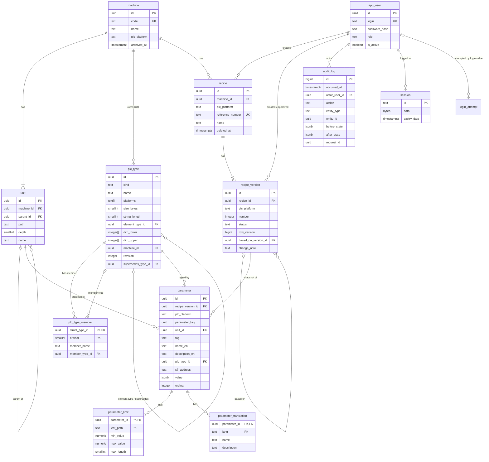

# Data Model

Status: Accepted (design stage, 2026-10-12)
Source of requirements: `general-draft.txt`
Related: `domain-model.md`, `overview.md`, `reliability.md`, ADR-0005 to ADR-0012

This document defines the PostgreSQL 16 schema. The table names and column names below are the names the code MUST use.

## 1. Conventions

- Identifiers are `snake_case`. No quoted identifiers.
- Entity tables use `id UUID PRIMARY KEY DEFAULT gen_random_uuid()`. The domain uses UUID identity types.
- `audit_log` uses `BIGINT GENERATED ALWAYS AS IDENTITY`. Gaps in the sequence are normal.
- Time columns are `TIMESTAMPTZ`. `now()` is the transaction start time. All rows of one transaction get the same timestamp.
- Strings are `TEXT` with a `CHECK` on length or pattern. No `VARCHAR(n)`.
- Enumerated values are `TEXT` with a `CHECK (... IN (...))`. No `CREATE TYPE ... AS ENUM`. A new value is one migration that replaces the constraint.
- Every foreign key column has an index.
- Every table has `created_at TIMESTAMPTZ NOT NULL DEFAULT now()`.
- Soft delete uses a nullable `deleted_at` or `archived_at` column (ADR-0011).
- Expected scale is Assumption A19. No table is partitioned.
- The schema is `public`. The runtime role is `recipe_app`. The migration role is `recipe_migrator`.

Allowed `plc_platform` values: `CodesysIec`, `TwinCat3`, `S7_1200`, `S7_1500`, `S7_300`.

## 2. Entity relationship diagram



## 3. Tables (DDL)

The DDL is in dependency order. Each block is one migration step. Comments explain the constraint that is not obvious.

### 3.1 `machine`

```sql
CREATE TABLE machine (
    id            UUID PRIMARY KEY DEFAULT gen_random_uuid(),
    code          TEXT NOT NULL,
    name          TEXT NOT NULL,
    plc_platform  TEXT NOT NULL,
    archived_at   TIMESTAMPTZ,
    created_at    TIMESTAMPTZ NOT NULL DEFAULT now(),
    CONSTRAINT machine_code_format CHECK (code ~ '^M[1-9][0-9]{0,6}$'),
    CONSTRAINT machine_code_unique UNIQUE (code),
    CONSTRAINT machine_name_length CHECK (length(name) BETWEEN 1 AND 200),
    CONSTRAINT machine_platform_value CHECK (
        plc_platform IN ('CodesysIec', 'TwinCat3', 'S7_1200', 'S7_1500', 'S7_300')
    ),
    -- Target for the composite FK that propagates the platform (I5).
    CONSTRAINT machine_id_platform_unique UNIQUE (id, plc_platform)
);
```

### 3.2 `unit`

```sql
CREATE TABLE unit (
    id           UUID PRIMARY KEY DEFAULT gen_random_uuid(),
    machine_id   UUID NOT NULL REFERENCES machine (id),
    parent_id    UUID,
    path         TEXT NOT NULL,
    -- Number of segments. Generated, so it can never disagree with path.
    depth        SMALLINT GENERATED ALWAYS AS
                     (array_length(string_to_array(path, '.'), 1)) STORED,
    name         TEXT NOT NULL,
    archived_at  TIMESTAMPTZ,
    created_at   TIMESTAMPTZ NOT NULL DEFAULT now(),
    -- 1 to 6 segments. Each segment is 1..64 (I9, Assumption A6).
    CONSTRAINT unit_path_format CHECK (
        path ~ '^U([1-9]|[1-5][0-9]|6[0-4])(\.([1-9]|[1-5][0-9]|6[0-4])){0,5}$'
    ),
    CONSTRAINT unit_depth_range CHECK (depth BETWEEN 1 AND 6),
    CONSTRAINT unit_root_has_no_parent CHECK ((depth = 1) = (parent_id IS NULL)),
    CONSTRAINT unit_name_length CHECK (length(name) BETWEEN 1 AND 200),
    CONSTRAINT unit_path_unique UNIQUE (machine_id, path),
    -- Target for the composite parent FK below and for parameter scope checks.
    CONSTRAINT unit_machine_id_unique UNIQUE (machine_id, id),
    -- The parent must be in the same machine (I10).
    CONSTRAINT unit_parent_same_machine
        FOREIGN KEY (machine_id, parent_id) REFERENCES unit (machine_id, id)
);
CREATE INDEX unit_machine_id_idx ON unit (machine_id);
CREATE INDEX unit_parent_id_idx ON unit (parent_id);
```

The domain checks that the parent path is the prefix of the child path (`U1.2` is the parent of `U1.2.4`). The database does not check this.

### 3.3 `plc_type`

```sql
CREATE FUNCTION dims_valid(lower_b INTEGER[], upper_b INTEGER[]) RETURNS BOOLEAN
LANGUAGE sql IMMUTABLE AS $$
    SELECT cardinality(lower_b) >= 1
       AND cardinality(lower_b) = cardinality(upper_b)
       AND NOT EXISTS (
           SELECT 1 FROM generate_subscripts(lower_b, 1) AS i
           WHERE lower_b[i] > upper_b[i]
       );
$$;

CREATE TABLE plc_type (
    id                  UUID PRIMARY KEY DEFAULT gen_random_uuid(),
    kind                TEXT NOT NULL,
    name                TEXT NOT NULL,
    platforms           TEXT[] NOT NULL,
    -- Size of one element in bytes on S7. NULL for arrays and structs.
    size_bytes          SMALLINT,
    -- Only for STRING and WSTRING. Number of characters.
    string_length       SMALLINT,
    element_type_id     UUID REFERENCES plc_type (id),
    dim_lower           INTEGER[],
    dim_upper           INTEGER[],
    -- NULL for the global primitive catalog. Set for a UDT, an array type,
    -- and a machine-specific STRING(n) / WSTRING(n).
    machine_id          UUID REFERENCES machine (id),
    revision            INTEGER NOT NULL DEFAULT 1,
    supersedes_type_id  UUID REFERENCES plc_type (id),
    created_at          TIMESTAMPTZ NOT NULL DEFAULT now(),
    CONSTRAINT plc_type_kind_value CHECK (kind IN ('primitive', 'array', 'struct')),
    CONSTRAINT plc_type_name_format CHECK (name ~ '^[A-Za-z_][A-Za-z0-9_]{0,63}$'),
    CONSTRAINT plc_type_platforms_value CHECK (
        cardinality(platforms) >= 1
        AND platforms <@ ARRAY['CodesysIec', 'TwinCat3', 'S7_1200', 'S7_1500', 'S7_300']
    ),
    CONSTRAINT plc_type_revision_positive CHECK (revision >= 1),
    CONSTRAINT plc_type_string_length_only_for_strings CHECK (
        string_length IS NULL OR (kind = 'primitive' AND name IN ('STRING', 'WSTRING'))
    ),
    CONSTRAINT plc_type_string_length_range CHECK (
        string_length IS NULL OR string_length BETWEEN 1 AND 254
    ),
    -- Shape per kind.
    CONSTRAINT plc_type_primitive_shape CHECK (
        kind <> 'primitive'
        OR (element_type_id IS NULL AND dim_lower IS NULL AND dim_upper IS NULL
            AND size_bytes IS NOT NULL
            AND (machine_id IS NULL OR name IN ('STRING', 'WSTRING')))
    ),
    CONSTRAINT plc_type_array_shape CHECK (
        kind <> 'array'
        OR (element_type_id IS NOT NULL AND dims_valid(dim_lower, dim_upper)
            AND size_bytes IS NULL AND machine_id IS NOT NULL)
    ),
    CONSTRAINT plc_type_struct_shape CHECK (
        kind <> 'struct'
        OR (element_type_id IS NULL AND dim_lower IS NULL AND dim_upper IS NULL
            AND size_bytes IS NULL AND machine_id IS NOT NULL)
    ),
    -- A UDT name is unique per machine and revision. Primitive names are
    -- unique in the global catalog (machine_id NULL counts as one value).
    CONSTRAINT plc_type_name_unique UNIQUE NULLS NOT DISTINCT (machine_id, name, revision)
);
CREATE INDEX plc_type_element_type_id_idx ON plc_type (element_type_id);
CREATE INDEX plc_type_machine_id_idx ON plc_type (machine_id);
CREATE INDEX plc_type_supersedes_type_id_idx ON plc_type (supersedes_type_id);
-- Fast "does this type exist on platform X" check in the trigger of 4.2.
CREATE INDEX plc_type_platforms_gin ON plc_type USING GIN (platforms);
```

The domain checks the absence of cycles (I8) and the platform of all members. The database does not check these two rules.

### 3.4 `plc_type_member`

```sql
CREATE TABLE plc_type_member (
    struct_type_id  UUID NOT NULL REFERENCES plc_type (id),
    ordinal         SMALLINT NOT NULL,
    member_name     TEXT NOT NULL,
    member_type_id  UUID NOT NULL REFERENCES plc_type (id),
    created_at      TIMESTAMPTZ NOT NULL DEFAULT now(),
    PRIMARY KEY (struct_type_id, ordinal),
    CONSTRAINT plc_type_member_ordinal_range CHECK (ordinal BETWEEN 1 AND 1024),
    CONSTRAINT plc_type_member_name_format CHECK (member_name ~ '^[A-Za-z_][A-Za-z0-9_]{0,63}$'),
    CONSTRAINT plc_type_member_name_unique UNIQUE (struct_type_id, member_name),
    CONSTRAINT plc_type_member_no_self CHECK (struct_type_id <> member_type_id)
);
CREATE INDEX plc_type_member_member_type_id_idx ON plc_type_member (member_type_id);
```

### 3.5 `app_user`

```sql
CREATE TABLE app_user (
    id              UUID PRIMARY KEY DEFAULT gen_random_uuid(),
    login           TEXT NOT NULL,
    -- Argon2id PHC string. Never returned to the UI. Never logged.
    password_hash   TEXT NOT NULL,
    role            TEXT NOT NULL,
    is_active       BOOLEAN NOT NULL DEFAULT true,
    created_at      TIMESTAMPTZ NOT NULL DEFAULT now(),
    deactivated_at  TIMESTAMPTZ,
    CONSTRAINT app_user_login_format CHECK (login ~ '^[a-z0-9._-]{3,64}$'),
    CONSTRAINT app_user_login_unique UNIQUE (login),
    CONSTRAINT app_user_role_value CHECK (
        role IN ('administrator', 'process_engineer', 'operator')
    ),
    CONSTRAINT app_user_hash_format CHECK (password_hash LIKE '$argon2id$%'),
    CONSTRAINT app_user_active_consistent CHECK (is_active = (deactivated_at IS NULL))
);
```

The application lowercases the login before every query. The `CHECK` rejects uppercase, so the unique constraint is case-insensitive.

### 3.6 `session`

```sql
-- Layout of tower-sessions-sqlx-store for PostgreSQL. The store creates
-- this table when it is missing. The migration creates it first so that
-- recipe_app does not need CREATE rights.
CREATE TABLE session (
    id           TEXT PRIMARY KEY,
    data         BYTEA NOT NULL,
    expiry_date  TIMESTAMPTZ NOT NULL
);
CREATE INDEX session_expiry_date_idx ON session (expiry_date);
```

The store writes the `user_id` inside `data`. A scheduled task deletes rows with `expiry_date < now()` every 10 minutes.

### 3.6a `login_attempt`

Counter for the login rate limit (`api.md` section 7, Assumption A22). The counter lives in the database so that a restart of the application does not reset it.

```sql
CREATE TABLE login_attempt (
    login        TEXT NOT NULL,
    attempted_at TIMESTAMPTZ NOT NULL DEFAULT now(),
    succeeded    BOOLEAN NOT NULL
);
CREATE INDEX login_attempt_login_attempted_at_idx ON login_attempt (login, attempted_at);
```

The `Login` use case inserts one row per attempt. Before the password check it counts rows with `succeeded = false` for the same `login` in the last 15 minutes. Five or more rows give HTTP 429. A scheduled task deletes rows older than 24 hours every 10 minutes.

### 3.7 `recipe`

```sql
CREATE TABLE recipe (
    id                UUID PRIMARY KEY DEFAULT gen_random_uuid(),
    machine_id        UUID NOT NULL,
    -- Copy of machine.plc_platform. Kept correct by the composite FK.
    plc_platform      TEXT NOT NULL,
    reference_number  TEXT NOT NULL,
    name              TEXT NOT NULL,
    deleted_at        TIMESTAMPTZ,
    created_by        UUID NOT NULL REFERENCES app_user (id),
    created_at        TIMESTAMPTZ NOT NULL DEFAULT now(),
    CONSTRAINT recipe_machine_platform
        FOREIGN KEY (machine_id, plc_platform) REFERENCES machine (id, plc_platform),
    CONSTRAINT recipe_reference_format CHECK (reference_number ~ '^[A-Z0-9][A-Z0-9_-]{0,49}$'),
    CONSTRAINT recipe_reference_unique UNIQUE (reference_number),
    CONSTRAINT recipe_name_length CHECK (length(name) BETWEEN 1 AND 200),
    CONSTRAINT recipe_id_platform_unique UNIQUE (id, plc_platform)
);
CREATE INDEX recipe_machine_id_idx ON recipe (machine_id);
CREATE INDEX recipe_created_by_idx ON recipe (created_by);
CREATE INDEX recipe_live_idx ON recipe (machine_id, name) WHERE deleted_at IS NULL;
```

### 3.8 `recipe_version`

```sql
CREATE TABLE recipe_version (
    id                   UUID PRIMARY KEY DEFAULT gen_random_uuid(),
    recipe_id            UUID NOT NULL,
    plc_platform         TEXT NOT NULL,
    number               INTEGER NOT NULL,
    status               TEXT NOT NULL DEFAULT 'draft',
    -- Optimistic lock token (I12, ADR-0008). Bumped by trigger on every UPDATE.
    row_version          BIGINT NOT NULL DEFAULT 1,
    based_on_version_id  UUID REFERENCES recipe_version (id),
    change_note          TEXT NOT NULL,
    created_by           UUID NOT NULL REFERENCES app_user (id),
    created_at           TIMESTAMPTZ NOT NULL DEFAULT now(),
    updated_at           TIMESTAMPTZ NOT NULL DEFAULT now(),
    approved_by          UUID REFERENCES app_user (id),
    approved_at          TIMESTAMPTZ,
    retired_at           TIMESTAMPTZ,
    deleted_at           TIMESTAMPTZ,
    CONSTRAINT recipe_version_recipe_platform
        FOREIGN KEY (recipe_id, plc_platform) REFERENCES recipe (id, plc_platform),
    CONSTRAINT recipe_version_number_positive CHECK (number >= 1),
    CONSTRAINT recipe_version_number_unique UNIQUE (recipe_id, number),
    CONSTRAINT recipe_version_status_value CHECK (status IN ('draft', 'approved', 'retired')),
    CONSTRAINT recipe_version_change_note_length CHECK (length(change_note) BETWEEN 1 AND 2000),
    CONSTRAINT recipe_version_row_version_positive CHECK (row_version >= 1),
    -- Status and timestamps agree.
    CONSTRAINT recipe_version_approved_fields CHECK (
        (status = 'draft' AND approved_at IS NULL AND approved_by IS NULL AND retired_at IS NULL)
        OR (status = 'approved' AND approved_at IS NOT NULL AND approved_by IS NOT NULL AND retired_at IS NULL)
        OR (status = 'retired' AND approved_at IS NOT NULL AND approved_by IS NOT NULL AND retired_at IS NOT NULL)
    ),
    -- Only a draft can be discarded.
    CONSTRAINT recipe_version_deleted_only_draft CHECK (deleted_at IS NULL OR status = 'draft'),
    CONSTRAINT recipe_version_id_platform_unique UNIQUE (id, plc_platform)
);
CREATE INDEX recipe_version_recipe_id_idx ON recipe_version (recipe_id);
CREATE INDEX recipe_version_based_on_idx ON recipe_version (based_on_version_id);
CREATE INDEX recipe_version_created_by_idx ON recipe_version (created_by);
CREATE INDEX recipe_version_approved_by_idx ON recipe_version (approved_by);
-- I1: at most one approved version per recipe.
CREATE UNIQUE INDEX recipe_version_one_approved
    ON recipe_version (recipe_id) WHERE status = 'approved';
-- Assumption A7: at most one live draft per recipe.
CREATE UNIQUE INDEX recipe_version_one_live_draft
    ON recipe_version (recipe_id) WHERE status = 'draft' AND deleted_at IS NULL;
```

### 3.9 `parameter`

```sql
CREATE TABLE parameter (
    id                 UUID PRIMARY KEY DEFAULT gen_random_uuid(),
    recipe_version_id  UUID NOT NULL,
    plc_platform       TEXT NOT NULL,
    -- Stable identity across versions (N4). Copied by CreateVersion.
    parameter_key      UUID NOT NULL DEFAULT gen_random_uuid(),
    unit_id            UUID NOT NULL REFERENCES unit (id),
    tag                TEXT NOT NULL,
    name_en            TEXT NOT NULL,
    description_en     TEXT NOT NULL DEFAULT '',
    plc_type_id        UUID NOT NULL REFERENCES plc_type (id),
    s7_address         TEXT,
    -- JSON tree with the shape of the type tree. See section 9.
    value              JSONB NOT NULL,
    ordinal            INTEGER NOT NULL DEFAULT 0,
    created_at         TIMESTAMPTZ NOT NULL DEFAULT now(),
    CONSTRAINT parameter_version_platform
        FOREIGN KEY (recipe_version_id, plc_platform)
        REFERENCES recipe_version (id, plc_platform),
    CONSTRAINT parameter_tag_format CHECK (tag ~ '^[A-Z][A-Z0-9_]{0,63}$'),
    CONSTRAINT parameter_tag_unique UNIQUE (recipe_version_id, tag),
    CONSTRAINT parameter_key_unique UNIQUE (recipe_version_id, parameter_key),
    CONSTRAINT parameter_name_length CHECK (length(name_en) BETWEEN 1 AND 200),
    CONSTRAINT parameter_description_length CHECK (length(description_en) <= 2000),
    -- DB<n>.DBX<off>.<bit> or DB<n>.DB{B,W,D}<off>. Bit only with X (N7).
    CONSTRAINT parameter_s7_address_format CHECK (
        s7_address IS NULL
        OR s7_address ~ '^DB[1-9][0-9]{0,4}\.DB(X[0-9]{1,5}\.[0-7]|[BWD][0-9]{1,5})$'
    ),
    -- I5: S7-300 requires an address. Other platforms must not have one.
    CONSTRAINT parameter_s7_address_required CHECK (
        (plc_platform = 'S7_300') = (s7_address IS NOT NULL)
    ),
    CONSTRAINT parameter_ordinal_range CHECK (ordinal BETWEEN 0 AND 100000)
);
CREATE INDEX parameter_recipe_version_id_idx ON parameter (recipe_version_id, ordinal);
CREATE INDEX parameter_unit_id_idx ON parameter (unit_id);
CREATE INDEX parameter_plc_type_id_idx ON parameter (plc_type_id);
CREATE INDEX parameter_key_idx ON parameter (parameter_key);
```

The numeric range of `db` and `offset` (both at most 65535) is checked by `S7Address::parse` in the domain. The regular expression checks the shape only.

### 3.10 `parameter_limit`

```sql
CREATE TABLE parameter_limit (
    parameter_id  UUID NOT NULL REFERENCES parameter (id) ON DELETE CASCADE,
    -- '' means the parameter itself (primitive type). See LeafPath grammar.
    leaf_path     TEXT NOT NULL DEFAULT '',
    min_value     NUMERIC,
    max_value     NUMERIC,
    max_length    SMALLINT,
    created_at    TIMESTAMPTZ NOT NULL DEFAULT now(),
    PRIMARY KEY (parameter_id, leaf_path),
    CONSTRAINT parameter_limit_path_format CHECK (
        leaf_path ~ '^(\.[A-Za-z_][A-Za-z0-9_]{0,63}|\[-?[0-9]{1,9}(,-?[0-9]{1,9})*\])*$'
    ),
    CONSTRAINT parameter_limit_min_le_max CHECK (
        min_value IS NULL OR max_value IS NULL OR min_value <= max_value
    ),
    CONSTRAINT parameter_limit_not_empty CHECK (
        min_value IS NOT NULL OR max_value IS NOT NULL OR max_length IS NOT NULL
    ),
    -- A leaf is numeric or string, not both.
    CONSTRAINT parameter_limit_one_kind CHECK (
        max_length IS NULL OR (min_value IS NULL AND max_value IS NULL)
    ),
    CONSTRAINT parameter_limit_max_length_positive CHECK (max_length IS NULL OR max_length >= 1)
);
```

`ON DELETE CASCADE` is safe. The trigger in 4.1 allows a `DELETE` on `parameter` only in a live draft.

### 3.11 `parameter_translation`

```sql
CREATE TABLE parameter_translation (
    parameter_id  UUID NOT NULL REFERENCES parameter (id) ON DELETE CASCADE,
    lang          TEXT NOT NULL,
    name          TEXT NOT NULL,
    description   TEXT NOT NULL DEFAULT '',
    created_at    TIMESTAMPTZ NOT NULL DEFAULT now(),
    PRIMARY KEY (parameter_id, lang),
    -- BCP 47 shape: language subtag plus optional subtags. English is the
    -- base text in parameter.name_en, so 'en' is not a translation.
    CONSTRAINT parameter_translation_lang_format CHECK (
        lang ~ '^[a-z]{2,3}(-[A-Za-z0-9]{2,8})*$' AND lang <> 'en'
    ),
    CONSTRAINT parameter_translation_name_length CHECK (length(name) BETWEEN 1 AND 200),
    CONSTRAINT parameter_translation_description_length CHECK (length(description) <= 2000)
);
```

### 3.12 `audit_log`

```sql
CREATE TABLE audit_log (
    id             BIGINT GENERATED ALWAYS AS IDENTITY PRIMARY KEY,
    occurred_at    TIMESTAMPTZ NOT NULL DEFAULT now(),
    -- NULL for system actions (migration, session cleanup).
    actor_user_id  UUID REFERENCES app_user (id),
    action         TEXT NOT NULL,
    entity_type    TEXT NOT NULL,
    entity_id      UUID NOT NULL,
    before_state   JSONB,
    after_state    JSONB,
    request_id     UUID NOT NULL,
    CONSTRAINT audit_log_action_format CHECK (action ~ '^[A-Z][A-Za-z]{2,63}$'),
    CONSTRAINT audit_log_entity_type_format CHECK (entity_type ~ '^[a-z_]{2,64}$'),
    CONSTRAINT audit_log_has_state CHECK (before_state IS NOT NULL OR after_state IS NOT NULL)
);
CREATE INDEX audit_log_entity_idx ON audit_log (entity_type, entity_id, occurred_at);
CREATE INDEX audit_log_actor_idx ON audit_log (actor_user_id, occurred_at);
CREATE INDEX audit_log_occurred_at_brin ON audit_log USING BRIN (occurred_at);
```

`action` values are the `AuditAction` enum names of the domain, for example `RecipeVersionApproved`. `entity_type` is the table name of the entity.

## 4. Triggers and functions

All trigger functions are `LANGUAGE plpgsql`. Each one raises with a stable `ERRCODE` and a message that starts with the error code of `reliability.md` section 1. The application maps these codes to domain errors.

### 4.1 `enforce_version_mutable` (I3, I4)

Rows of `parameter`, `parameter_limit`, and `parameter_translation` can change only while the version is a live draft. `DiscardDraft` is a soft delete, so it never deletes parameter rows.

```sql
CREATE FUNCTION version_is_live_draft(p_version_id UUID) RETURNS BOOLEAN
LANGUAGE sql STABLE AS $$
    SELECT EXISTS (
        SELECT 1 FROM recipe_version
        WHERE id = p_version_id AND status = 'draft' AND deleted_at IS NULL
    );
$$;

CREATE FUNCTION enforce_version_mutable() RETURNS trigger
LANGUAGE plpgsql AS $$
DECLARE
    v_version UUID;
BEGIN
    IF TG_TABLE_NAME = 'parameter' THEN
        IF TG_OP = 'UPDATE' AND NEW.recipe_version_id <> OLD.recipe_version_id THEN
            RAISE EXCEPTION 'E-RCP-030 parameter cannot move to another version'
                USING ERRCODE = 'check_violation';
        END IF;
        v_version := COALESCE(NEW.recipe_version_id, OLD.recipe_version_id);
    ELSE
        SELECT p.recipe_version_id INTO v_version
        FROM parameter p
        WHERE p.id = COALESCE(NEW.parameter_id, OLD.parameter_id);
    END IF;

    IF NOT version_is_live_draft(v_version) THEN
        RAISE EXCEPTION 'E-RCP-031 version % is not a live draft', v_version
            USING ERRCODE = 'check_violation';
    END IF;
    RETURN COALESCE(NEW, OLD);
END;
$$;

CREATE TRIGGER parameter_mutable
    BEFORE INSERT OR UPDATE OR DELETE ON parameter
    FOR EACH ROW EXECUTE FUNCTION enforce_version_mutable();
CREATE TRIGGER parameter_limit_mutable
    BEFORE INSERT OR UPDATE OR DELETE ON parameter_limit
    FOR EACH ROW EXECUTE FUNCTION enforce_version_mutable();
CREATE TRIGGER parameter_translation_mutable
    BEFORE INSERT OR UPDATE OR DELETE ON parameter_translation
    FOR EACH ROW EXECUTE FUNCTION enforce_version_mutable();
```

Note on the `ON DELETE CASCADE` of 3.10 and 3.11: the cascade fires the child triggers. The child triggers pass because the parent `DELETE` already passed for the same draft.

### 4.2 `enforce_type_platform` (I6)

```sql
CREATE FUNCTION enforce_type_platform() RETURNS trigger
LANGUAGE plpgsql AS $$
DECLARE
    v_platforms TEXT[];
    v_type_machine UUID;
    v_recipe_machine UUID;
BEGIN
    SELECT t.platforms, t.machine_id INTO v_platforms, v_type_machine
    FROM plc_type t WHERE t.id = NEW.plc_type_id;

    IF NOT (NEW.plc_platform = ANY (v_platforms)) THEN
        RAISE EXCEPTION 'E-PLT-020 type % does not exist on platform %',
            NEW.plc_type_id, NEW.plc_platform USING ERRCODE = 'check_violation';
    END IF;

    SELECT r.machine_id INTO v_recipe_machine
    FROM recipe_version v JOIN recipe r ON r.id = v.recipe_id
    WHERE v.id = NEW.recipe_version_id;

    IF v_type_machine IS NOT NULL AND v_type_machine <> v_recipe_machine THEN
        RAISE EXCEPTION 'E-PLT-021 type % belongs to another machine', NEW.plc_type_id
            USING ERRCODE = 'check_violation';
    END IF;
    RETURN NEW;
END;
$$;

CREATE TRIGGER parameter_type_platform
    BEFORE INSERT OR UPDATE OF plc_type_id, plc_platform ON parameter
    FOR EACH ROW EXECUTE FUNCTION enforce_type_platform();
```

### 4.3 `enforce_unit_machine` (parameter unit is in the machine of the recipe)

```sql
CREATE FUNCTION enforce_unit_machine() RETURNS trigger
LANGUAGE plpgsql AS $$
DECLARE
    v_unit_machine UUID;
    v_recipe_machine UUID;
BEGIN
    SELECT u.machine_id INTO v_unit_machine FROM unit u WHERE u.id = NEW.unit_id;
    SELECT r.machine_id INTO v_recipe_machine
    FROM recipe_version v JOIN recipe r ON r.id = v.recipe_id
    WHERE v.id = NEW.recipe_version_id;

    IF v_unit_machine IS DISTINCT FROM v_recipe_machine THEN
        RAISE EXCEPTION 'E-RCP-032 unit % is not in the machine of the recipe', NEW.unit_id
            USING ERRCODE = 'check_violation';
    END IF;
    RETURN NEW;
END;
$$;

CREATE TRIGGER parameter_unit_machine
    BEFORE INSERT OR UPDATE OF unit_id, recipe_version_id ON parameter
    FOR EACH ROW EXECUTE FUNCTION enforce_unit_machine();
```

### 4.4 `bump_row_version` (I12)

```sql
CREATE FUNCTION bump_row_version() RETURNS trigger
LANGUAGE plpgsql AS $$
BEGIN
    NEW.row_version := OLD.row_version + 1;
    NEW.updated_at := now();
    RETURN NEW;
END;
$$;

CREATE TRIGGER recipe_version_bump
    BEFORE UPDATE ON recipe_version
    FOR EACH ROW EXECUTE FUNCTION bump_row_version();
```

The application never sets `row_version`. It sends the expected value in `WHERE row_version = $expected` and checks that exactly one row changed. See section 6.

### 4.5 `machine_platform_frozen`

The composite FK of 3.7 already blocks a platform change when a recipe exists. This trigger gives a clear error code instead of a generic FK violation.

```sql
CREATE FUNCTION machine_platform_frozen() RETURNS trigger
LANGUAGE plpgsql AS $$
BEGIN
    IF NEW.plc_platform <> OLD.plc_platform
       AND EXISTS (SELECT 1 FROM recipe WHERE machine_id = OLD.id) THEN
        RAISE EXCEPTION 'E-PLT-010 machine % has recipes, platform is frozen', OLD.code
            USING ERRCODE = 'check_violation';
    END IF;
    RETURN NEW;
END;
$$;

CREATE TRIGGER machine_platform_frozen
    BEFORE UPDATE OF plc_platform ON machine
    FOR EACH ROW EXECUTE FUNCTION machine_platform_frozen();
```

### 4.6 `plc_type_immutable` (ADR-0006)

A type row and its members never change. Members can be inserted only in the transaction that created the struct row. `now()` is the transaction start time, so `created_at = now()` is true only inside that transaction.

```sql
CREATE FUNCTION plc_type_immutable() RETURNS trigger
LANGUAGE plpgsql AS $$
DECLARE
    v_struct_created TIMESTAMPTZ;
BEGIN
    IF TG_OP IN ('UPDATE', 'DELETE') THEN
        RAISE EXCEPTION 'E-PLT-022 % rows are immutable', TG_TABLE_NAME
            USING ERRCODE = 'check_violation';
    END IF;
    -- INSERT on plc_type_member only.
    SELECT created_at INTO v_struct_created FROM plc_type WHERE id = NEW.struct_type_id;
    IF v_struct_created <> now() THEN
        RAISE EXCEPTION 'E-PLT-023 members of type % are closed', NEW.struct_type_id
            USING ERRCODE = 'check_violation';
    END IF;
    RETURN NEW;
END;
$$;

CREATE TRIGGER plc_type_immutable
    BEFORE UPDATE OR DELETE ON plc_type
    FOR EACH ROW EXECUTE FUNCTION plc_type_immutable();
CREATE TRIGGER plc_type_member_immutable
    BEFORE INSERT OR UPDATE OR DELETE ON plc_type_member
    FOR EACH ROW EXECUTE FUNCTION plc_type_immutable();
```

## 5. Roles and grants

Two roles. The server connects as `recipe_app`. The migration step at container start connects as `recipe_migrator`. Passwords come from Docker secrets (reliability.md section 7).

```sql
CREATE ROLE recipe_migrator LOGIN;   -- owner of all objects
CREATE ROLE recipe_app LOGIN;        -- runtime, least privilege

REVOKE ALL ON SCHEMA public FROM PUBLIC;
GRANT USAGE ON SCHEMA public TO recipe_app;

GRANT SELECT ON ALL TABLES IN SCHEMA public TO recipe_app;

GRANT INSERT ON machine, unit, plc_type, plc_type_member, app_user, session,
                login_attempt, recipe, recipe_version, parameter,
                parameter_limit, parameter_translation, audit_log
    TO recipe_app;

GRANT UPDATE ON machine, unit, app_user, session, recipe, recipe_version,
                parameter, parameter_limit, parameter_translation
    TO recipe_app;

GRANT DELETE ON session, login_attempt, parameter, parameter_limit,
                parameter_translation
    TO recipe_app;

-- No grant means denied:
--   audit_log        : no UPDATE, no DELETE (append-only, I13)
--   plc_type         : no UPDATE, no DELETE (immutable)
--   plc_type_member  : no UPDATE, no DELETE
--   machine, unit    : no DELETE (soft delete via archived_at)
--   app_user         : no DELETE (soft delete via deactivated_at)
--   recipe           : no DELETE (soft delete via deleted_at, I14)
--   recipe_version   : no DELETE (soft delete via deleted_at, I14)

GRANT EXECUTE ON ALL FUNCTIONS IN SCHEMA public TO recipe_app;
```

`DELETE` on `parameter` and its children is allowed because the trigger of 4.1 limits it to a live draft. `recipe_app` has no `CREATE`, `TRUNCATE`, or `REFERENCES` privilege.

## 6. Transactional operations

Every command runs in exactly one transaction. The use case opens it through `UnitOfWork`. The audit `INSERT` is part of the same transaction. The `COMMIT` either persists everything or nothing (R29).

Isolation levels:

- `SERIALIZABLE` for commands that read a set of rows and then write a result that depends on that set.
- `READ COMMITTED` for commands that change one aggregate guarded by `row_version`.

Retry policy: when `COMMIT` or a statement fails with SQLSTATE `40001` (serialization failure) or `40P01` (deadlock), the use case runs the whole transaction again. Maximum 3 attempts. Back-off `50 ms * attempt`. After the third failure the use case returns `Err(ConcurrencyRetryExhausted)`. The HTTP layer maps it to `409 Conflict`.

The lock token for parameter edits is `recipe_version.row_version`. Every edit inside a draft starts with the statement "touch version", which bumps the token through the trigger of 4.4:

```sql
UPDATE recipe_version SET updated_at = now()
WHERE id = $version AND row_version = $expected;   -- must affect 1 row
```

| Command | Isolation | Statements in order | Guard |
|---|---|---|---|
| `CreateMachine` | READ COMMITTED | `INSERT machine`. `INSERT unit` (path `U1`, depth 1). `INSERT audit_log` (`MachineCreated`) | `machine_code_unique` -> `DuplicateMachineCode` |
| `AddUnit` | READ COMMITTED | `SELECT unit WHERE id = $parent FOR SHARE`. `INSERT unit`. `INSERT audit_log` (`UnitAdded`) | `unit_path_unique`, `unit_depth_range`, `unit_parent_same_machine` |
| `ArchiveUnit` | READ COMMITTED | `UPDATE unit SET archived_at`. `INSERT audit_log` | Domain checks that no live draft references the unit |
| `DefineUdt` | SERIALIZABLE | `INSERT plc_type` (struct, revision n+1, `supersedes_type_id`). `INSERT plc_type_member` per member. `INSERT audit_log` (`UdtDefined`) | `plc_type_name_unique`. Domain checks cycle (I8) and member platforms |
| `CreateRecipe` | READ COMMITTED | `INSERT recipe`. `INSERT recipe_version` (number 1, draft, `change_note` "Initial version"). `INSERT audit_log` (`RecipeCreated`, `RecipeVersionCreated`) | `recipe_reference_unique` -> `DuplicateReference`. `recipe_machine_platform` -> machine must exist |
| `CreateVersion` | SERIALIZABLE | `SELECT max(number) FROM recipe_version WHERE recipe_id`. `INSERT recipe_version` (draft, `based_on_version_id`). `INSERT parameter SELECT ... FROM parameter WHERE recipe_version_id = $based_on` (new `id`, same `parameter_key`). `INSERT parameter_limit SELECT ...`. `INSERT parameter_translation SELECT ...`. `INSERT audit_log` (`RecipeVersionCreated`) | `recipe_version_one_live_draft` -> `DraftAlreadyExists`. `recipe_version_number_unique` -> retry |
| `UpsertParameter` | READ COMMITTED | touch version. `INSERT ... ON CONFLICT (recipe_version_id, parameter_key) DO UPDATE` on `parameter`. `DELETE parameter_limit WHERE parameter_id` then `INSERT parameter_limit` rows. Same for `parameter_translation`. `INSERT audit_log` (`ParameterUpserted`, before and after state) | 0 rows on touch -> `ConcurrentEdit`. Triggers 4.1, 4.2, 4.3 |
| `RemoveParameter` | READ COMMITTED | touch version. `DELETE parameter WHERE id` (cascade to limits and translations). `INSERT audit_log` (`ParameterRemoved`, before state) | 0 rows on touch -> `ConcurrentEdit`. Trigger 4.1 |
| `ApproveVersion` | SERIALIZABLE | `SELECT recipe_version WHERE id = $v FOR UPDATE` (status must be draft, `row_version` must match). Load parameters, limits, types and validate (I7). `UPDATE recipe_version SET status = 'retired', retired_at = now() WHERE recipe_id = $r AND status = 'approved' RETURNING id`. `UPDATE recipe_version SET status = 'approved', approved_by, approved_at = now() WHERE id = $v AND row_version = $expected`. `INSERT audit_log` (`RecipeVersionRetired`) when a row was retired. `INSERT audit_log` (`RecipeVersionApproved`) | `recipe_version_one_approved` (I1). 0 rows on approve -> `ConcurrentEdit`. Empty parameter set -> `DraftHasNoParameters` |
| `RetireVersion` | READ COMMITTED | `UPDATE recipe_version SET status = 'retired', retired_at = now() WHERE id = $v AND status = 'approved' AND row_version = $expected`. `INSERT audit_log` (`RecipeVersionRetired`) | 0 rows -> `VersionNotApproved` or `ConcurrentEdit` |
| `DiscardDraft` | READ COMMITTED | `UPDATE recipe_version SET deleted_at = now() WHERE id = $v AND status = 'draft' AND deleted_at IS NULL AND row_version = $expected`. `INSERT audit_log` (`RecipeVersionDiscarded`) | 0 rows -> `VersionNotDraft` or `ConcurrentEdit` |
| `DeleteRecipe` | SERIALIZABLE | `SELECT 1 FROM recipe_version WHERE recipe_id = $r AND status = 'approved'` (must be empty). `UPDATE recipe SET deleted_at = now() WHERE id = $r AND deleted_at IS NULL`. `INSERT audit_log` (`RecipeDeleted`) | Row found -> `RecipeHasApprovedVersion`. 0 rows -> `RecipeDeleted` |
| `CreateUser` | READ COMMITTED | `INSERT app_user`. `INSERT audit_log` (`UserCreated`, after state without hash) | `app_user_login_unique` -> `DuplicateLogin` |
| `SetUserRole` | SERIALIZABLE | `SELECT count(*) FROM app_user WHERE role = 'administrator' AND is_active`. `UPDATE app_user SET role`. `INSERT audit_log` (`UserRoleChanged`) | Count would become 0 -> `LastAdministrator` |
| `DeactivateUser` | SERIALIZABLE | Same count check. `UPDATE app_user SET is_active = false, deactivated_at = now()`. `DELETE session` rows of the user. `INSERT audit_log` (`UserDeactivated`) | `LastAdministrator` |
| `ResetPassword` | READ COMMITTED | `UPDATE app_user SET password_hash`. `DELETE session` rows of the user except the current one. `INSERT audit_log` (`PasswordReset`, no state) | Hash format `CHECK` |
| `Login` | READ COMMITTED | `SELECT count(*) FROM login_attempt` for the login in the last 15 minutes (5 or more failures -> HTTP 429). `SELECT app_user WHERE login`. Verify hash in the application. `INSERT login_attempt`. `INSERT session`. `INSERT audit_log` (`UserLoggedIn`) | Inactive user -> `LoginRejected`. Failed verification is also audited (`LoginFailed`, actor NULL, `after_state` holds the login only) |
| `ExportVersion` | READ COMMITTED | `SELECT` version, parameters, limits, translations, types (status must be approved). `INSERT audit_log` (`RecipeVersionExported`, `after_state` holds version id and export schema version) | Status not approved -> `VersionNotApproved` (Assumption A8) |

Audit `before_state` and `after_state` hold the row as JSON. `password_hash` is never written to the audit log.

## 7. PLC primitive type matrix (Assumption A3)

The draft says "required" types without a list. This matrix is the seed content of `plc_type` for `kind = 'primitive'`. A migration can add or remove a row. The application cannot. "Size" is the size on S7 in bytes and gives the S7 address width letter for S7-300 (`X` bit, `B` 1, `W` 2, `D` 4, `B` for larger types with the address of the first byte).

| Type | S7 size | S7 width | CodesysIec | TwinCat3 | S7_1200 | S7_1500 | S7_300 |
|---|---|---|---|---|---|---|---|
| `BOOL` | 1 bit | X | yes | yes | yes | yes | yes |
| `BYTE` | 1 | B | yes | yes | yes | yes | yes |
| `WORD` | 2 | W | yes | yes | yes | yes | yes |
| `DWORD` | 4 | D | yes | yes | yes | yes | yes |
| `LWORD` | 8 | B | yes | yes | no | yes | no |
| `SINT` | 1 | B | yes | yes | yes | yes | no |
| `USINT` | 1 | B | yes | yes | yes | yes | no |
| `INT` | 2 | W | yes | yes | yes | yes | yes |
| `UINT` | 2 | W | yes | yes | yes | yes | no |
| `DINT` | 4 | D | yes | yes | yes | yes | yes |
| `UDINT` | 4 | D | yes | yes | yes | yes | no |
| `LINT` | 8 | B | yes | yes | no | yes | no |
| `ULINT` | 8 | B | yes | yes | no | yes | no |
| `REAL` | 4 | D | yes | yes | yes | yes | yes |
| `LREAL` | 8 | B | yes | yes | yes | yes | no |
| `STRING` | n + 2 | B | yes | yes | yes | yes | yes |
| `WSTRING` | 2n + 4 | B | yes | yes | yes | yes | no |
| `CHAR` | 1 | B | no | no | yes | yes | yes |
| `WCHAR` | 2 | W | no | no | yes | yes | no |
| `TIME` | 4 | D | yes | yes | yes | yes | yes |
| `LTIME` | 8 | B | yes | yes | no | yes | no |
| `DATE` | 2 | W | yes | yes | yes | yes | yes |
| `TIME_OF_DAY` | 4 | D | yes | yes | yes | yes | yes |
| `DATE_AND_TIME` | 8 | B | yes | yes | no | yes | yes |
| `LDT` | 8 | B | yes | yes | no | yes | no |
| `DTL` | 12 | B | no | no | yes | yes | no |
| `S5TIME` | 2 | W | no | no | no | yes | yes |

Notes:

- `DATE` is 4 bytes on CODESYS and TwinCAT 3. `size_bytes` holds the S7 size because only S7-300 needs an address width. The domain holds the IEC sizes in code.
- The seed row for `STRING` has `string_length = 254` and `machine_id = NULL`. A `STRING(20)` for one machine is a `primitive` row with `machine_id` set, `name = 'STRING'`, `string_length = 20`. The same rule applies to `WSTRING`.
- `LDT` is `LDATE_AND_TIME` on CODESYS and TwinCAT 3. The seed uses the short name on all platforms.
- `S5TIME` exists on S7-1500 for compatibility. The matrix follows the vendor manuals as of the design date. A plant that needs another type adds one migration row.

## 8. Migrations

- Tool: `sqlx migrate`. Files live in `crates/recipe-db/migrations/`.
- Name: `NNNN_description.sql`, four digits, forward-only. There is no down migration. A mistake is corrected by a new migration.
- `0001_schema.sql` creates roles, tables, indexes, functions, triggers, and grants of sections 3 to 5.
- `0002_seed_plc_types.sql` inserts the rows of section 7 with fixed UUIDs, so the domain can reference them by constant.
- `0003_seed_admin.sql` inserts the first administrator. The login and the Argon2id hash come from environment variables at migration time. The migration fails when they are missing.
- The `recipe-server` container runs `sqlx::migrate!()` as `recipe_migrator` at start. The HTTP listener opens only after the migration step returns `Ok`. A failed migration stops the container with a non-zero exit code. Docker restarts it. The log shows the migration name and the SQL error.
- Every migration runs in one transaction. `sqlx` takes an advisory lock, so two containers cannot migrate at the same time.
- A migration never rewrites `audit_log` rows and never drops a column that an older audit row references in `before_state` or `after_state`.

## 9. Example JSONB value

UDT `ST_Zone` for machine `M12` on `S7_1500`, revision 1:

| ordinal | member_name | member_type |
|---|---|---|
| 1 | `temp_sp` | `REAL` |
| 2 | `active` | `BOOL` |
| 3 | `ramps` | `ARRAY[1..3] OF INT` (an `array` row with `element_type_id = INT`, `dim_lower = {1}`, `dim_upper = {3}`) |
| 4 | `label` | `STRING(16)` (a machine-specific `primitive` row) |

Parameter `ZONE_1` with `plc_type_id = ST_Zone` has this `value`:

```json
{
  "temp_sp": 85.5,
  "active": true,
  "ramps": [10, 20, 30],
  "label": "Zone A"
}
```

Rules that the domain checks before the row is written (I7):

- The object has exactly the member names `temp_sp`, `active`, `ramps`, `label`. No extra key. No missing key.
- `ramps` has exactly 3 elements. Index 1 of the PLC is JSON index 0. A two-dimensional array `ARRAY[0..1, 1..2]` is a JSON array of 2 arrays of 2 elements.
- `85.5` is a valid `REAL`. `"Zone A"` has at most 16 characters.

Matching `parameter_limit` rows for `ZONE_1`:

| parameter_id | leaf_path | min_value | max_value | max_length |
|---|---|---|---|---|
| `ZONE_1` | `.temp_sp` | `20` | `120` | NULL |
| `ZONE_1` | `.ramps[1]` | `0` | `100` | NULL |
| `ZONE_1` | `.ramps[2]` | `0` | `100` | NULL |
| `ZONE_1` | `.ramps[3]` | `0` | `100` | NULL |
| `ZONE_1` | `.label` | NULL | NULL | `12` |

`.active` has no row. A `BOOL` leaf has no limit. `leaf_path` uses PLC indices (`[1]` to `[3]`), not JSON indices. A primitive parameter such as `SPEED : INT` has one row with `leaf_path = ''`.
