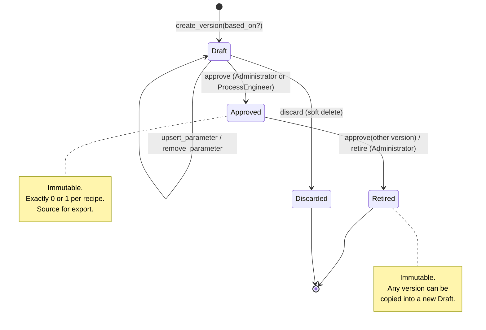

# Domain Model

Status: Accepted (design stage, 2026-10-12)
Source of requirements: `general-draft.txt`
Related: `overview.md`, `data-model.md`, `api.md`, ADR-0006 to ADR-0013

This document defines the domain vocabulary. All other documents and all code MUST use these names.

## 1. Bounded contexts

| Context | Responsibility | Aggregates |
|---|---|---|
| Plant Model | Machines, unit hierarchy, PLC platform, PLC type catalog, UDT definitions | `Machine`, `PlcType` |
| Recipe Management | Recipes, versions, parameters, limits, values, approval workflow | `Recipe` |
| Identity and Access | Users, roles, sessions, permission checks | `User` |
| Audit | Append-only record of every mutating operation | `AuditEntry` (write-only from other contexts) |
| Export | Read model that serializes an `Approved` version to the export format | none (read model) |

The application is one deployable unit (modular monolith). A context is a Rust module in `recipe-domain`. A context does not import entities from another context. It uses only the identifier types (`MachineId`, `UserId`) of the other context. See ADR-0010.

## 2. Entities and value objects

### 2.1 Plant Model

**Machine** (entity, aggregate root)

| Field | Type | Rule |
|---|---|---|
| `id` | `MachineId` (UUID) | Stable identity |
| `code` | `MachineCode` | Pattern `M<n>`, `1 <= n <= 9999999`, unique |
| `name` | `Text` | Not empty, max 200 chars |
| `plc_platform` | `PlcPlatform` | Exactly one per machine |
| `units` | `Vec<Unit>` | At least one unit of depth 1 |
| `archived_at` | `Option<Timestamp>` | Soft delete |

`PlcPlatform` (value object, enum): `CodesysIec`, `TwinCat3`, `S7_1200`, `S7_1500`, `S7_300`.

Rule: `plc_platform` cannot change after the machine has one recipe. A change of the controller is a new machine.

**Unit** (entity inside `Machine`)

| Field | Type | Rule |
|---|---|---|
| `id` | `UnitId` (UUID) | |
| `path` | `UnitPath` | `U<s1>[.<s2>...]`, each segment `1..=64`, 1 to 6 segments (main unit + up to 5 sub-levels, N2/N3) |
| `parent` | `Option<UnitId>` | `None` only when depth is 1 |
| `name` | `Text` | Not empty |
| `archived_at` | `Option<Timestamp>` | Soft delete. An archived unit keeps its children archived. A live draft cannot reference an archived unit |

`UnitPath` is unique inside one machine. The parent of `U1.2.4` is `U1.2`. A unit cannot exist without its parent. A unit is never deleted. `ArchiveUnit` sets `archived_at` on the unit and on all its descendants.

**PlcType** (entity, aggregate root, immutable after creation)

| Field | Type | Rule |
|---|---|---|
| `id` | `PlcTypeId` (UUID) | |
| `kind` | `TypeKind` | `Primitive`, `Array`, `Struct` |
| `name` | `TypeName` | For primitives: IEC or S7 name (`INT`, `LREAL`, `S5TIME`). For UDTs: user name, unique per machine and revision |
| `platforms` | `BTreeSet<PlcPlatform>` | Platforms where this type exists (N5) |
| `revision` | `u32` | Starts at 1. Increases with each `supersedes` step of the same UDT name |
| `size_bytes` | `Option<u32>` | Set for primitives. Used for the S7 address width check. `None` for arrays and structs |
| `string_length` | `Option<u16>` | Only for `STRING` and `WSTRING` primitives |
| `element_type` | `Option<PlcTypeId>` | Only when `kind = Array` |
| `dimensions` | `Vec<ArrayDimension>` | Only when `kind = Array`. `ArrayDimension { lower: i32, upper: i32 }`, `lower <= upper` |
| `members` | `Vec<TypeMember>` | Only when `kind = Struct`. Ordered. `TypeMember { name, type_id }` |
| `machine` | `Option<MachineId>` | `None` for the global primitive catalog. `Some` for a UDT or an array type |
| `supersedes` | `Option<PlcTypeId>` | Previous revision of the same UDT |

Rules:

- A primitive type is seeded by a migration. The application does not create primitive types, with one exception: a `STRING` or `WSTRING` with a specific `string_length` is a machine-scoped primitive row that `DefineUdt` or `UpsertParameter` creates on demand (`data-model.md` 3.3).
- An array type is always machine-scoped (`machine = Some`). It is created on demand in the same way.
- A UDT is immutable. An edit of a UDT creates a new `PlcType` with `supersedes = Some(old)`. Parameters that reference the old revision keep it. See ADR-0006.
- A `Struct` cannot contain itself, directly or through members (no cycles).
- All member types of a UDT MUST be available on the same platform as the UDT.

`TypeTree` (value object): the fully resolved tree of one `PlcType`. The domain uses it to validate a `ParameterValue` and the `leaf_path` of a `ProcessLimit`.

`LeafPath` (value object): a path to one scalar inside a type tree. Grammar: `("." <member_name> | "[" <index> ("," <index>)* "]")*`. The empty path is the parameter itself when the type is a primitive. Examples: `.setpoint`, `[3]`, `.zones[2].temp_max`.

### 2.2 Recipe Management

**Recipe** (entity, aggregate root)

| Field | Type | Rule |
|---|---|---|
| `id` | `RecipeId` (UUID) | |
| `machine` | `MachineId` | Exactly one machine (ADR-0010) |
| `reference_number` | `ReferenceNumber` | Alphanumeric `[A-Z0-9][A-Z0-9_-]{0,49}`, unique, uppercase |
| `name` | `Text` | Not empty, max 200 chars |
| `versions` | `Vec<RecipeVersion>` | Ordered by `number` |
| `deleted_at` | `Option<Timestamp>` | Soft delete (ADR-0011) |

**RecipeVersion** (entity inside `Recipe`)

| Field | Type | Rule |
|---|---|---|
| `id` | `RecipeVersionId` (UUID) | |
| `number` | `u32` | Starts at 1. Unique per recipe. Never reused |
| `status` | `VersionStatus` | `Draft`, `Approved`, `Retired` |
| `parameters` | `Vec<Parameter>` | Full snapshot (ADR-0009) |
| `based_on` | `Option<RecipeVersionId>` | Version that was copied to create this one |
| `change_note` | `Text` | Required when the user creates the version |
| `row_version` | `u64` | Optimistic lock token (ADR-0008) |
| `created_by`, `created_at` | `UserId`, `Timestamp` | |
| `approved_by`, `approved_at` | `Option<(UserId, Timestamp)>` | Set once |
| `retired_at` | `Option<Timestamp>` | Set once |
| `deleted_at` | `Option<Timestamp>` | Set once, only for a `Draft` (discard) |
| `updated_at` | `Timestamp` | Last change of the version or of any of its parameters. Changes together with `row_version` |

**Parameter** (entity inside `RecipeVersion`)

A `Parameter` is a snapshot row. It holds the definition and the value together.

| Field | Type | Rule |
|---|---|---|
| `id` | `ParameterId` (UUID) | Identity of this row in this version |
| `key` | `ParameterKey` (UUID) | Stable identity across versions (N4). Copied when a version is copied |
| `unit` | `UnitId` | Unit of the machine of the recipe |
| `tag` | `ParameterTag` | `[A-Z][A-Z0-9_]{0,63}`, unique inside one version |
| `name_en`, `description_en` | `Text` | English base text. `name_en` not empty |
| `translations` | `Vec<Translation>` | `Translation { lang: LangCode, name, description }`, one per language (ADR-0012) |
| `plc_type` | `PlcTypeId` | Type MUST be available on the platform of the machine |
| `s7_address` | `Option<S7Address>` | `Some` is required when the platform is `S7_300`. `None` otherwise (N7) |
| `limits` | `Vec<ProcessLimit>` | Zero or more. At most one per `leaf_path` (ADR-0007) |
| `value` | `ParameterValue` | JSON tree that matches the `TypeTree` |
| `ordinal` | `u32` | Display order inside the unit |

**ProcessLimit** (value object)

| Field | Type | Rule |
|---|---|---|
| `leaf_path` | `LeafPath` | Must resolve to a scalar leaf in the type tree |
| `min` | `Option<Decimal>` | Numeric leaves only |
| `max` | `Option<Decimal>` | Numeric leaves only. `min <= max` when both are set |
| `max_length` | `Option<u16>` | `STRING`/`WSTRING` leaves only. `<=` type length |

A `BOOL` leaf has no limit. A process limit MUST be inside the range of the data type. The data type range is not a process limit (draft: "They are not only the limits of the data type").

**S7Address** (value object)

Grammar: `DB<db>.DB<width><offset>[.<bit>]` where `db` is `1..=65535`, `width` is `X|B|W|D`, `offset` is `0..=65535`, `bit` is `0..=7` and is present only when `width = X`. The width MUST match the size of the type: `X` for `BOOL`, `B` for 1-byte types, `W` for 2-byte types, `D` for 4-byte types. Arrays and structs use the address of the first byte.

**ParameterValue** (value object)

A JSON value with the same shape as the `TypeTree`:

- primitive: JSON number, string, or boolean
- array: JSON array with exactly `(upper - lower + 1)` elements per dimension
- struct: JSON object with exactly the member names

The domain validates every leaf against the data type range and then against the `ProcessLimit` for that leaf.

### 2.3 Identity and Access

**User** (entity, aggregate root)

| Field | Type | Rule |
|---|---|---|
| `id` | `UserId` (UUID) | |
| `login` | `Login` | Unique, case-insensitive, `[a-z0-9._-]{3,64}` |
| `password_hash` | `PasswordHash` | Argon2id PHC string. Never logged. `Debug` redacts it |
| `role` | `Role` | `Administrator`, `ProcessEngineer`, `Operator` |
| `is_active` | `bool` | Inactive users cannot log in |

`Permission` (value object, enum). The full matrix is in `api.md` section 3. The domain checks permissions in the use case, not in the HTTP layer (ADR-0013).

Session rules: `DeactivateUser` and `ResetPassword` end all sessions of that user. `ChangeOwnPassword` ends all sessions of the user except the current one. The login rate limit uses the `login_attempt` record (`api.md` section 7, Assumption A22). The last active Administrator cannot be deactivated or demoted (`LastAdministrator`).

### 2.4 Audit

**AuditEntry** (write-only record)

| Field | Type |
|---|---|
| `id` | `i64` (identity) |
| `occurred_at` | `Timestamp` |
| `actor` | `Option<UserId>` (`None` for system actions such as migration) |
| `action` | `AuditAction` (enum, for example `RecipeVersionApproved`) |
| `entity_type`, `entity_id` | `Text`, `UUID` |
| `before`, `after` | `Option<Json>` |
| `request_id` | `Uuid` |

The use case writes the `AuditEntry` in the same transaction as the change (ADR-0005). The database role of the application cannot update or delete audit rows.

## 3. Invariants and their mechanism

| # | Invariant | Mechanism in domain | Mechanism in database |
|---|---|---|---|
| I1 | A recipe has at most one `Approved` version | `Recipe::approve()` retires the current approved version in the same call | Partial unique index on `(recipe_id) WHERE status = 'approved'` |
| I2 | `Approved -> Retired` when a new version becomes `Approved` | Same call as I1. The two status changes form one domain operation | Both updates and the audit rows are in one transaction |
| I3 | A change of type, limit, UDT revision, address, unit, or value happens only in a `Draft` | `RecipeVersion::upsert_parameter()` returns `Err(VersionNotEditable)` when status is not `Draft` | Trigger rejects `INSERT/UPDATE/DELETE` on parameter rows whose version is not `draft` |
| I4 | A version that is not `Draft` is immutable | Same as I3 | Same as I3 |
| I5 | S7-300 parameters have an address | `Parameter::new()` returns `Err(S7AddressRequired)` | `CHECK (plc_platform <> 'S7_300' OR s7_address IS NOT NULL)` with platform propagated by composite FK |
| I6 | The type of a parameter exists on the platform of the machine | `TypeCatalog::check_platform()` | Trigger on `parameter` that checks `plc_type.platforms` |
| I7 | A value matches its type tree and limits | `ParameterValue::validate(&TypeTree, &[ProcessLimit])` | Not enforced in the database. JSONB is opaque |
| I8 | A UDT has no cycle | `TypeTree::resolve()` returns `Err(TypeCycle)` | Not enforced in the database |
| I9 | Unit depth `<= 6`, segments `1..=64` | `UnitPath::parse()` | `CHECK` on path pattern and depth |
| I10 | A unit has its parent in the same machine | `Machine::add_unit()` | Composite FK `(machine_id, parent_id) -> unit(machine_id, id)` |
| I11 | `reference_number` and `machine.code` are unique | Repository returns `Err(DuplicateReference)` | `UNIQUE` |
| I12 | Two users cannot overwrite the same `Draft` | Use case compares `row_version`, returns `Err(ConcurrentEdit)` | `UPDATE ... WHERE row_version = $expected` and check of rows affected |
| I13 | Every mutating operation has an audit entry | Use case calls `audit.record()` before commit. A use case without audit does not compile (the `UnitOfWork::commit` takes the entry) | Audit role has no `UPDATE`/`DELETE` grant |
| I14 | Deleting a recipe does not destroy history | `Recipe::delete()` sets `deleted_at`. `Err(RecipeHasApprovedVersion)` when an approved version exists | No `DELETE` grant on `recipe`, `recipe_version`, `parameter` for the application role |

## 4. Version state machine



Transitions that do not exist: `Retired -> Approved`, `Approved -> Draft`, `Retired -> Draft`. A user who needs an old version again creates a new `Draft` with `based_on` set to that version and approves it.

`Discarded` is `Draft` with `deleted_at` set. It is not a status value in the database.

## 5. Domain operations (commands)

Each command is one use case in `recipe-app`. Each command runs in one database transaction and writes one or more `AuditEntry` rows.

| Command | Aggregate | Result on success | Typical errors |
|---|---|---|---|
| `CreateMachine` | Machine | new machine with one main unit | `DuplicateMachineCode` |
| `RenameMachine` | Machine | new `name` | `MachineArchived` |
| `ArchiveMachine` | Machine | `archived_at` set. Recipes of the machine stay readable | `MachineHasDraft` |
| `AddUnit` | Machine | new unit under a parent | `UnitDepthExceeded`, `ParentNotFound`, `DuplicateUnitPath` |
| `RenameUnit` | Machine | new `name` | `UnitArchived` |
| `ArchiveUnit` | Machine | `archived_at` set on the unit and its descendants | `UnitReferencedByDraft` |
| `DefineUdt` | PlcType | new UDT revision | `TypeCycle`, `MemberTypeNotOnPlatform` |
| `CreateRecipe` | Recipe | recipe with version 1 as `Draft` | `DuplicateReference`, `MachineArchived` |
| `RenameRecipe` | Recipe | new `name` | `RecipeDeleted` |
| `CreateVersion` | Recipe | new `Draft`, copy of `based_on` | `RecipeDeleted`, `DraftAlreadyExists` (at most one `Draft` per recipe, Assumption A7) |
| `UpsertParameter` | Recipe | parameter row in the `Draft` | `VersionNotEditable`, `ConcurrentEdit`, `S7AddressRequired`, `ValueOutOfLimit`, `ValueShapeMismatch` |
| `RemoveParameter` | Recipe | row removed from the `Draft` | `VersionNotEditable`, `ConcurrentEdit` |
| `ApproveVersion` | Recipe | version `Approved`, previous approved `Retired` | `VersionNotDraft`, `DraftHasNoParameters`, `ValidationFailed` |
| `RetireVersion` | Recipe | version `Retired` without replacement | `VersionNotApproved` |
| `DiscardDraft` | Recipe | `Draft` soft-deleted | `VersionNotDraft` |
| `DeleteRecipe` | Recipe | `deleted_at` set | `RecipeHasApprovedVersion` |
| `CreateUser`, `SetUserRole`, `DeactivateUser`, `ActivateUser`, `ResetPassword` | User | | `DuplicateLogin`, `LastAdministrator` |
| `ChangeOwnPassword` | User | new hash, other sessions ended | `InvalidCredentials` (old password check) |
| `Login` | User | new session | `InvalidCredentials`, `UserInactive`, rate limit (HTTP 429) |
| `Logout` | User | session ended | - |

Queries (read side) do not write audit entries, except `ExportVersion`, which records who exported which version (Assumption A8). The full endpoint list is in `api.md` section 2.

## 6. Rust type signatures (reference only)

```rust
pub enum VersionStatus { Draft, Approved, Retired }

pub struct RecipeVersion { /* fields as in 2.2 */ }

impl RecipeVersion {
    pub fn upsert_parameter(&mut self, p: Parameter, ctx: &TypeCatalog)
        -> Result<(), RecipeError>;
}

impl Recipe {
    /// Approves `version`. Retires the current approved version, if any.
    pub fn approve(&mut self, version: RecipeVersionId, by: UserId, now: Timestamp)
        -> Result<ApprovalOutcome, RecipeError>;
}

pub struct ApprovalOutcome {
    pub approved: RecipeVersionId,
    pub retired: Option<RecipeVersionId>,
}
```

## 7. Glossary (ubiquitous language)

| Term | Meaning |
|---|---|
| Machine | One production machine with one PLC controller |
| Unit | A part of a machine. Units form a tree of at most 6 levels |
| PLC platform | The controller family that defines which data types exist |
| UDT | User-defined type. A named struct. Immutable per revision |
| Parameter | One named, typed value in a recipe version, attached to a unit |
| Process limit | The range a process engineer allows for a value. Narrower than the data type range |
| Recipe | A named set of parameters for one machine, identified by a reference number |
| Version | A snapshot of all parameters of a recipe at one point in time |
| Approve | Make a version the active one. At most one per recipe |
| Retire | Mark an approved version as no longer active. Terminal |
| Export | Serialize an approved version to the JSON export format (ADR-0002) |
