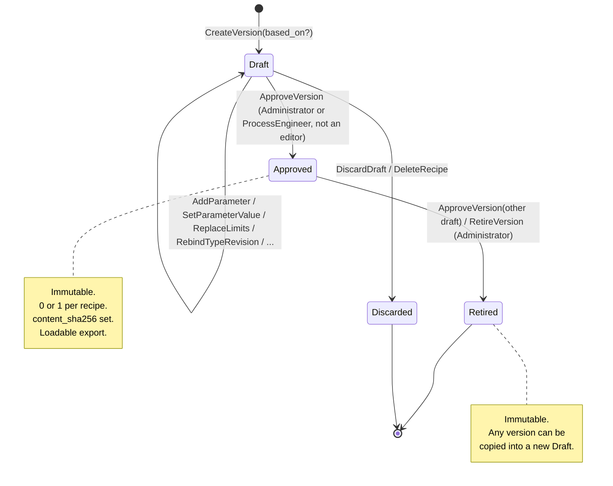

# Domain Model

Status: Accepted (design stage, revised after review, 2026-10-12)
Source of requirements: `general-draft.txt`
Related: `overview.md`, `data-model.md`, `api.md`, `reliability.md`, ADR-0006 to ADR-0022

This document defines the domain vocabulary. Rust code uses these names. SQL names come from `data-model.md`, which holds the mapping table between the two.

## 1. Bounded contexts

| Context | Responsibility | Aggregates |
|---|---|---|
| Plant Model | Machines, unit hierarchy, PLC platform, PLC type catalog, UDT revisions, derived types | `Machine`, `PlcType` |
| Recipe Management | Recipes, drafts, approval, limits, values, type rebind | `Recipe`, `Draft` |
| Identity and Access | Users, roles, sessions, login throttle, permission checks | `User`, `Session` |
| Audit | Append-only record of every mutating operation and every security event | `AuditEntry`, `SecurityEvent` (write-only from other contexts) |
| Export | Read model that serializes an `Approved` or `Retired` version to the export document. The module `export` builds the hashed body and computes `content_sha256` (ADR-0019) | none |

The application is one deployable unit (modular monolith). A context is a Rust module in `recipe-domain`. A context does not import entities from another context. It uses only identifier types (`MachineId`, `UserId`) of the other context. An error variant can carry a value object of another context, for example `reference` (`ReferenceNumber`) in `PlantError` or `login` (`Login`) in `RecipeError`. These fields are value types, not entities. The module layout follows `overview.md` sections 4 and 5.

Recipe Management reads the Plant Model through read-only ports (`TypeCatalog`, `UnitLookup`). A parameter request names its type with a `TypeExpr` (section 2.1). The use case passes it to `EnsureDerivedType` through a port. `EnsureDerivedType` returns the type and creates a missing `STRING(n)`, `WSTRING(n)`, or array type. It is an internal operation of the Plant Model, not a use case (section 5.1). Recipe Management never writes `plc_type` itself.

Domain methods take resolved values only: `&TypeTree`, `&TypeTrees`, `&PlatformTypes`, `&LiveUnits`, `&ApprovalPolicy`, `&DraftEditors`. No port and no I/O exist in `recipe-domain`.

## 2. Entities and value objects

### 2.1 Plant Model

**Machine** (entity, aggregate root)

| Field | Type | Rule |
|---|---|---|
| `id` | `MachineId` (UUID) | Stable identity |
| `code` | `MachineCode` | Pattern `M<n>`, `1 <= n <= 9999999`. Unique among live machines (Assumption A32) |
| `name` | `Text` | Not empty, max 200 chars |
| `plc_platform` | `PlcPlatform` | Exactly one per machine. Frozen after the first recipe |
| `units` | `Vec<Unit>` | At least one live unit of depth 1 |
| `archived_at` | `Option<Timestamp>` | Soft delete |

`PlcPlatform` (value object, enum): `CodesysIec`, `TwinCat3`, `S7_1200`, `S7_1500`, `S7_300`.

Rules:

- `plc_platform` cannot change after the machine has one recipe. A controller change is a new machine. The old machine is archived, and its code becomes free (Assumption A32).
- `ArchiveMachine` fails with `MachineHasDraft` when a recipe of the machine has a live draft. Recipes of an archived machine stay readable and exportable.

**Unit** (entity inside `Machine`)

| Field | Type | Rule |
|---|---|---|
| `id` | `UnitId` (UUID) | |
| `path` | `UnitPath` | `U<s1>[.<s2>[.<s3>[.<s4>[.<s5>]]]]`. Each segment is `1..=64`. One to five segments (Assumption A30) |
| `parent` | `Option<UnitId>` | Derived from `path`, not stored. The database derives it from the generated column `unit.parent_path` (`data-model.md` 3.2). `None` only when the path has one segment |
| `name` | `Text` | Not empty, max 200 chars |
| `archived_at` | `Option<Timestamp>` | Soft delete |

Rules:

- `UnitPath` is unique inside one machine. The parent of `U1.2.4` is `U1.2`. A unit cannot exist without its parent.
- A unit is never deleted. `ArchiveUnit` sets `archived_at` on the unit and on all its descendants.
- `ArchiveUnit` fails with `UnitReferencedByDraft` when the live draft of a recipe uses the unit. It fails with `UnitReferencedByApproved` when the `Approved` version of a recipe uses the unit.
- `ArchiveUnit` fails with `LastMainUnit` when the unit is the last live unit of depth 1.

**PlcType** (entity, aggregate root, immutable after creation)

| Field | Type | Rule |
|---|---|---|
| `id` | `PlcTypeId` (UUID) | |
| `kind` | `TypeKind` | `Primitive`, `Array`, `Struct` |
| `name` | `TypeName` | Primitives: IEC or S7 name (`INT`, `LREAL`, `S5TIME`). Structs: user name `[A-Za-z_][A-Za-z0-9_]{0,63}`. Arrays: `None` |
| `revision` | `u32` | Starts at 1. Increases by one with each `supersedes` step of the same struct name |
| `platforms` | `BTreeSet<PlcPlatform>` | Platforms where this type exists. A global primitive has the platforms of `data-model.md` 7. A struct, an array, or a sized string of a machine has only the platform of its machine (`platforms = ARRAY[machine.plc_platform]` in SQL) |
| `size_bytes` | `Option<u32>` | Primitives only. S7 size of one element in bytes. `BOOL` is 1, its storage unit. `STRING(n)` is `n + 2`. `WSTRING(n)` is `2n + 4`. `None` for a struct and an array. `S7Layout` computes their size and does not store it |
| `string_length` | `Option<u16>` | Only for `STRING` and `WSTRING`. The `StringLength` table below gives the range per platform |
| `leaf_class` | `Option<LeafClass>` | Primitives only. The class of the leaf (`LeafClass` below). `None` for a struct and an array |
| `element_type` | `Option<PlcTypeId>` | Only when `kind = Array` |
| `dimensions` | `Vec<ArrayDimension>` | Only when `kind = Array`. `ArrayDimension { lower: i32, upper: i32 }`. One to 3 dimensions (Assumption A38). `lower <= upper`. `upper - lower < 65536` |
| `members` | `Vec<TypeMember>` | Only when `kind = Struct`. Ordered. 1 to 1024 members (`type.max_members`, `reliability.md` 7.11). `TypeMember { name, type_id }` |
| `machine` | `Option<MachineId>` | `None` for the global primitive catalog. `Some` for a struct, an array, or a sized string. The seed default rows of `STRING` and `WSTRING` (`data-model.md` 7) are the one exception: they are sized strings with `None` |
| `supersedes` | `Option<PlcTypeId>` | Previous revision of the same struct |

Shape identity (one row per shape, `data-model.md` 3.3):

| Kind | Identity |
|---|---|
| Global primitive | `(machine = None, name)` |
| Sized string | `(machine, name, string_length)` |
| Struct | `(machine, name, revision)` |
| Array | `(machine, element_type, dimensions)` |

`StringLength` (value object): the number of characters of a `STRING(n)` or a `WSTRING(n)`. This table is the only definition of the range per platform.

| Platform | `STRING(n)` | `WSTRING(n)` |
|---|---|---|
| `CodesysIec`, `TwinCat3` | `1..=255` | `1..=255` |
| `S7_300` | `1..=254` | not available |
| `S7_1200`, `S7_1500` | `1..=254` | `1..=16382` |

The database `CHECK plc_type_string_length_range` allows 1 to 16382 on every platform. The domain applies the range of the platform. The form proposes 80 on `CodesysIec` and `TwinCat3` and 254 on the S7 platforms.

Rules:

- A migration seeds the global primitives. The application creates only derived types through `EnsureDerivedType`. `EnsureDerivedType` returns the existing row when the shape exists.
- A struct is immutable. An edit of a struct creates a new `PlcType` with `supersedes = Some(old)` and `revision = old.revision + 1`. Parameters that reference the old revision keep it. The domain marks them `outdated_type` (Assumption A29).
- A struct cannot contain itself, directly or through members (no cycle).
- The member names of a struct are unique. A duplicate name is `E-PLT-021 DuplicateMemberName` (ADR-0024).
- All member types of a struct MUST exist on every platform of the struct.
- A derived type MUST exist on the platform of its machine.
- IEC derived types (`ENUM`, subrange, alias) are not supported (Assumption A39).

**TypeExpr** (value object): the text form of a type in a request. `AddParameter` and `UpdateParameterDefinition` carry it in the field `type`. `DefineUdt` carries it in the field `members[i].type`. Grammar:

```text
type_expr := primitive | string | udt | array
primitive := name of a primitive of data-model.md section 7, except STRING and WSTRING
string    := ("STRING" | "WSTRING") ["(" length ")"]
udt       := udt_name "@" revision
array     := "ARRAY[" dim ("," dim){0,2} "] OF " type_expr
dim       := bound ".." bound
bound     := -?[0-9]{1,10}
length    := [1-9][0-9]{0,4}
udt_name  := [A-Za-z_][A-Za-z0-9_]{0,63}
revision  := [1-9][0-9]{0,9}
```

Rules:

- Keywords and primitive names are upper case. The only spaces are the space before `OF` and the space after it.
- A `bound` is inside the INTEGER range. Each `dim` follows the `ArrayDimension` rules of the `PlcType` table. An array has 1 to 3 dimensions (Assumption A38).
- A `length` follows the `StringLength` table for the platform of the machine.
- `STRING` without a length in a `TypeExpr` means the seed row of the platform of the machine: `STRING(254)` on `S7_300`, `S7_1200` and `S7_1500`, and `STRING(80)` on `CodesysIec` and `TwinCat3` (`data-model.md` 7). `WSTRING` without a length means the seed row of the platform of the machine: `WSTRING(254)` on `S7_1200` and `S7_1500`, `WSTRING(80)` on `CodesysIec` and `TwinCat3`.
- The element of an array is any `TypeExpr`, also another array.
- A `udt` names a struct revision of the same machine.

Examples: `INT`, `STRING`, `STRING(20)`, `WSTRING(80)`, `ST_Zone@3`, `ARRAY[1..8] OF REAL`, `ARRAY[0..1,1..2] OF ST_Zone@3`, `ARRAY[1..4] OF STRING(16)`.

`EnsureDerivedType` (section 5.1) resolves a `TypeExpr`, the innermost element first. It finds a primitive by name and a struct by `(machine, name, revision)`. It returns the `STRING(n)`, `WSTRING(n)`, or array row of the machine, or it creates the row.

Errors. Every failure of this table is `E-PLT-013 DerivedTypeInvalid` with a reason:

| Reason | Example |
|---|---|
| Grammar error: the text does not match the grammar. More than 3 dimensions is a grammar error | `ARRAY[1..8] INT`, `ARRAY[1..2,1..2,1..2,1..2] OF INT` |
| The struct name or the revision does not exist on the machine | `ST_Zone@9` |
| The type does not exist on the platform of the machine | `WSTRING(10)` on `S7_300` |
| A bound, a dimension, or a length is outside its range | `ARRAY[5..1] OF INT`, `STRING(300)` on `S7_1500` |

`DefineUdt` is the one exception. A member whose `TypeExpr` resolves to a type that is not on the platform is `E-PLT-006 MemberTypeNotOnPlatform`, because the member name is the useful detail. Every other consumer of a `TypeExpr` reports `E-PLT-013` for a type that is not on the platform.

A resolved type above a size limit is `E-PLT-018 TypeTooLarge`. The limits are 16 384 leaves (`budget.leaves_per_parameter`), `json.max_depth` levels, and 1024 members of a struct (`type.max_members`). `reliability.md` 7.11 holds the values.

`TypeTree` (value object): the fully resolved tree of one `PlcType`. The domain uses it to check a `ParameterValue`, the `leaf_path` of a `ProcessLimit`, and the S7 layout.

`TypeTrees` (value object): the `TypeTree` of every parameter type of one draft, keyed by `PlcTypeId`. The snapshot checks of a whole draft use it.

`LeafPath` (value object): a path to one scalar inside a type tree, or to every element of one array. Grammar:

```text
leaf_path := segment*
segment   := "." member | "[" index ("," index){0,2} "]" | "[*]"
member    := [A-Za-z_][A-Za-z0-9_]{0,63}
index     := -?[0-9]{1,10}
```

The empty path is the parameter itself when the type is a primitive. An index segment has one index per array dimension, at most 3 (Assumption A38). An index value is inside the INTEGER range `-2147483648..=2147483647`. `[*]` means every element of the array at that position. `[*]` never shares a segment with an index. Examples: `.setpoint`, `[3]`, `[1,2]`, `.zones[2].temp_max`, `.zones[*].temp_max`. This grammar is the only definition. `data-model.md` 3.13 and `reliability.md` 4.3 cite it.

**S7Address** (value object)

Grammar: `DB<db>.DBX<offset>.<bit>` when `width = X`, and `DB<db>.DB<width><offset>` when `width` is `B`, `W`, or `D`. `db` is `1..=65535`. `offset` is `0..=65535`. `bit` is `0..=7`. The bit is required with `X` and absent with every other width.

Width rule: the width MUST match the type. A mismatch is `E-RCP-054 S7AddressWidthMismatch` (ADR-0024).

| Type | Width |
|---|---|
| `BOOL` | `X` (bit address `DBX<byte>.<bit>`) |
| 1-byte primitive | `B` |
| 2-byte primitive | `W` |
| 4-byte primitive | `D` |
| 8-byte primitive, `DTL` (12 bytes), `STRING`, `WSTRING`, struct, array | `B` (address of the first byte) |

Alignment rule: every element wider than 1 byte, every `STRING` and `WSTRING`, every struct, and every array MUST start on an even byte. A 1-byte element (`BYTE`, `CHAR`, `SINT`, `USINT`) and a packed `BOOL` may start on any byte. `DB1.DBW3` is not valid.

Overlap rule: inside one version, two parameters cannot occupy the same bit of one data block. A `BOOL` parameter occupies one bit. Every other parameter occupies all bits of the bytes `[offset, offset + layout size)`. The domain checks the rule for the whole draft at `AddParameter`, `UpdateParameterDefinition`, and `ApproveVersion`.

Platform rule: an address is required on `S7_300`, optional on `S7_1200` and `S7_1500`, and not allowed on `CodesysIec` and `TwinCat3` (Assumption A31). The width, alignment, and overlap rules apply to every parameter with an address, on every platform.

**S7Layout** (value object): computes the layout size and the alignment of a `TypeTree` on S7. The layout size is computed, not stored. Rules:

- The storage unit of a primitive is its `size_bytes`. A `BOOL` has the storage unit 1.
- In a struct, consecutive `BOOL` members pack 8 per byte. The next non-`BOOL` member starts at the next byte, or at the next even byte when it is wider than 1 byte.
- In an array, `BOOL` elements pack 8 per byte and 1-byte elements pack one per byte. Wider elements start on even bytes.
- A struct and an array start on an even byte. Their size is rounded up to an even number of bytes.

**LeafClass** (value object, enum): the class of a primitive leaf. The class sets the JSON form of a value, the stored text, and the process limit. The column `Class` of `data-model.md` 7 gives the class of every primitive.

| Class | Primitives | Value in a request | Stored and hashed text | Process limit |
|---|---|---|---|---|
| `Numeric` | `SINT`, `USINT`, `INT`, `UINT`, `DINT`, `UDINT`, `LINT`, `ULINT`, `BYTE`, `WORD`, `DWORD`, `LWORD`, `REAL`, `LREAL` | JSON number | Canonical decimal text | `min`, `max` |
| `String` | `STRING`, `WSTRING` | JSON string | The string | `max_length` |
| `Bool` | `BOOL` | JSON `true` or `false` | The boolean | none |
| `Char` | `CHAR`, `WCHAR` | JSON string with one Unicode scalar | The string | none |
| `Duration` | `TIME`, `LTIME`, `S5TIME` | JSON string with an `IecLiteral` | Canonical decimal text of the count of the base unit | `min`, `max` in the base unit |
| `Instant` | `DATE`, `LDATE`, `TIME_OF_DAY`, `LTOD`, `DATE_AND_TIME`, `LDT`, `DTL` | JSON string with an `IecLiteral` | Canonical decimal text of the count of the base unit | `min`, `max` in the base unit |

SQL values (`data-model.md` 3.3): `numeric`, `string`, `bool`, `char`, `duration`, `instant`. A `CHAR` value is one Unicode scalar in `U+0000..=U+00FF`. A `WCHAR` value is one Unicode scalar in `U+0000..=U+FFFF`.

Base units (Assumption A43). A `Duration` or `Instant` value is an integer count of the base unit of its type. The domain stores, hashes, and limits this count. The stored and hashed value is the decimal text of the count, so a signed and an unsigned 64-bit range both fit. The domain holds each platform range in code.

| Type | Class | Base unit | Range of the count |
|---|---|---|---|
| `TIME` | `Duration` | milliseconds | Platform range: CODESYS and TwinCAT 0 to 4 294 967 295 (unsigned 32 bit). S7 -2 147 483 648 to 2 147 483 647 (signed 32 bit). The range is held in code |
| `LTIME` | `Duration` | nanoseconds | Platform range: CODESYS and TwinCAT 0 to 2^64-1 (unsigned 64 bit). `S7_1500` -2^63 to 2^63-1 (signed 64 bit) |
| `S5TIME` | `Duration` | milliseconds | 0 ms to 9 990 s. `S5T#0ms` is valid. The step depends on the value. It is 10 ms up to 9 990 ms and 100 ms up to 99 900 ms. It is 1 s up to 999 s and 10 s up to 9 990 s |
| `DATE` | `Instant` | days since 1970-01-01 | `CodesysIec` and `TwinCat3`: 1970-01-01 to 2106-02-07. `S7_1200` and `S7_1500`: 1990-01-01 to 2169-06-06. `S7_300`: 1990-01-01 to 2168-12-31 (ADR-0026) |
| `LDATE` | `Instant` | nanoseconds since 1970-01-01 | Platform range: CODESYS and TwinCAT 0 to 2^64-1 (unsigned 64 bit). `LDATE` does not exist on S7 platforms |
| `TIME_OF_DAY` | `Instant` | milliseconds since midnight | `0..=86_399_999` |
| `LTOD` | `Instant` | nanoseconds since midnight | Platform range: CODESYS and TwinCAT 0 to 2^64-1 (unsigned 64 bit). `S7_1500` 0 to 2^63-1. The `tod` grammar keeps a literal below one day, `0..=86_399_999_999_999` |
| `DATE_AND_TIME` | `Instant` | seconds since 1970-01-01 | `S7_1500` and `S7_300`: 1990-01-01-00:00:00 to 2089-12-31-23:59:59. `CodesysIec` and `TwinCat3`: 1970-01-01-00:00:00 to 2106-02-07-06:28:15 (ADR-0026) |
| `LDT` | `Instant` | nanoseconds since 1970-01-01 | Platform range: CODESYS and TwinCAT 0 to 2^64-1 (unsigned 64 bit). `S7_1500` 0 to 2^63-1, which is 1970-01-01 to 2262-04-11 |
| `DTL` | `Instant` | nanoseconds since 1970-01-01 | `S7_1200` and `S7_1500`: 1970-01-01 to 2262-04-11. The count is never negative |

The domain holds each range of this table in code, as it does for the `Numeric` types. An `Instant` has no time zone. The domain applies no offset.

**IecLiteral** (value object): the text form of a `Duration` or `Instant` value in a request, on a page, and in an error message. `IecLiteral::parse(type, text)` returns the count of the base unit. `Display` writes the canonical literal. The parser is code of `recipe-domain`. It uses no external crate. Grammar:

```text
literal  := duration | date_lit | tod_lit | dt_lit
duration := ("T#" | "LT#" | "S5T#") ["-"] part+
part     := digits unit
unit     := "d" | "h" | "m" | "s" | "ms" | "us" | "ns"
date_lit := ("D#" | "LD#") date
tod_lit  := ("TOD#" | "LTOD#") tod
dt_lit   := ("DT#" | "LDT#" | "DTL#") date "-" tod
date     := [0-9]{4} "-" [0-9]{2} "-" [0-9]{2}
tod      := [0-9]{2} ":" [0-9]{2} ":" [0-9]{2} ["." [0-9]{1,9}]
digits   := [0-9]{1,19}
```

Rules:

- The prefix names the type: `T#` is `TIME`, `LT#` is `LTIME`, `S5T#` is `S5TIME`, `D#` is `DATE`, and `LD#` is `LDATE`. `TOD#` is `TIME_OF_DAY`, `LTOD#` is `LTOD`, `DT#` is `DATE_AND_TIME`, `LDT#` is `LDT`, and `DTL#` is `DTL`.
- The prefixes `TOD#` and `DT#` are literal syntax, not type names.
- The parts of a duration follow the unit order `d`, `h`, `m`, `s`, `ms`, `us`, `ns`. Each unit occurs at most once.
- The first part has no upper bound. Every later part is less than one unit of the part before it, for example `m` less than 60.
- `TIME` accepts the units `d` to `ms`. `S5TIME` accepts `h` to `ms`. `LTIME` accepts every unit. Only `TIME` and `LTIME` accept the sign `-`.
- A fraction of a second has at most 3 digits for `TIME_OF_DAY`. `DATE_AND_TIME` has no fraction. `LTOD`, `LDT`, and `DTL` accept up to 9 digits.
- The date exists in the calendar. The hour is `00..=23`.
- The count is inside the range of the base-unit table.
- The canonical literal writes every part that is not zero. Zero is `T#0ms`, `LT#0ns`, or `S5T#0ms`, and its count is `0`. A fraction has no trailing zeros.
- `parse` and `Display` round-trip.
- A text that does not parse, or a count outside the range, is `E-RCP-005 ValueShapeMismatch` for a value. For a limit it is `E-RCP-006 LimitOutsideTypeRange`.
- Pages and error messages show a `Duration` or `Instant` value and its limits as the canonical literal.

Examples: `T#1d2h3m4s5ms` is the count `93784005`. `TOD#12:30:00.500` is `45000500`. `D#2026-10-12` is `20738`. `DT#2026-10-12-12:30:00` is `1791808200`.

### 2.2 Recipe Management

**Recipe** (entity, aggregate root)

| Field | Type | Rule |
|---|---|---|
| `id` | `RecipeId` (UUID) | |
| `machine` | `MachineId` | Exactly one machine (ADR-0010) |
| `reference_number` | `ReferenceNumber` | `[A-Z0-9][A-Z0-9_-]{0,49}`. Folded to upper case. Unique (Assumption A27) |
| `name` | `Text` | Not empty, max 200 chars |
| `versions` | `Vec<VersionHeader>` | Ordered by `number`. `VersionHeader { id, number, status, row_version }` |
| `deleted_at` | `Option<Timestamp>` | Soft delete (ADR-0021) |

The root holds headers only. It never loads parameters. `Recipe::approve()` and `Recipe::retire()` change headers and return the outcome. The use case persists the outcome through intent methods of the repository.

**Draft** (aggregate)

A `Draft` is the one `RecipeVersion` of a recipe with `status = Draft` and `deleted_at = None`, together with its `Vec<Parameter>`. A recipe has at most one `Draft` (Assumption A7). The parameter commands load and save the `Draft` only.

**ApprovedVersion**, **RetiredVersion** (read models)

Immutable views of a version and its parameters. They carry `row_version` so `RetireVersion` keeps its optimistic check.

**RecipeVersion** (entity)

| Field | Type | Rule |
|---|---|---|
| `id` | `RecipeVersionId` (UUID) | |
| `number` | `u32` | Starts at 1. Unique per recipe. Never reused |
| `status` | `VersionStatus` | `Draft`, `Approved`, `Retired` |
| `based_on` | `Option<RecipeVersionId>` | Version of the same recipe that was copied |
| `change_note` | `Text` | Given by the user, also for version 1. Max 4 000 chars |
| `row_version` | `i64` | Optimistic lock token (ADR-0008). The database increments it |
| `content_sha256` | `Option<Sha256>` | Set once at approval over the canonical export content (ADR-0019) |
| `created_by`, `created_at` | `UserId`, `Timestamp` | |
| `updated_at` | `Timestamp` | Last change of the version or of any parameter |
| `approved_by`, `approved_at` | `Option<(UserId, Timestamp)>` | Set once |
| `retired_at` | `Option<Timestamp>` | Set once |
| `deleted_at` | `Option<Timestamp>` | Set once, only on a `Draft` (discard) |

**Parameter** (entity inside `Draft`, snapshot row in every version)

| Field | Type | Rule |
|---|---|---|
| `id` | `ParameterId` (UUID) | Identity of this row in this version |
| `key` | `ParameterKey` (UUID) | The unique identifier of the draft requirement. The server generates it at `AddParameter`. Unique inside a version and stable across the versions of one recipe. Copied when a version is copied (Assumption A40) |
| `unit` | `UnitId` | Live unit of the machine of the recipe |
| `tag` | `ParameterTag` | `[A-Z][A-Z0-9_]{0,63}`. Unique inside one version |
| `name_en` | `Text` | Not empty, max 200 chars |
| `description_en` | `Text` | Not empty, max 4 000 chars |
| `translations` | `Vec<Translation>` | `Translation { lang: LangCode, name, description }`. One per language (ADR-0012) |
| `plc_type` | `PlcTypeId` | Type MUST exist on the platform of the machine. The request names it with a `TypeExpr` (section 2.1) |
| `outdated_type` | `bool` | Derived, not stored. A parameter is outdated when any `plc_type` in its resolved type tree has a successor revision. The tree holds the type itself, every member, and every element type, at any depth |
| `s7_address` | `Option<S7Address>` | Required on `S7_300`. Optional on `S7_1200` and `S7_1500`. Not allowed on `CodesysIec` and `TwinCat3` (Assumption A31) |
| `limits` | `Vec<ProcessLimit>` | At most one per `leaf_path` |
| `value` | `ParameterValue` | JSON tree that matches the `TypeTree` |
| `ordinal` | `u32` | Sort order of the UI inside the unit, `0..=100000`. Not unique. UI only, not exported (`api.md` 6.3) |

`LangCode` (value object): `^[a-z]{2,3}(-[A-Z]{2})?$`, not `en` (Assumption A17). The grammar is the same in every document.

**ProcessLimit** (value object)

| Field | Type | Rule |
|---|---|---|
| `leaf_path` | `LeafPath` | Resolves to a scalar leaf, or with `[*]` to every element of an array |
| `min` | `Option<Decimal>` | `Numeric`, `Duration`, and `Instant` leaves only. A `Duration` or `Instant` limit is a count of the base unit (section 2.1) |
| `max` | `Option<Decimal>` | Same classes as `min`. `min <= max` when both are set |
| `max_length` | `Option<u16>` | `String` leaves only. `<=` type length |

Rules per class (`LeafClass`, section 2.1):

- A `Numeric`, `Duration`, or `Instant` leaf takes `min` and `max`. A `String` leaf takes `max_length`.
- A `Bool` or `Char` leaf has no limit (Assumption A36). A limit on such a leaf is `LimitNotApplicable`.
- A limit field that does not match the class is also `LimitNotApplicable`, for example `max_length` on an `INT` leaf.
- A process limit MUST be inside the range of the data type. The data type range is not a process limit.
- At approval, every `Numeric`, `String`, `Duration`, and `Instant` leaf MUST have a limit, directly or through `[*]` (Assumption A36). A missing limit is `LimitMissing`.

**ParameterValue** (value object)

A JSON value with the same shape as the `TypeTree`:

- primitive: the JSON form of its `LeafClass` (section 2.1)
- array: JSON array with exactly `(upper - lower + 1)` elements per dimension
- struct: JSON object with exactly the member names

Canonical text per class:

| Class | Canonical text |
|---|---|
| `Numeric` | The decimal text of `Decimal`: no exponent, no trailing zeros, `-0` becomes `0`. `1.5e2` becomes `150` |
| `Duration`, `Instant` | `IecLiteral` converts the literal to the count. The canonical text is the decimal text of the count, for example `93784005` for `T#1d2h3m4s5ms` |
| `String`, `Char` | The string |
| `Bool` | `true` or `false` |

The domain stores a `Numeric`, `Duration`, or `Instant` leaf as a JSON number with its canonical text. The export writes the same text as a JSON string (`api.md` 6.1).

The domain checks every leaf against the data type range and then against the `ProcessLimit` for that leaf.

Size budget (Assumption A26): at most 16 384 leaves per parameter and 262 144 leaves per version. At most 32 768 limit rows and 4 000 parameters per version.

**ApprovalPolicy** (value object)

| Field | Type | Rule |
|---|---|---|
| `separation_of_duties` | `bool` | Default `true` (Assumption A34). The approver cannot be `created_by` of the draft or a member of `DraftEditors` |

`DraftEditors` (value object): the set of users who ran a draft command on the version.

A draft command is one of the eight parameter commands of section 5.2: `AddParameter`, `UpdateParameterDefinition`, `SetParameterValue`, `ReplaceLimits`, `UpsertTranslation`, `RemoveTranslation`, `RemoveParameter`, and `RebindTypeRevision`. Only these eight commands write `draft_editor`.

### 2.3 Identity and Access

**User** (entity, aggregate root)

| Field | Type | Rule |
|---|---|---|
| `id` | `UserId` (UUID) | |
| `login` | `Login` | Unique, case-insensitive, `[a-z0-9._-]{3,64}` |
| `password_hash` | `PasswordHash` | Argon2id PHC string. Never logged. `Debug` redacts it |
| `role` | `Role` | `Administrator`, `ProcessEngineer`, `Operator` |
| `is_active` | `bool` | Inactive users cannot log in |
| `session_epoch` | `i64` | Starts at 0. Every increment ends all sessions of the user |
| `must_change_password` | `bool` | `true` after `create-admin`, `CreateUser`, and `ResetPassword`. Until the user changes the password, the session reaches only the routes listed in `api.md` 7.4 |

**Session** (entity, aggregate root, owned by the application)

| Field | Type | Rule |
|---|---|---|
| `id` | `SessionId` | SHA-256 of the 128-bit cookie token. The token itself is never stored |
| `user` | `UserId` | |
| `epoch` | `i64` | Copy of `session_epoch` at login. Column `session.epoch` (`data-model.md` 3.6) |
| `csrf_token` | `CsrfToken` | New token at login |
| `created_at`, `last_seen_at`, `expires_at` | `Timestamp` | Idle 30 min, absolute 12 h (`reliability.md` 7.11) |

Session rules:

- `Login` creates a new session with a new token and a new id. A session that existed before login is discarded. The use case returns the token, and `recipe-web` sets the cookie.
- Every request loads `role`, `is_active`, `session_epoch`, and `must_change_password` from the user. The request fails with `Unauthenticated` when the user is inactive or when `session.epoch != user.session_epoch`. The session never caches the role.
- `DeactivateUser`, `ResetPassword`, and `SetUserRole` increment `session_epoch`. `ChangeOwnPassword` increments it and then creates a new session for the current request.
- `Logout` deletes the session row.

**LoginThrottle** (value object, `reliability.md` 7.11, Assumption A22)

- After 3 failures per `(login, client_ip)` in 15 minutes, an attempt within `2^(n-3)` seconds after the last failure is `LoginThrottled`. The delay is capped at 60 seconds.
- After 100 failures per `client_ip` in 15 minutes, every attempt from that address is `LoginThrottled`.
- There is no permanent lockout. `UnlockLogin` (Administrator) clears the counters of one login.
- Order (ADR-0014): the use case takes an Argon2 permit. A permit timeout returns `E-WEB-009`. T1, under the advisory lock of class 1 on the login (`data-model.md` 1.4), counts the failures, inserts the attempt row with `succeeded = false`, and commits.
- T1 inserts the attempt row only while the per-IP budget is not reached. After that, T1 inserts nothing, and the use case returns `LoginThrottled` from the count alone.
- When the attempt is throttled, the use case releases the permit and returns `LoginThrottled`. Otherwise it runs the password check and releases the permit.
- T2 sets `succeeded = true` and creates the session, or writes a `SecurityEvent`. A failed attempt below the per-IP budget therefore always counts (`data-model.md` 6).
- In read-only mode (Assumption A24), `Login` runs in the same way. T1 inserts the attempt row, and a failed or throttled login writes its `SecurityEvent`. These writes are small and stay inside the reserved margin of `reliability.md` 7.8.
- The response and the timing are the same for an unknown login, an inactive user, and a wrong password (Assumption A42).

`Permission` (value object, enum) lives in `recipe-domain`. The full matrix is in `api.md` section 3. Every use case, also every query use case, checks its permission as its first statement (ADR-0013).

`LastAdministrator` rule: the last active `Administrator` cannot be deactivated or demoted.

### 2.4 Audit

**AuditEntry** (write-only record)

| Field | Type |
|---|---|
| `id` | `i64` (identity) |
| `occurred_at` | `Timestamp` |
| `chain_seq` | `i64` (position in the hash chain, written by the database) |
| `actor` | `Option<UserId>` (`None` only for `create-admin`, the startup settings comparison, and a data migration that changes catalog rows) |
| `action` | `AuditAction` |
| `aggregate_type`, `aggregate_id` | `Text`, `UUID` (the root: `machine`, `recipe`, `app_user`, `app_setting`, or `plc_type` for a global primitive row that a data migration changes) |
| `entity_type`, `entity_id` | `Text`, `UUID` (the changed row) |
| `before`, `after` | `Option<Json>` (a diff object or the full row, by action. See the state rule below) |
| `request_id` | `Uuid` |
| `client_ip`, `session_ref` | `Option<IpAddr>`, `Option<Text>` (prefix of the session id hash) |
| `prev_hash`, `entry_hash` | `Option<Sha256>`, `Sha256` (hash chain, written by the database. `prev_hash` is `None` only for the first row) |

The trigger function `audit_hash_chain` locks the single row of `audit_chain_head`, assigns `chain_seq`, and computes `entry_hash` over a fixed canonical text (ADR-0022, `data-model.md` 4.9).

State rule for `before` and `after` (the same rule as ADR-0005 and `data-model.md` 10):

- Five actions store a diff object of the changed fields: `ParameterDefinitionUpdated`, `ParameterValueSet`, `LimitsReplaced`, `TranslationUpserted`, and `TypeRevisionRebound`.
- Every other action stores the full row of the changed entity as JSON, without `password_hash`. This includes `ParameterAdded` and `ParameterRemoved`. A create stores the row in `after`, a delete stores it in `before`, and an update stores it in both.
- Three actions store a specific state object instead of a row. `UserLoggedIn` and `UserLoggedOut` store `session_ref`. `VersionExported` stores the version id, the schema version, and `content_sha256`.
- `VersionApproved` adds `allow_outdated` to the full row.

Migrations. Schema migrations and the seed migration `0004_seed_plc_types.sql` write no audit row. `_sqlx_migrations` is the record of schema and seed changes. A later data migration that changes catalog rows writes one audit row per changed row under `SET ROLE audit_owner`. The row has `actor = None` and `request_id` = the UUID of the migration version (`data-model.md` 5.1 and 10).

`AuditAction` (enum): one name per command result, plus `DerivedTypeCreated` for the internal operation and `SettingChanged` for the startup settings comparison. 35 names:

| Context | Actions |
|---|---|
| Plant Model | `MachineCreated`, `MachineRenamed`, `MachineArchived`, `UnitAdded`, `UnitRenamed`, `UnitArchived`, `UdtDefined`, `DerivedTypeCreated` |
| Recipe Management | `RecipeCreated`, `RecipeRenamed`, `RecipeDeleted`, `RecipeRestored`, `VersionCreated`, `DraftDiscarded`, `VersionApproved`, `VersionRetired`, `ParameterAdded`, `ParameterDefinitionUpdated`, `ParameterValueSet`, `LimitsReplaced`, `TranslationUpserted`, `TranslationRemoved`, `ParameterRemoved`, `TypeRevisionRebound` |
| Identity and Access | `UserLoggedIn`, `UserLoggedOut`, `UserCreated`, `UserRoleSet`, `UserDeactivated`, `UserActivated`, `PasswordReset`, `OwnPasswordChanged`, `LoginUnlocked` |
| Export | `VersionExported` |
| Configuration | `SettingChanged` |

The use case writes the `AuditEntry` in the same transaction as the change (ADR-0005). The `UnitOfWork::commit` method takes a `NonEmpty<AuditEntry>`, so a command without an audit entry does not compile. Section 5 lists the other commit paths. The application role `recipe_app` cannot update or delete audit rows.

**SecurityEvent** (write-only record, Assumption A33)

| Field | Type |
|---|---|
| `id` | `i64` (identity) |
| `occurred_at` | `Timestamp` |
| `kind` | `SecurityEventKind`: `LoginFailed`, `LoginRejectedInactive`, `LoginThrottled`, `CsrfRejected`, `Forbidden`, `Unlock`, `AuditChainBroken` (written by the nightly audit chain check). SQL values (`data-model.md` 3.8): `login_failed`, `login_rejected_inactive`, `login_throttled`, `csrf_rejected`, `forbidden`, `unlock`, `audit_chain_broken` |
| `login_hmac` | `Option<Hmac>` (HMAC of the login field, never the plain text. Set when no account matches, and always for `LoginThrottled`) |
| `user` | `Option<UserId>` |
| `client_ip`, `user_agent` | `Option<IpAddr>` (`None` only for `AuditChainBroken`), `Option<Text>` |
| `request_id` | `Uuid` |
| `detail` | `Option<Json>` |
| `count` | `u32` (number of events in the row, at least 1) |

A `SecurityEvent` is written in its own short transaction. It is kept when the request fails. Events of the kinds `LoginFailed`, `LoginThrottled`, and `CsrfRejected` aggregate per `(client_ip, kind, minute)`. The first event of a minute inserts the row. Each later event of that minute increments `count` (`data-model.md` 3.8). The table is append-only for `recipe_app`, except this increment. Rows are kept 400 days. Then the function `security_event_purge()` deletes them in batches (ADR-0022, `data-model.md` 4.12).

A change of a configuration value, for example `approval.separation_of_duties`, is not a security event. The startup settings comparison writes it as the audit action `SettingChanged` (`reliability.md` 7.12).

## 3. Invariants and their mechanism

| # | Invariant | Mechanism in domain | Mechanism in database |
|---|---|---|---|
| I1 | A recipe has at most one `Approved` version | `Recipe::approve()` retires the current approved header in the same call | Partial unique index `recipe_version_one_approved` on `(recipe_id) WHERE status = 'approved'` |
| I2 | `Approved -> Retired` when another version becomes `Approved` | Same call as I1. One domain operation | Both updates and the audit rows are in one transaction |
| I3 | A change of type, limit, revision, address, unit, translation, or value happens only in a live `Draft` | `Draft` is the only aggregate with parameter methods. A command on a non-draft version returns `VersionNotEditable` | Trigger function `enforce_version_mutable` on `parameter`, `parameter_limit`, `parameter_translation` (`E-RCP-030`, `E-RCP-031`). It takes `FOR SHARE` on the version |
| I4 | A version that is not `Draft` changes only its status fields | `Recipe::retire()` changes `status` and `retired_at` only | Trigger function `recipe_version_transition` (`E-RCP-033`): allows `draft -> approved`, `approved -> retired`, `deleted_at` on a draft. It always freezes `id`, `recipe_id`, `plc_platform`, `number`, `based_on_version_id`, `created_by`, `created_at`. After approval it also freezes `approved_by`, `approved_at`, `change_note`, `content_sha256` |
| I5 | An `S7_300` parameter has an address. An `S7_1200` or `S7_1500` parameter may have one. A `CodesysIec` or `TwinCat3` parameter has none | `Parameter::new()` returns `S7AddressRequired` or `S7AddressNotAllowed` | `CHECK parameter_s7_address_platform` enforces the three cases. Composite FK `parameter_version_platform` copies the platform |
| I6 | The type of a parameter exists on the platform of the machine | `EnsureDerivedType` returns `E-PLT-013 DerivedTypeInvalid` for a `TypeExpr` that is not on the platform. `DefineUdt` is the exception: it reports a member type that is not on the platform as `E-PLT-006 MemberTypeNotOnPlatform`. `E-RCP-013 TypeNotOnPlatform` is only an item inside `E-RCP-020 ValidationFailed`: the snapshot check reports a stored parameter whose type is no longer on the platform | Trigger function `enforce_type_platform` on `parameter` (`E-PLT-031`, `E-PLT-032`) |
| I7 | A value matches its type tree and its limits | `ParameterValue::check(&TypeTree, &[ProcessLimit])` | Not enforced. JSONB is opaque. `CHECK parameter_value_size` bounds the size |
| I8 | A struct has no cycle | `TypeTree::resolve()` returns `TypeCycle` | Not enforced |
| I9 | Unit path has 1 to 5 segments, each `1..=64` | `UnitPath::parse()` | `CHECK unit_path_format` |
| I10 | A unit has its parent in the same machine, and the parent path exists | `Machine::add_unit()` | Composite FK `unit_parent_exists (machine_id, parent_path) REFERENCES unit (machine_id, path)`. `parent_path` is a generated column. There is no `parent_id` column |
| I11 | `reference_number` is unique. `machine.code` is unique among live machines | Repository returns `DuplicateReference` or `DuplicateMachineCode` | `UNIQUE recipe_reference_unique`. Partial unique index `machine_code_live_unique` on `(code) WHERE archived_at IS NULL` |
| I12 | Two users cannot overwrite the same `Draft` | Use case compares `row_version` after `recipe_version FOR UPDATE` and returns `ConcurrentEdit` on a mismatch. Then it runs the touch statement | Lock order `recipe FOR UPDATE -> recipe_version FOR UPDATE`. Compare after `FOR UPDATE`, then touch. The trigger function `bump_row_version` increments the token |
| I13 | Every command has an audit entry, except the two cases of section 5 | `UnitOfWork::commit(NonEmpty<AuditEntry>)` | `recipe_app` has `INSERT` and `SELECT` only on `audit_log`. Hash chain trigger function `audit_hash_chain` with the row lock on `audit_chain_head`. The nightly check recomputes every hash and reports a break as `E-AUD-002` |
| I14 | Deleting a recipe does not destroy history | `Recipe::delete()` sets `deleted_at`. `RecipeHasApprovedVersion` when an approved version exists | No `DELETE` grant on `recipe`, `recipe_version` for `recipe_app` |
| I15 | The unit of a parameter is in the machine of the recipe | `LiveUnits::contains(unit_id)` in `Draft::set_definition()` | Trigger function `enforce_unit_machine` on `parameter` (`E-RCP-032`) |
| I16 | Separation of duties at approval | `Recipe::approve(&ApprovalPolicy, &DraftEditors)` returns `ApproverEditedDraft` | Table `draft_editor` written by every draft command. Not enforced by trigger |
| I17 | At approval every numeric, string, duration, and instant leaf has a limit. A bool or char leaf has none | `Draft::check_for_approval()` returns `LimitMissing` | Not enforced |
| I18 | Size budgets (A26) | `Draft::set_value()` and `Draft::add_parameter()` return `SizeBudgetExceeded` | Statement trigger function `version_size_budget` on `parameter` and `parameter_limit` (`E-RCP-035`, `E-RCP-036`) |
| I19 | A draft references only live units, a live machine, and a non-deleted recipe | The whole-snapshot check `Draft::check_snapshot(&LiveUnits)` runs in `CreateVersion` and `ApproveVersion` and returns `E-RCP-020 ValidationFailed` with the list. The eight draft commands check one parameter and return the specific code, for example `E-PLT-009 UnitArchived`, `E-PLT-013 DerivedTypeInvalid`, or `E-RCP-012 RecipeDeleted` | `SELECT ... FROM recipe FOR UPDATE` with `deleted_at IS NULL` as the first statement. `AddParameter` and `UpdateParameterDefinition` take `FOR SHARE` on the unit row. `CreateVersion` takes `FOR SHARE` on the unit rows of the base version and checks `archived_at` again. `ArchiveUnit` takes `machine FOR NO KEY UPDATE`, then `FOR UPDATE` on the unit rows. Every command that adds a reference to a unit takes `machine FOR SHARE` first (ADR-0015) |
| I20 | S7 addresses do not overlap and are aligned, on every platform that has an address (A31) | `Draft::check_s7_layout(&TypeTree)` returns `S7AddressOverlap` or `S7AddressMisaligned` | `CHECK parameter_s7_address_format` checks the grammar only |
| I21 | The platform of a machine does not change after its first recipe | No command changes `plc_platform` of a machine with a recipe | Trigger function `machine_platform_frozen` (`E-PLT-030`). Composite FK `recipe_machine_platform` |
| I22 | A `PlcType` row and its members never change. A struct has at least one member | `DefineUdt` creates a new revision. It returns `StructHasNoMembers` for an empty struct | Trigger function `plc_type_immutable` (`E-PLT-033`, `E-PLT-034`, `E-PLT-035`). Constraint trigger function `plc_type_struct_has_member` (`E-PLT-036`) |
| I23 | A machine code, a unit path, and a reference number do not change while a non-draft version references them | No command changes these identifiers | Trigger function `freeze_identifiers` (`E-PLT-037`, `E-PLT-038`, `E-RCP-034`). Column grants withhold `UPDATE` on these columns |

## 4. Version state machine



Rules:

- Transitions that do not exist: `Retired -> Approved`, `Approved -> Draft`, `Retired -> Draft`. The trigger function `recipe_version_transition` rejects them.
- `Discarded` is `Draft` with `deleted_at` set. It is not a status value.
- `RetireVersion` without a replacement exists for the Administrator (Assumption A28).
- Idempotent approve: when the version is already `Approved` and `row_version == expected + 1`, `ApproveVersion` returns `AlreadyApproved` and writes no audit entry.
- Outdated type: A parameter is outdated when any `plc_type` in its resolved type tree has a successor revision. The tree holds the type itself, every member, and every element type, at any depth. The parameter shows `outdated_type = true`. The engineer creates a draft and runs `RebindTypeRevision`. Approved and Retired versions keep the old revision (Assumption A29).
- Approval of outdated parameters: `ApproveVersion` returns `TypeRevisionOutdated` when a parameter of the draft is outdated, unless the request carries `allow_outdated = true`. The check runs before the transaction and again after the locks inside it. A revision that commits between the two runs therefore also stops the approval. The audit entry `VersionApproved` records the flag (Assumption A29, ADR-0018).

## 5. Domain operations

Each command is one use case in `recipe-app`. There are 33 command use cases. `EnsureDerivedType` is an internal operation, not a use case (section 5.1). Each command writes one or more `AuditEntry` rows, with two exceptions. An `ApproveVersion` that returns `AlreadyApproved` writes none (section 4). A failed or throttled `Login` writes a `SecurityEvent` and no `AuditEntry`. In read-only mode (Assumption A24), every command except `Login`, `Logout`, and `ExportVersion` returns `E-WEB-006` and writes nothing. Each command runs in one READ COMMITTED transaction, except `Login` and the two SERIALIZABLE commands of section 5.3.

Lock order (ADR-0015): `machine` → `recipe` → `recipe_version` → `unit` → children. A command takes only the locks that it needs, always in this order:

- `RenameMachine`, `ArchiveMachine`, `RenameUnit`, and `ArchiveUnit` take `machine FOR NO KEY UPDATE` first.
- `AddUnit`, `CreateRecipe`, `RestoreRecipe`, `CreateVersion`, `AddParameter`, `UpdateParameterDefinition`, `RebindTypeRevision`, and `DefineUdt` take `machine FOR SHARE` first. `DefineUdt` then takes the advisory locks of section 5.1.
- A recipe command reads `recipe.machine_id` without a lock before it locks the machine. The column never changes.
- Every recipe command except `CreateRecipe` then takes `recipe FOR UPDATE` and requires `deleted_at IS NULL`. `RestoreRecipe` requires `deleted_at IS NOT NULL`. A draft command then takes `recipe_version FOR UPDATE`.
- `AddParameter` and `UpdateParameterDefinition` then take `FOR SHARE` on the unit row. Every caller of `EnsureDerivedType` takes its class-2 advisory locks last, before its first `plc_type` insert (section 5.1). `CreateVersion` takes `FOR SHARE` on the unit rows of the base version after the recipe lock and checks `archived_at` again (I19).
- The foreign key `plc_type.machine_id` takes `FOR KEY SHARE` on a machine row that the command already holds. The insert of a derived type therefore waits for no other transaction.
- A statement that locks several rows of one table orders them by `id`, and `app_user` rows are locked `FOR NO KEY UPDATE` (`data-model.md` 6).

Every draft command also writes `draft_editor` and compares `row_version`. The error column gives the complete error set of each command.

Commit paths. Each write goes through one port of `recipe-app` (ADR-0015):

| Port | Operations |
|---|---|
| `UnitOfWork::commit(NonEmpty<AuditEntry>)` | Every command of sections 5.1 to 5.4, except the `Login` steps and the `UnlockLogin` step below. `Login` T2 on success (`UserLoggedIn`). `Logout` (`UserLoggedOut`). `ExportVersion` (`VersionExported`). The startup settings comparison (`SettingChanged`). The subcommand `create-admin` (`UserCreated`, `actor = None`) |
| `SecurityEventSink::record(SecurityEvent)` | Its own short transaction, with no audit entry. `Login` T2 on failure, a throttled `Login`, a `Forbidden` result, a CSRF rejection, the `unlock` event after the commit of `UnlockLogin`, and the job `audit_chain_check`. An aggregated kind increments `count` (section 2.4). A failed or throttled `Login` writes its row also in read-only mode |
| `LoginAttemptStore` | `Login` T1 counts the failures and inserts the attempt under the advisory lock, below the per-IP budget, also in read-only mode. `Login` T2 on success marks the attempt inside the `UnitOfWork` transaction. A wrong current password in `ChangeOwnPassword` also inserts an attempt |
| `MaintenanceStore` | The job `cleanup`. It deletes expired sessions and old `login_attempt` rows in batches of `login_attempt.purge_batch`, and it calls `security_event_purge()` once per batch. The job `audit_chain_check` records `audit.last_check_seq` and `audit.last_check_at` in `app_setting`. The job `heartbeat` records `heartbeat.last_at` in `app_setting`. No audit entry |

### 5.1 Plant Model

| Command | Aggregate | Result | Errors |
|---|---|---|---|
| `CreateMachine` | Machine | New machine with unit `U1` | `E-PLT-001 DuplicateMachineCode` |
| `RenameMachine` | Machine | New `name` | `E-PLT-010 MachineArchived` |
| `ArchiveMachine` | Machine | `archived_at` set | `E-PLT-011 MachineHasDraft` |
| `AddUnit` | Machine | New unit under a live parent. Locks: `machine FOR SHARE`, then the parent `unit FOR SHARE` | `E-PLT-002 UnitDepthExceeded`, `E-PLT-003 ParentNotFound` (the foreign key `unit_parent_exists`, second line), `E-PLT-004 DuplicateUnitPath`, `E-PLT-009 UnitArchived` (parent), `E-PLT-010 MachineArchived`, `E-PLT-017 InvalidUnitPath` (`parent_path` or `segment`) |
| `RenameUnit` | Machine | New `name`. Locks: `machine FOR NO KEY UPDATE`, then the unit `FOR UPDATE` | `E-PLT-009 UnitArchived` |
| `ArchiveUnit` | Machine | `archived_at` on the unit and its descendants. Locks: `machine FOR NO KEY UPDATE`, then the unit rows `FOR UPDATE` in `id` order. Two archives on one machine therefore run one after the other | `E-PLT-008 LastMainUnit`, `E-PLT-012 UnitReferencedByDraft`, `E-PLT-014 UnitReferencedByApproved` |
| `DefineUdt` | PlcType | New struct, or new revision with `supersedes`. Each member carries a `TypeExpr` in `members[i].type`. Locks: `machine FOR SHARE`, then the advisory locks of class 2 in the fixed order below | `E-PLT-005 TypeCycle`, `E-PLT-006 MemberTypeNotOnPlatform`, `E-PLT-013 DerivedTypeInvalid`, `E-PLT-015 DuplicateTypeName`, `E-PLT-016 StructHasNoMembers`, `E-PLT-018 TypeTooLarge`, `E-PLT-021 DuplicateMemberName` |

`EnsureDerivedType` is an internal operation of the Plant Model, not a use case. It resolves a `TypeExpr` (section 2.1) to a `PlcTypeId`, the innermost element first. It finds a primitive by name and a struct by `(machine, name, revision)`. It returns the existing `STRING(n)`, `WSTRING(n)`, or array row of the machine, or it creates the row. `AddParameter`, `UpdateParameterDefinition`, and `DefineUdt` call it with the `TypeExpr` of the request. `RebindTypeRevision` calls it with the array shape of each moved parameter. Each caller calls it inside its own transaction. It has no permission of its own, because the calling use case checks its permission first. Its errors are `E-PLT-013 DerivedTypeInvalid` and `E-PLT-018 TypeTooLarge`. `DefineUdt` reports a member type that is not on the platform as `E-PLT-006 MemberTypeNotOnPlatform` instead (section 2.1). It writes the audit action `DerivedTypeCreated` only when it creates a row. A new row has only the platform of its machine in `platforms`.

Advisory locks of class 2, the class of derived types (`data-model.md` 1.4). The key is `pg_advisory_xact_lock(2, hashtext(machine_id::text || ':' || name))`. `name` is the struct name, `STRING`, or `WSTRING`. An array row has no name, so its key uses the text `ARRAY`. A command first parses every `TypeExpr` that it carries and collects the keys that it needs. `RebindTypeRevision` computes the array shapes instead. The command sorts the keys in the fixed order: the struct name, `STRING`, `WSTRING`, `ARRAY`. It takes all these locks in that order before the first `plc_type` insert. `EnsureDerivedType` then takes no lock of its own. No command takes a row lock on `plc_type`. The unique indexes of `plc_type` stay as the second line.

### 5.2 Recipe Management

| Command | Aggregate | Result | Errors |
|---|---|---|---|
| `CreateRecipe` | Recipe | Recipe with version 1 as empty `Draft` | `E-RCP-001 DuplicateReference`, `E-PLT-010 MachineArchived`, `E-PLT-019 MachineNotFound` (`machine_code`) |
| `RenameRecipe` | Recipe | New `name` | `E-RCP-012 RecipeDeleted` |
| `DeleteRecipe` | Recipe | `deleted_at` set. The live draft is discarded in the same transaction | `E-RCP-010 RecipeHasApprovedVersion`, `E-RCP-026 RecipeHasRetiredVersion` (ProcessEngineer only), `E-RCP-012 RecipeDeleted` |
| `RestoreRecipe` | Recipe | `deleted_at` cleared (Administrator) | `E-RCP-025 RecipeNotDeleted`, `E-PLT-010 MachineArchived` (the machine of the recipe) |
| `CreateVersion` | Recipe, Draft | New `Draft`, a copy of `based_on`. The snapshot check runs first. A failed check returns `E-RCP-020` with the items and creates no draft. A successful result lists only the outdated parameters | `E-RCP-011 DraftAlreadyExists`, `E-RCP-012 RecipeDeleted`, `E-RCP-020 ValidationFailed`, `E-RCP-021 SizeBudgetExceeded`, `E-PLT-010 MachineArchived`, `E-WEB-009 Timeout` (validation), `E-WEB-011 TaskFailed` (validation) |
| `DiscardDraft` | Draft | `deleted_at` set | `E-RCP-007 VersionNotDraft`, `E-RCP-012 RecipeDeleted`, `E-WEB-001 ConcurrentEdit` |
| `ApproveVersion` | Recipe, Draft | `Approved`, previous approved `Retired`, `content_sha256` set. The request carries the flag `allow_outdated` | `E-RCP-007 VersionNotDraft`, `E-RCP-008 DraftHasNoParameters`, `E-RCP-012 RecipeDeleted`, `E-RCP-015 ApproverEditedDraft`, `E-RCP-016 LimitMissing`, `E-RCP-020 ValidationFailed`, `E-RCP-022 S7AddressOverlap`, `E-RCP-023 S7AddressMisaligned`, `E-RCP-024 TypeRevisionOutdated` (only when `allow_outdated` is false), `E-EXP-004 Serialize` (hashed body), `E-WEB-001 ConcurrentEdit`, `E-WEB-009 Timeout` (validation), `E-WEB-011 TaskFailed` (validation) |
| `RetireVersion` | Recipe | `Retired` without replacement | `E-RCP-009 VersionNotApproved`, `E-RCP-012 RecipeDeleted`, `E-WEB-001 ConcurrentEdit` |
| `AddParameter` | Draft | New parameter row. The server generates `key` (Assumption A40). `EnsureDerivedType` resolves the `TypeExpr` of `type`. The request carries the required `value` and the list `limits[]`, which can be empty | `E-RCP-002 VersionNotEditable`, `E-RCP-003 S7AddressRequired`, `E-RCP-004 ValueOutOfLimit`, `E-RCP-005 ValueShapeMismatch`, `E-RCP-006 LimitOutsideTypeRange`, `E-RCP-012 RecipeDeleted`, `E-RCP-014 DuplicateTag`, `E-RCP-017 LeafPathNotFound`, `E-RCP-018 MinGreaterThanMax`, `E-RCP-019 LimitNotApplicable`, `E-RCP-021 SizeBudgetExceeded`, `E-RCP-022 S7AddressOverlap`, `E-RCP-023 S7AddressMisaligned`, `E-RCP-053 S7AddressNotAllowed`, `E-RCP-054 S7AddressWidthMismatch`, `E-PLT-009 UnitArchived`, `E-PLT-013 DerivedTypeInvalid`, `E-PLT-018 TypeTooLarge`, `E-PLT-020 UnitNotFound` (`unit_path`), `E-WEB-001 ConcurrentEdit` |
| `UpdateParameterDefinition` | Draft | New unit, tag, name, description, type, address, ordinal. When the type changes, the request carries a new `value` and a new `limits[]`, and both are required. Otherwise the request carries neither, and the value and the limits stay unchanged | `E-RCP-002 VersionNotEditable`, `E-RCP-003 S7AddressRequired`, `E-RCP-004 ValueOutOfLimit`, `E-RCP-005 ValueShapeMismatch`, `E-RCP-006 LimitOutsideTypeRange`, `E-RCP-012 RecipeDeleted`, `E-RCP-014 DuplicateTag`, `E-RCP-017 LeafPathNotFound`, `E-RCP-018 MinGreaterThanMax`, `E-RCP-019 LimitNotApplicable`, `E-RCP-021 SizeBudgetExceeded`, `E-RCP-022 S7AddressOverlap`, `E-RCP-023 S7AddressMisaligned`, `E-RCP-051 ParameterNotFound`, `E-RCP-053 S7AddressNotAllowed`, `E-RCP-054 S7AddressWidthMismatch`, `E-PLT-009 UnitArchived`, `E-PLT-013 DerivedTypeInvalid`, `E-PLT-018 TypeTooLarge`, `E-PLT-020 UnitNotFound` (`unit_path`), `E-WEB-001 ConcurrentEdit`. A missing `value` after a type change is `E-RCP-005` |
| `SetParameterValue` | Draft | New value. Limits and translations unchanged | `E-RCP-002 VersionNotEditable`, `E-RCP-004 ValueOutOfLimit`, `E-RCP-005 ValueShapeMismatch`, `E-RCP-012 RecipeDeleted`, `E-RCP-021 SizeBudgetExceeded`, `E-RCP-051 ParameterNotFound`, `E-WEB-001 ConcurrentEdit` |
| `ReplaceLimits` | Draft | The limit set of one parameter replaced. Value and translations unchanged | `E-RCP-002 VersionNotEditable`, `E-RCP-004 ValueOutOfLimit` (the current value is outside the new limit), `E-RCP-006 LimitOutsideTypeRange`, `E-RCP-012 RecipeDeleted`, `E-RCP-017 LeafPathNotFound`, `E-RCP-018 MinGreaterThanMax`, `E-RCP-019 LimitNotApplicable`, `E-RCP-021 SizeBudgetExceeded`, `E-RCP-051 ParameterNotFound`, `E-WEB-001 ConcurrentEdit` |
| `UpsertTranslation` | Draft | One translation set | `E-RCP-002 VersionNotEditable`, `E-RCP-012 RecipeDeleted`, `E-RCP-027 InvalidLangCode`, `E-RCP-051 ParameterNotFound`, `E-WEB-001 ConcurrentEdit` |
| `RemoveTranslation` | Draft | One translation deleted | `E-RCP-002 VersionNotEditable`, `E-RCP-012 RecipeDeleted`, `E-RCP-050 TranslationNotFound`, `E-RCP-051 ParameterNotFound`, `E-WEB-001 ConcurrentEdit` |
| `RemoveParameter` | Draft | Parameter, its limits, and its translations deleted | `E-RCP-002 VersionNotEditable`, `E-RCP-012 RecipeDeleted`, `E-RCP-051 ParameterNotFound`, `E-WEB-001 ConcurrentEdit` |
| `RebindTypeRevision` | Draft | `{ draft, from_type_id, to_type_id, new_member_values }`. `new_member_values` is a map from `(parameter_key, leaf_path)` to a decimal text, a string, or a bool. Every parameter of the draft whose type uses `from_type_id` moves to `to_type_id`. Values and limits are mapped by member name. A new member takes its value from `new_member_values`. A missing entry gives `E-RCP-028` | `E-RCP-002 VersionNotEditable`, `E-RCP-005 ValueShapeMismatch` (a sent value of a new member), `E-RCP-012 RecipeDeleted`, `E-RCP-021 SizeBudgetExceeded`, `E-RCP-028 RebindNeedsValue`, `E-RCP-029 RebindDropsLimit`, `E-RCP-052 RebindTargetInvalid`, `E-PLT-013 DerivedTypeInvalid` (a new array type), `E-PLT-018 TypeTooLarge` (a new array type), `E-WEB-001 ConcurrentEdit` |

`RebindTypeRevision` rules (ADR-0018):

- `to_type_id` is a newer revision of the struct of `from_type_id` on the same machine. Otherwise the command returns `RebindTargetInvalid`. It also returns `RebindTargetInvalid` when no parameter of the draft uses `from_type_id`.
- A parameter uses `from_type_id` when it is the parameter type, or the element type of an array type at any depth. `EnsureDerivedType` gives each new array type.
- A struct that has `from_type_id` as a member keeps its revision. The engineer defines a new revision of that struct and rebinds it with a second command.
- The command checks every affected parameter first. It returns one `RebindNeedsValue` or `RebindDropsLimit` entry per failing parameter and leaf in one list, and it changes nothing.

`ValidationFailed { items }` lists the problems of the snapshot check. A parameter item names an archived unit, a value out of limit, or a type that is no longer on the platform (the item `E-RCP-013 TypeNotOnPlatform`). A version item names a deleted recipe or an archived machine. `CreateVersion` returns `ValidationFailed` when the base version references an archived unit, an archived machine, or a type that is not on the platform. Then it creates no draft. The `303` of a successful `CreateVersion` lists only the outdated parameters.

### 5.3 Identity and Access

| Command | Aggregate | Result | Errors |
|---|---|---|---|
| `Login` | User, Session | New session, new CSRF token. Argon2 permit, then the transactions T1 and T2 (section 2.3, `data-model.md` 6). T1 holds `pg_advisory_xact_lock(1, hashtext(login))`, class 1 of `data-model.md` 1.4 | `E-IDN-003 InvalidCredentials` (also unknown and inactive users, A42), `E-IDN-004 UserInactive` (only in the event log and `security_event`), `E-IDN-005 LoginThrottled`, `E-IDN-007 MustChangePassword` (session limited to the routes of `api.md` 7.4), `E-WEB-009 Timeout` (Argon2 permit), `E-WEB-011 TaskFailed` (password hash) |
| `Logout` | Session | Session deleted | - |
| `CreateUser` | User | New user. The request has no password. The server generates a one-time password, shows it once, and sets `must_change_password = true` | `E-IDN-001 DuplicateLogin`, `E-WEB-009 Timeout` (Argon2 permit), `E-WEB-011 TaskFailed` (password hash) |
| `SetUserRole` | User | New role. `session_epoch` incremented | `E-IDN-002 LastAdministrator` |
| `DeactivateUser` | User | `is_active = false`. `session_epoch` incremented | `E-IDN-002 LastAdministrator` |
| `ActivateUser` | User | `is_active = true` | `E-IDN-009 UserAlreadyActive` |
| `ResetPassword` | User | One-time password, generated by the server and shown once. `must_change_password = true`. `session_epoch` incremented | `E-WEB-009 Timeout` (Argon2 permit), `E-WEB-011 TaskFailed` (password hash) |
| `ChangeOwnPassword` | User, Session | New hash. `session_epoch` incremented. New session for the current request | `E-IDN-008 InvalidCurrentPassword`, `E-IDN-006 PasswordPolicy`, `E-WEB-009 Timeout` (Argon2 permit), `E-WEB-011 TaskFailed` (password hash) |
| `UnlockLogin` | User | Throttle counters of one login cleared | - |

`SetUserRole` and `DeactivateUser` run in SERIALIZABLE for the last-administrator count. They retry once on `40001`, then return `E-DB-001`. All other commands run in READ COMMITTED with no retry.

### 5.4 Export

| Command | Aggregate | Result | Errors |
|---|---|---|---|
| `ExportVersion` | read model | Export document. Audit entry `VersionExported` | `E-EXP-001 NoApprovedVersion`, `E-EXP-002 ContentHashMismatch`, `E-EXP-003 VersionNotExportable` (draft or discarded), `E-EXP-004 Serialize`, `E-RCP-012 RecipeDeleted` (`/versions/{n}` of a deleted recipe), `E-WEB-009 Timeout` (export) |

### 5.5 Queries

A query is a use case. It checks its permission first and writes no audit entry.

| Query | Permission |
|---|---|
| `ListMachines`, `GetMachine`, `GetUnitTree`, `GetUnit`, `ListTypes`, `GetTypeTree`, `GetTypeUsage` | `RecipeView` |
| `ListRecipes`, `GetRecipe`, `ListVersions`, `GetVersion`, `DiffVersions`, `GetRecipeHistory` | `RecipeView` |
| `ListParameters`, `GetParameter`, `GetLimits`, `GetTranslations` | `RecipeView` |
| `ListUsers`, `GetUser` | `UserManage` |
| `ListAuditEntries`, `GetAuditEntry` | `AuditView` (Administrator) or `AuditViewRecipes` (ProcessEngineer, only entries with `aggregate_type = 'recipe'`) |
| `ListSecurityEvents` | `AuditView` |
| `GetOwnProfile` (`/me`) | authenticated |
| `GetMachineForm` | `MachineManage` |
| `GetUnitForm` | `UnitManage` |
| `GetUdtForm` | `UdtManage` |
| `GetRecipeForm` | `RecipeCreate` |
| `GetVersionForm` | `VersionCreate` |
| `GetParameterForm` | `ParameterEdit` |
| `GetApprovalPreview` | `VersionApprove` |
| `GetUserForm` | `UserManage` |
| `GetLoginForm` (`/login`) | none. It needs no session, like `Login` |
| `GetOwnPasswordForm` (`/me/password`) | authenticated, like `ChangeOwnPassword` |

Every form and preview route is a query with the permission of the command that it prepares. The last ten rows are these queries. The HTTP layer still only authenticates (`api.md` 3.2).

## 6. Rust type signatures (reference only)

```rust
pub enum VersionStatus { Draft, Approved, Retired }

pub enum ApprovalOutcome {
    Approved { approved: RecipeVersionId, retired: Option<RecipeVersionId> },
    AlreadyApproved,
}

impl Recipe {
    pub fn approve(&mut self, version: RecipeVersionId, expected_row_version: i64,
                   by: UserId, now: Timestamp, policy: &ApprovalPolicy,
                   editors: &DraftEditors) -> Result<ApprovalOutcome, RecipeError>;
}

impl Draft {
    pub fn set_value(&mut self, key: ParameterKey, value: ParameterValue, tree: &TypeTree)
        -> Result<(), RecipeError>;
    pub fn check_for_approval(&self, units: &LiveUnits, trees: &TypeTrees,
                              allow_outdated: bool) -> Result<(), RecipeError>;
}
```

## 7. Glossary (ubiquitous language)

| Term | Meaning |
|---|---|
| Machine | One production machine with one PLC controller |
| Unit | A part of a machine. Units form a tree of at most 5 levels |
| PLC platform | The controller family that defines which data types exist |
| Struct (UDT) | User-defined type. Immutable per revision |
| Derived type | A sized string or an array type created on demand for one machine |
| Revision | One immutable version of a struct. A new revision supersedes the old one |
| Parameter | One named, typed value in a recipe version, attached to a unit. Its `key` is its identifier |
| Process limit | The range a process engineer allows for a value. Inside the data type range |
| Recipe | A named set of parameters for one machine, identified by a reference number |
| Version | A snapshot of all parameters of a recipe at one point in time |
| Draft | The one editable version of a recipe |
| Approve | Make a version the active one. At most one per recipe |
| Retire | Mark an approved version as no longer active. Terminal |
| Rebind | Move every parameter of a draft that uses one struct revision to a newer revision of the same struct |
| Export | Serialize an approved or retired version to the JSON export document (ADR-0019) |
| Security event | A record of a failed or rejected security action, kept outside the audit chain |

## 8. Assumptions used here

`overview.md` section 9 is the authority for the number and the text of each assumption. This table lists the assumptions that this document uses.

| # | Assumption |
|---|---|
| A7 | A recipe has at most one `Draft` at a time |
| A17 | The UI supports `pl` and `en`. The plain cookie `recipe_lang` stores the UI language. The session does not store it. `POST /lang` sets the cookie, also before login. Parameter translations accept language codes `^[a-z]{2,3}(-[A-Z]{2})?$` |
| A22 | Login throttling is a progressive delay per (login, client IP) and a per-IP budget. There is no permanent lockout. An Administrator can unlock a login |
| A24 | When free space on the data volume is below 5 %, the application enters read-only mode. `Login`, `Logout`, every query, and every export continue. Every other command returns 503 `E-WEB-006`. The only audit actions in read-only mode are `UserLoggedIn`, `UserLoggedOut`, and `VersionExported`. `Login` keeps its `login_attempt` rows and the `security_event` rows of a failed or throttled login, so the login throttle still works. The mode ends above 10 % |
| A25 | One installation serves one production line. The draft's "production line" has no entity |
| A26 | Size budgets: 16 384 leaves per parameter, 262 144 leaves and 32 768 limit rows per version, 4 000 parameters per version |
| A27 | A reference number matches `[A-Z0-9][A-Z0-9_-]{0,49}`. Input is folded to upper case |
| A28 | A Draft can be discarded. An Administrator can retire an Approved version without a replacement |
| A29 | A new UDT revision does not create versions. It marks parameters as outdated. The engineer rebinds them in a new Draft. An approval with outdated parameters needs the request flag `allow_outdated`, and the audit entry records the flag |
| A30 | A unit path has at most five segments. The draft example `U1.2.4.5.6` has five |
| A31 | A parameter on S7-1200 or S7-1500 may have an address. Only S7-300 requires one. A CODESYS or TwinCAT 3 parameter has no address |
| A32 | A machine code is unique among live machines. After archive the code can be used for a new machine with a new controller. The draft term "PLC controller" is the `plc_platform` value of the machine |
| A33 | Authentication and authorization failures (failed login, inactive login, throttling, CSRF rejection, Forbidden, unlock, audit chain break) are recorded in `security_event`. A successful login and a logout are audit actions `UserLoggedIn` and `UserLoggedOut`. A setting change is the audit action `SettingChanged` |
| A34 | Separation of duties on approval is on by default and can be turned off per plant through an audited configuration value |
| A36 | At approval every numeric, string, duration and instant leaf has a process limit. BOOL, CHAR and WCHAR leaves have none. `description_en` is never empty. The draft says "must have", the documents enforce it at approval |
| A38 | An array has at most 3 dimensions on every platform |
| A39 | IEC derived types (ENUM, subrange, alias) are not supported. A parameter uses a primitive, an array, or a UDT |
| A40 | The server generates the parameter `key`. It is unique inside a version and stable across the versions of one recipe |
| A42 | Authentication failures (unknown login, wrong password, inactive user) return one client message and code `E-IDN-003`. The event log and `security_event` carry the exact reason |
| A43 | A time value is an integer count of a base unit. TIME, S5TIME and TIME_OF_DAY count milliseconds. LTIME, LDATE, LTOD, LDT and DTL count nanoseconds. DATE counts days, and DATE_AND_TIME counts seconds. DATE, LDATE, DATE_AND_TIME, LDT and DTL count from 1970-01-01. TIME_OF_DAY and LTOD count from midnight. The UI shows IEC literals |
