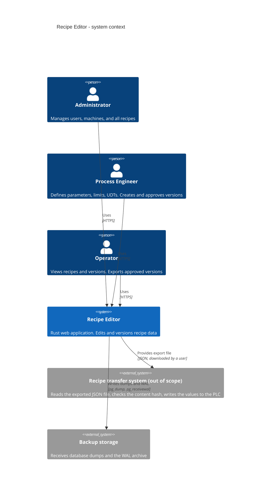
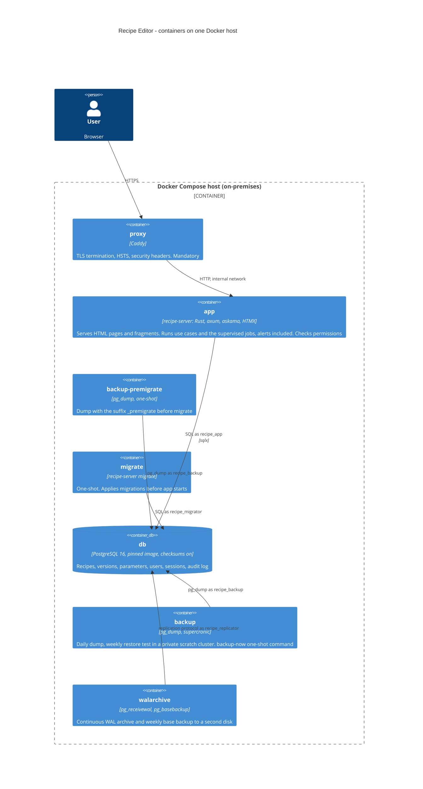
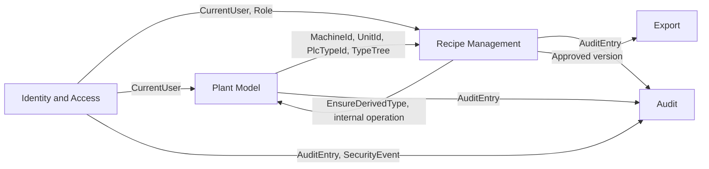
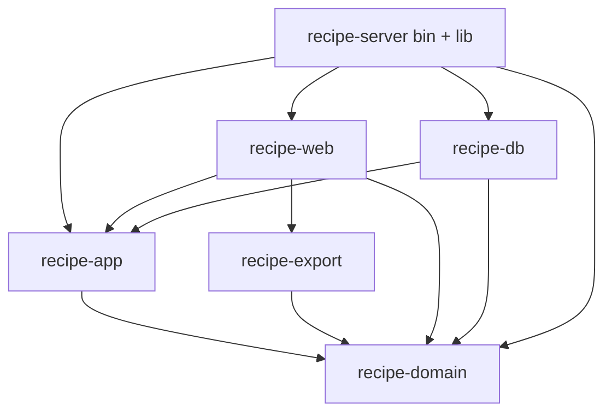

# Architecture Overview

Status: Accepted (design stage, revised after the review of 2026-10-12)
Source of requirements: `general-draft.txt`
Related: `domain-model.md`, `data-model.md`, `api.md`, `reliability.md`, `../adr/`

## 1. Purpose

The system edits and manages recipes for machines of an industrial production line. A recipe is a versioned set of typed parameters with process limits. The system stores recipe data only. It does not communicate with a PLC. An approved version can be exported as a JSON file with a content hash for a separate transfer system (ADR-0019).

The system must run 24/7 on one on-premises host. Data safety and reliability have priority over performance.

## 2. System context (C4 level 1)



## 3. Container view (C4 level 2)



There is one application process. There is no message broker, no cache, and no second database. `walarchive` connects as `recipe_replicator`, a login role with the `REPLICATION` attribute (`data-model.md` 5.1). Compose runs seven services. Start order: `db` healthy, `backup-premigrate` exit 0, `migrate` exit 0, `app`, `proxy`. `backup` and `walarchive` depend only on `db`. Every long-running service has a healthcheck and `restart: always`. `backup-premigrate` and `migrate` have `restart: no` (ADR-0020). The service `backup` also runs the weekly restore test (ADR-0067). `reliability.md` section 7.1 gives the networks and the healthchecks of the services, and section 7.8 gives their limits (ADR-0065, ADR-0070).

## 4. Bounded contexts

The contexts are defined in `domain-model.md` section 1. The relations between them:



Rules:

- A context exposes identifier types, resolved read values (`TypeTree`, `LiveUnits`), and commands. It does not expose its entities to another context.
- Recipe Management reads the Plant Model through read-only ports. It writes to the Plant Model only through the internal operation `EnsureDerivedType`, which creates a `STRING(n)`, `WSTRING(n)`, or array type on demand (ADR-0016, ADR-0017). It is not a use case.
- Audit is write-only for all contexts. Only the Audit context reads audit rows.

## 5. Cargo workspace

```text
Cargo.toml                 workspace root, shared [workspace.dependencies] and [workspace.lints]
migrations/                sqlx migrations, forward-only (ADR-0020)
deploy/                    compose.yaml, Caddyfile, db/initdb/01-roles.sh, backup scripts
crates/
  recipe-domain/           lib. Entities, value objects, invariants, validation, Permission enum, error codes.
                           Module export: hashed export body, canonical serializer, content hash. No I/O.
  recipe-app/              lib. Use cases, ports (traits), permission checks, audit entries.
  recipe-db/               lib. PostgreSQL adapters (sqlx), session store, unit of work.
  recipe-export/           lib. Export JSON Schema (schema/export-v1.schema.json), JSON writer of the
                           HTTP response, golden tests. Only recipe-web uses it.
  recipe-web/              lib. axum routers, askama templates, HTMX fragments, i18n, security headers,
                           session cookie.
  recipe-server/           bin + lib. Configuration, wiring, supervisor of the jobs, watchdog, panic hook,
                           subcommands serve | migrate | create-admin | healthcheck. Not published.
```

Dependency rule (an arrow means "depends on"):



`recipe-app` does not depend on `recipe-export` or `recipe-db`. `ApproveVersion` and `ExportVersion` build the hashed body and compute the hash with the module `export` of `recipe-domain` (ADR-0019). `recipe-app` defines the error type `StorageError` of its ports. `recipe-db` implements the ports and maps `sqlx::Error` into `StorageError`. The only edge between the two crates is therefore `recipe-db` to `recipe-app`, and the graph has no cycle.

The supervised jobs follow the same rule (ADR-0060):

- `recipe-app` holds the ports of the jobs and one iteration of each job (`run_once`). It has no loop and no schedule.
- `recipe-db` implements the ports that read or write the database. `recipe-web::ReadOnlyMode` implements `ReadOnlySwitch`.
- `recipe-server` implements `DiskSpace`, `BackupDirectory`, and `AlertWebhook`. It holds the supervisor, the schedules, the watchdog thread, the panic hook, and the wiring.
- `recipe-server` has a library target with every module and a thin `main.rs`. The tests of the crate import the modules from the library.

Internal operations have no permission and no row of the matrix: `EnsureDerivedType`, the six supervised jobs, and the startup settings comparison `CompareSettings`. `api.md` section 3.2 lists them.

| Crate | Error type | Allowed dependencies (examples) | Forbidden |
|---|---|---|---|
| `recipe-domain` | `thiserror` enums per context, and `ExportError` | `uuid`, `rust_decimal`, `serde`, `serde_json`, `serde_json_canonicalizer`, `time`, `sha2`, `hmac` (ADR-0035) | `sqlx`, `axum`, `tokio`, any I/O, any port trait |
| `recipe-app` | `thiserror`: `AppError` (wraps the domain errors, `StorageError`, and `AuditError`), `AuditError`, `StorageError` | `recipe-domain`, `thiserror`, `async-trait`, `tracing`, `tokio` (`rt`, `time`, `sync`), `serde_json`, `uuid` (`v4`), `argon2`, `getrandom`, `time` (`formatting`), `parking_lot` (feature `memory` only) (ADR-0029, ADR-0035) | `sqlx`, `axum`, `recipe-export`, `recipe-db` |
| `recipe-db` | None public. Maps `sqlx::Error` with SQLSTATE into `StorageError` of `recipe-app` | `sqlx` (postgres, runtime-tokio, tls-rustls), `recipe-app` | `axum` |
| `recipe-export` | None of its own. It returns `ExportError` of `recipe-domain` | `serde`, `serde_json`, `recipe-domain` | `sqlx`, `axum`, `recipe-app` |
| `recipe-web` | `thiserror` (`WebError`, HTTP shape only) | `axum`, `askama`, `fluent`, `tower-http`, `cookie`, `subtle`, `recipe-app`, `recipe-export` (ADR-0035) | `sqlx`, any session library |
| `recipe-server` | `anyhow` (the binary and its library target of ADR-0060 (bb), `main` returns `anyhow::Result`) | every crate above except `recipe-export`, `tokio`, `tracing-subscriber` (`env-filter`), `figment`, `axum`, `hyper`, `hyper-util`, `tokio-util`, `tower`, `time`, `rustix` (Unix only), `hyper-rustls`, `rustls`, `http-body-util` (ADR-0060, ADR-0063) | `recipe-export` (only `recipe-web` uses it), `sqlx` |

`recipe-web` sets the session cookie from the result of the `Login` and `ChangeOwnPassword` use cases. The `session` table and its adapter in `recipe-db` belong to the project (ADR-0014).

The workspace sets `#![forbid(unsafe_code)]` in every crate and the lints `clippy::unwrap_used`, `clippy::expect_used`, `clippy::panic`, `clippy::indexing_slicing` to `deny` (R32). `reliability.md` section 2 lists the full lint set and the panic policy.

## 6. Request flow (one mutating operation)

1. The browser sends a form or an HTMX request with the session cookie, the CSRF token, and the `row_version` of the draft.
2. `recipe-web` checks the CSRF token and the Origin, then checks the HTTP input (shape, lengths, encodings) and builds a command.
3. `recipe-web` loads `CurrentUser`: the session row gives the user id, and `app_user` gives `role`, `is_active`, `session_epoch`, and `must_change_password` on every request (ADR-0014).
4. The use case checks the permission (ADR-0013). It returns `Err(Forbidden)` when the role does not allow the operation. A `Forbidden` result is written to `security_event` in a separate transaction.
5. The use case loads the resolved read values (`TypeTree`, `LiveUnits`, `PlatformTypes`) and checks the input in `spawn_blocking` when the input is large.
6. The use case opens one transaction through the `UnitOfWork` port. It locks the machine row when the command needs it, then the recipe row, then the version row (ADR-0015).
7. The use case loads the aggregate (`Recipe` root or `Draft`), calls the domain method, and gets a `Result`.
8. The use case saves the aggregate with the `row_version` check (ADR-0008) and records the `AuditEntry` (ADR-0005). The commit takes a non-empty list of entries.
9. `UnitOfWork::commit` writes everything or nothing (R29).
10. `recipe-web` renders an HTML fragment or an error fragment with the error code (R36).

## 7. Requirement to mechanism

Each row is one requirement sentence from `general-draft.txt`. "Mechanism" names the design element that satisfies it. "Where" names the document that specifies the element. A row marked "partial" names what is still open.

| # | Requirement (draft) | Mechanism | Where |
|---|---|---|---|
| R01 | Web based application in Rust | axum server-side rendering with askama and HTMX. No JavaScript build chain | ADR-0001 |
| R02 | Edits and manages recipes for a production line | Recipe Management context. `Recipe` root, `Draft` aggregate, read models for Approved and Retired. One installation is one line (A25) | domain-model.md 2.2, ADR-0016 |
| R03 | Edits recipe data only. No machine communication | No PLC driver in any crate. Export is a JSON file. Transfer is out of scope | ADR-0019 |
| R04 | PostgreSQL and backend service in Docker | Docker Compose with seven services: `proxy`, `backup-premigrate`, `migrate`, `app`, `db`, `backup`, `walarchive` (A1) | ADR-0020, reliability.md 7 |
| R05 | Machines `M1` to `M9999999` | `MachineCode` value object. `CHECK (code ~ '^M[1-9][0-9]{0,6}$')`. Unique among live machines (A32) | domain-model.md 2.1, data-model.md 3.1 |
| R06 | One or more units `U1` to `U64` per machine | `Unit` entity. `CHECK` on every segment. `CreateMachine` creates the first unit. `ArchiveUnit` cannot archive the last live main unit (`E-PLT-008 LastMainUnit`) | domain-model.md 2.1, E-PLT-008 |
| R07 | Sub-unit hierarchy up to five levels, example `U1.2.4.5.6` | `UnitPath` with 1 to 5 segments (A30). Parent FK inside the same machine through the generated `parent_path`. `CHECK` on depth | I9, I10, data-model.md 3.2 |
| R08 | Parameter has type, name, description, unique identifier, process limits | `Parameter` fields `plc_type`, `name_en`, `description_en` (non-empty), `key` (the unique identifier, generated by the server, stable across versions, A40), `limits`. At approval every numeric, string, duration, and instant leaf has a limit (I17) | domain-model.md 2.2, ADR-0022 |
| R09 | Process engineer defines limits. Limits describe the process, not only the type | `ProcessLimit` per leaf or `[*]` for a whole array. Limit inside type range, value inside limit. Permission `ParameterEdit` for ProcessEngineer and Administrator | ADR-0007, api.md 3 |
| R10 | English names and descriptions. Translations permitted. Polish default UI | `name_en`/`description_en` base columns. `parameter_translation` table. `fluent` UI bundles with `pl` default and `en` fallback. The cookie `recipe_lang` stores the choice of the UI language (A17) | ADR-0012, api.md 8 |
| R11 | IEC data types of CODESYS and TwinCAT 3 | Seeded primitive `plc_type` rows with `platforms` containing `CodesysIec`, `TwinCat3`, including `LTIME`, `LDT`, `LDATE`, `LTOD`. A time value is a count of a base unit, shown as an IEC literal (A43). `ENUM`, subrange, and alias are not supported (A39) | ADR-0006, data-model.md 7 |
| R12 | Siemens S7-1200, S7-1500, S7-300 data types | Same catalog with `S7_1200`, `S7_1500`, `S7_300` availability (A3) | ADR-0006 |
| R13 | One-dimensional and multidimensional arrays, UDTs, nested structures | `PlcType.kind` in `Array`, `Struct`. `dimensions` list with at most 3 entries (A38). `plc_type_member` ordered rows. Recursive `TypeTree`. A request names a type with a `TypeExpr` such as `ARRAY[1..8] OF REAL`. `EnsureDerivedType` gets or creates the array and string types (ADR-0017) | domain-model.md 2.1, ADR-0006, ADR-0017, I8 |
| R14 | Each S7-300 parameter has a PLC memory address such as `DB1.DBD0` | `S7Address` value object with width, alignment, and overlap rules (I20). `CHECK parameter_s7_address_platform`: required on S7-300, optional on S7-1200 and S7-1500, not allowed on CODESYS and TwinCAT 3 (A31) | I5, I20, data-model.md 3.12 |
| R15 | Machines use different PLC types. One PLC controller per machine | `Machine.plc_platform` is one `NOT NULL` column. Platform frozen after the first recipe (trigger). A new controller is a new machine with the same code after archive (A32) | domain-model.md 2.1, ADR-0021 |
| R16 | Recipe has an alphanumeric reference number and a readable name | `ReferenceNumber` value object (charset A27). Plain `UNIQUE (reference_number)`. `name NOT NULL` | I11, ADR-0021 |
| R17 | Multiple versions with status `Draft`, `Approved`, `Retired` | `RecipeVersion.status` enum. State machine in domain-model.md 4. Transition trigger in the database | domain-model.md 4, data-model.md 4.7 |
| R18 | No more than one approved version at a time | Partial unique index `WHERE status = 'approved'`. `Recipe::approve()` under the recipe row lock | I1, ADR-0015 |
| R19 | Change of type, limit, or UDT creates a new version | Approved and Retired versions are immutable (domain error, transition trigger, mutability trigger). Edits happen in a new `Draft`. A new UDT revision marks parameters as outdated. `RebindTypeRevision` moves a draft to the new revision (A29) | ADR-0009, ADR-0018, I3, I4 |
| R20 | Record all changes | `audit_log` written in the same transaction by every command, with a hash chain. `security_event` for authentication and authorization events in their own transaction. Both are append-only for `recipe_app`, except `count` of an aggregated `security_event` row. `security_event_purge()` deletes `security_event` rows after 400 days | ADR-0005, ADR-0022, I13 |
| R21 | Logins and password hashes in the same database | `app_user` table with `login`, `password_hash` (Argon2id). Owned `session` table with `user_id` | ADR-0014, data-model.md 3.5 |
| R22 | Three roles: administrator, process engineer, operator | `Role` enum. `CHECK (role IN (...))` | ADR-0013 |
| R23 | Administrator or process engineer can create, edit, delete recipes when permissions allow | Permission matrix. `RecipeDelete`: ProcessEngineer only when no Approved and no Retired version exists. Administrator only when no Approved version exists | api.md 3, ADR-0021 |
| R24 | Operator can view recipes and versions. Operator cannot change them | Operator has only `RecipeView`, `VersionExport` (Approved only). Every command and query use case checks the permission first | api.md 3, ADR-0013 |
| R25 | Process engineer can create and edit recipes and versions | Permissions `RecipeCreate`, `RecipeEdit`, `VersionCreate`, `ParameterEdit` for ProcessEngineer | api.md 3 |
| R26 | Administrator has full recipe management rights | Administrator holds every permission in the matrix, including `RecipeRestore` and `VersionRetire`. Two state rules still apply. An Administrator cannot delete a recipe with an Approved version (`E-RCP-010`). An Administrator cannot approve a draft that the same user created or edited while separation of duties is on (`E-RCP-015`) | api.md 3, ADR-0021, ADR-0022 |
| R27 | Authorized user approves. New `Approved` retires the previous one | Permission `VersionApprove` (Administrator, ProcessEngineer). Separation of duties: the approver did not edit the draft (A34). `ApproveVersion` does both status changes in one transaction | I1, I2, I16, ADR-0022 |
| R28 | Enforce permissions for every recipe management operation | Permission check is the first statement of every command and query use case. HTTP layer only authenticates. Generated test per (operation, role) pair | ADR-0013, reliability.md 6 |
| R29 | Critical operations atomic | `UnitOfWork` port. One transaction per command with the lock order machine → recipe → version → unit → children. Table of every command with its statements in data-model.md 6 | data-model.md 6, ADR-0015 |
| R30 | Reliable and stable 24/7. No crash, no hang | Panics are caught per request (`CatchPanicLayer`). Watchdog restarts a hung process (A41). Timeouts on every request and query. Argon2 semaphore. Login throttling without permanent lockout. Health on an internal listener. Size budgets (A26) | reliability.md 2, 7, ADR-0020 |
| R31 | Data safety over performance | `synchronous_commit = on`, data checksums, pinned image. Daily `pg_dump` and continuous WAL archive to a second disk (A35). Row locks instead of retries for every write, except `SetUserRole` and `DeactivateUser`, which run SERIALIZABLE and retry once | reliability.md 7, ADR-0020 |
| R32 | No panic paths. `Result<T>`. Safe Rust | `#![forbid(unsafe_code)]`. Clippy `deny` on `unwrap_used`, `expect_used`, `panic`, `indexing_slicing`. No `expect` exception in `main`. Iterators instead of indexing | reliability.md 2 |
| R33 | `anyhow` for application errors, `thiserror` for libraries | `anyhow` only in the binary crate `recipe-server`. `thiserror` enums in the lib crates that own errors. `recipe-export` returns `ExportError` of `recipe-domain` (A37) | overview.md 5, reliability.md 1 |
| R34 | Design for safety, reliability, long-term operation, easy maintenance | Clean architecture with ports. Small aggregates. Forward-only migrations by a one-shot service. Pinned dependencies. Major-upgrade runbook | overview.md 5, reliability.md 5, 7 |
| R35 | Handle and record errors and unexpected behaviour, including edge cases | Every `Err` is logged once: at the HTTP boundary for requests, in the supervisor for background jobs (`job` field). A job logs a handled fault once at `WARN`. Each command lists its complete error set | reliability.md 1, 3, domain-model.md 5 |
| R36 | Clear, unique error messages that identify the source | Each error variant has a stable code `E-<CTX>-<nnn>`, one owner enum, and a message template with identifying values. One complete table. Authentication failures share the client code `E-IDN-003` on purpose (A42) | reliability.md 1.2 |
| R37 | Structured, detailed event logs for debugging | `tracing` JSON. Span per request with `request_id`, `user_id`, `role`, `client_ip`, `route`. Span per use case and per SQL statement | reliability.md 3 |
| R38 | Check all external input | Value object constructors (`parse`, not `new`). One grammar per value object. HTTP extractors reject unknown fields and over-long bodies. `/lang` redirects only to a same-origin path. `CHECK` constraints as the last line | reliability.md 4 |
| R39 | Clear and reliable UI and UX | Server-rendered forms. Every action gives a visible result or an error fragment. No client state that can diverge from the server. One design system with tokens, states, and components. WCAG 2.2 AA (A44) | ADR-0001, ADR-0036, design-system.md |
| R40 | ASD-STE100 for technical English | All documents, UI English strings, and error messages follow the structural STE rules. `ste-lint.py`, defined in reliability.md 8, runs in CI on the scope of ADR-0023 with zero hard violations | reliability.md 8 |
| R41 | Apply principles only when they solve a problem | Section 8 lists every principle from the draft with the problem it solves, or the statement that it is not applied | overview.md 8 |
| R42 | English for documentation, specifications, and code comments | Workspace rule in `CONTRIBUTING.md`. OpenSpec `config.yaml` context. `ste-lint.py` in CI | reliability.md 8, openspec/config.yaml |
| R43 | Use a design pattern only when it improves the code | Each pattern names the problem it solves in its doc comment. Review rejects a pattern with no named problem | reliability.md 8 |
| R44 | Use models tailored to the task. Use subagents | Process requirement for the build, not for the product. The plan assigns a model and subagents to each prompt | plan/implementation-prompts.md |
| R45 | Communicate with the chat user in Polish | Process requirement. Preamble of every prompt in the plan | plan/implementation-prompts.md |

## 8. Design principles

Every principle from the draft is listed. A principle is applied only for a named problem.

| Principle | Status | Problem it solves here |
|---|---|---|
| Object-oriented programming | Applied, limited | Aggregates and value objects own their rules (`Recipe::approve`, `UnitPath::parse`). No inheritance |
| SOLID | Applied: S, D | Single responsibility per crate and per use case. Dependency inversion through ports. O, L, I have no named problem and are not applied as rules |
| KISS | Applied | One process, one database, no broker, no cache. READ COMMITTED with explicit locks instead of SERIALIZABLE with retries (ADR-0015). Exception: `SetUserRole` and `DeactivateUser` run SERIALIZABLE and retry once |
| DRY | Applied | One table for settings, one table for error codes, one JSON Schema for the export. Each rule lives in one document |
| YAGNI | Applied | No API tokens until a transfer system exists. No `ReplaceController` until a plant needs it (A32). No event sourcing |
| GRASP | Applied: Information Expert, Creator | The `Draft` knows its parameters and checks them. `Recipe` creates versions |
| Separation of concerns | Applied | HTTP parsing, permission checks, domain rules, and SQL live in four crates |
| Composition over inheritance | Applied | `TypeTree` composes primitives, arrays, and structs. No type hierarchy in Rust |
| Encapsulation | Applied | Value objects exist only as valid values. Aggregates expose intent methods, not fields |
| Loose coupling | Applied | Contexts exchange identifiers and resolved read values, not entities |
| High cohesion | Applied | A use case does one command. A crate has one layer |
| Law of Demeter | Applied | The use case calls `draft.set_value(...)`, not `draft.parameters[i].value = ...` |
| Tell, do not ask | Applied | The approval rule lives in `Recipe::approve()`. The use case does not read statuses and decide |
| Principle of least astonishment | Applied | Version numbers never change. A deleted recipe stays visible in history. The UI uses the same status words as the database |
| Convention over configuration | Applied | Route names follow the command name where a route exists. Action routes use the command verb. Template names and audit action names follow the command name |
| Inversion of control | Applied | The use case receives ports. `recipe-server` wires them |
| Dependency injection | Applied | Constructor injection of ports in `recipe-app`. No service locator |
| Abstraction | Applied, limited | Ports abstract storage and time. No abstraction over PostgreSQL itself (one database for 10 years) |
| Modularity | Applied | Six crates with a fixed dependency direction |
| Immutability | Applied | Approved and Retired versions, `plc_type` rows, and audit rows never change. Value objects are immutable |
| Idempotency | Applied | A repeated approve returns `AlreadyApproved`. `EnsureDerivedType` is get-or-create. Migrations are checksum-verified |
| Easy to change | Applied | A change of the UI library does not touch the domain. A new PLC type is one migration row |
| Parse at the boundary | Applied | `UnitPath`, `S7Address`, `ReferenceNumber`, `MachineCode` exist only as valid values |

## 9. Assumptions

Requirements that are not in the draft. Each one is a decision from the analysis or review stage. The ADR gives the alternatives.

| # | Assumption | Source |
|---|---|---|
| A1 | Deployment is Docker Compose on one on-premises host. No high availability cluster. The draft sentence "Use PostgreSQL and backend service in a Docker container as the database" is broken. It is read as: PostgreSQL is the database, and the database and the backend run in Docker containers | ADR-0020 |
| A2 | The export format is a versioned JSON document with a content hash. The transfer to the PLC is out of scope | ADR-0019 |
| A3 | The list of supported data types per platform is the matrix in `data-model.md` section 7. The draft says "required" without a list | ADR-0006 |
| A4 | An Operator can export an `Approved` version. Export is a read operation that writes one audit entry | api.md 3 |
| A5 | Administrator and ProcessEngineer can approve a version. The approver must not have edited the draft (A34) | ADR-0022 |
| A6 | Every unit path segment is in `1..=64` | domain-model.md 2.1 |
| A7 | A recipe has at most one `Draft` at a time | domain-model.md 5 |
| A8 | An export is written to the audit log with the user and the version | domain-model.md 5 |
| A9 | Administrator and ProcessEngineer manage machines, units, and UDTs. Only Administrator manages users | api.md 3 |
| A10 | A recipe belongs to exactly one machine | ADR-0010 |
| A11 | A recipe version stores parameter values, not only definitions | domain-model.md 2.2 |
| A12 | `Retired` is terminal. A version cannot return to `Approved` | domain-model.md 4 |
| A13 | A recipe with an `Approved` version cannot be deleted. A ProcessEngineer cannot delete a recipe with a `Retired` version | ADR-0021 |
| A14 | Delete is a soft delete for recipes, versions, machines, units, and users. An Administrator can restore a recipe | ADR-0021 |
| A15 | Technology versions: Rust stable (edition 2024), PostgreSQL 16 pinned minor, axum 0.8, sqlx 0.8, askama, HTMX 2 | ADR-0001, ADR-0020 |
| A16 | Backup is a daily `pg_dump` plus a continuous WAL archive. Restore is tested weekly and before each release | ADR-0020 |
| A17 | The UI supports `pl` and `en`. The plain cookie `recipe_lang` stores the UI language. The session does not store it. `POST /lang` sets the cookie, also before login. Parameter translations accept language codes `^[a-z]{2,3}(-[A-Z]{2})?$` | ADR-0012 |
| A18 | The Caddy container terminates every TLS connection of a client. Caddy is mandatory. A plant device in front of Caddy sends TLS to Caddy, and Caddy terminates it. Caddy sends plain HTTP to `app` inside the Compose network | ADR-0020, ADR-0065 |
| A19 | Expected scale: fewer than 100 users, fewer than 10 000 recipes, fewer than 4 000 parameters per version. No partitioning | data-model.md |
| A20 | Audit visibility: Administrator reads the full audit log. ProcessEngineer reads only entries about recipes, versions, and parameters. Operator reads none. The recipe history page stays visible to all roles | api.md 3 |
| A21 | Session timeouts are configuration values. Defaults: 30 minutes idle, 12 hours absolute | reliability.md 7.11 |
| A22 | Login throttling is a progressive delay per (login, client IP) and a per-IP budget. There is no permanent lockout. An Administrator can unlock a login | ADR-0014 |
| A23 | Password policy: minimum 12 and maximum 128 characters, checked against a breached-password list | ADR-0014 |
| A24 | When free space on the data volume is below 5 %, the application enters read-only mode. A failed measurement of the free space also turns the mode on. `Login`, `Logout`, every query, and every export continue. Every other command returns 503 `E-WEB-006`. The only audit actions in read-only mode are `UserLoggedIn`, `UserLoggedOut`, `VersionExported`, and the `SettingChanged` entries of the startup settings comparison. `Login` keeps its `login_attempt` rows and the `security_event` rows of a failed or throttled login, so the login throttle still works. The mode ends above 10 %. Only a measurement that succeeds can end the mode | reliability.md 7.8, ADR-0020, ADR-0061, ADR-0073 |
| A25 | One installation serves one production line. The draft's "production line" has no entity | domain-model.md 1 |
| A26 | Size budgets: 16 384 leaves per parameter, 262 144 leaves and 32 768 limit rows per version, 4 000 parameters per version | domain-model.md I18 |
| A27 | A reference number matches `[A-Z0-9][A-Z0-9_-]{0,49}`. Input is folded to upper case | domain-model.md 2.2 |
| A28 | A Draft can be discarded. An Administrator can retire an Approved version without a replacement | domain-model.md 4 |
| A29 | A new UDT revision does not create versions. It marks parameters as outdated. The engineer rebinds them in a new Draft. An approval with outdated parameters needs the request flag `allow_outdated`, and the audit entry records the flag | ADR-0018 |
| A30 | A unit path has at most five segments. The draft example `U1.2.4.5.6` has five | ADR-0022 |
| A31 | A parameter on S7-1200 or S7-1500 may have an address. Only S7-300 requires one. A CODESYS or TwinCAT 3 parameter has no address | ADR-0022 |
| A32 | A machine code is unique among live machines. After archive the code can be used for a new machine with a new controller. The draft term "PLC controller" is the `plc_platform` value of the machine | ADR-0021 |
| A33 | Authentication and authorization failures (failed login, inactive login, throttling, CSRF rejection, Forbidden, unlock, audit chain break) are recorded in `security_event`. A successful login and a logout are audit actions `UserLoggedIn` and `UserLoggedOut`. A setting change is the audit action `SettingChanged` | ADR-0022 |
| A34 | Separation of duties on approval is on by default and can be turned off per plant through an audited configuration value | ADR-0022 |
| A35 | The host provides a second disk or a network share for the WAL archive. Without it the RPO is 24 hours and the runbook states the risk | ADR-0020 |
| A36 | At approval every numeric, string, duration and instant leaf has a process limit. BOOL, CHAR and WCHAR leaves have none. `description_en` is never empty. The draft says "must have", the documents enforce it at approval | ADR-0022, I17 |
| A37 | `anyhow` is used in the binary crate only. The draft word "application" means the executable `recipe-server`. Library crates use `thiserror` | overview.md 5 |
| A38 | An array has at most 3 dimensions on every platform | domain-model.md 2.1 |
| A39 | IEC derived types (ENUM, subrange, alias) are not supported. A parameter uses a primitive, an array, or a UDT | ADR-0006 |
| A40 | The server generates the parameter `key`. It is unique inside a version and stable across the versions of one recipe | domain-model.md 2.2 |
| A41 | A panic is contained per request and the process restarts when it hangs. The draft words "must not crash" are read as "contain and restart". `overflow-checks` stays on | reliability.md 2, ADR-0020 |
| A42 | Authentication failures (unknown login, wrong password, inactive user) return one client message and code `E-IDN-003`. The event log and `security_event` carry the exact reason | api.md 7.4, ADR-0014 |
| A43 | A time value is an integer count of a base unit. TIME, S5TIME and TIME_OF_DAY count milliseconds. LTIME, LDATE, LTOD, LDT and DTL count nanoseconds. DATE counts days, and DATE_AND_TIME counts seconds. DATE, LDATE, DATE_AND_TIME, LDT and DTL count from 1970-01-01. TIME_OF_DAY and LTOD count from midnight. The UI shows IEC literals | domain-model.md 2.1, ADR-0022 |
| A44 | The UI meets WCAG 2.2 level AA. Every interactive target outside a sentence of text is at least 44 by 44 CSS px, and one light theme supports forced colors. The users work at a machine with gloves and glare, often at a touch panel | ADR-0036, design-system.md |
