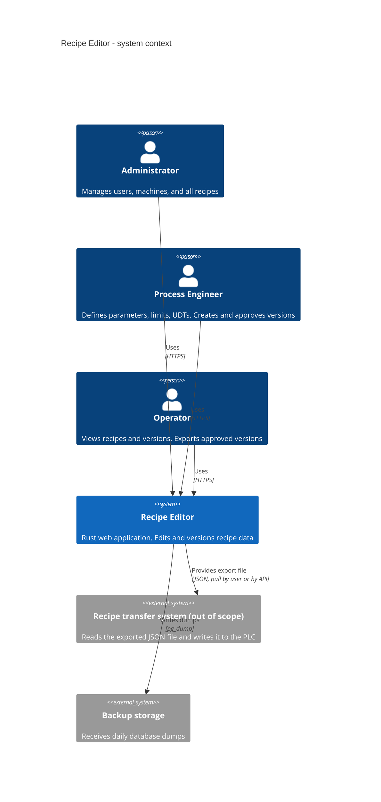
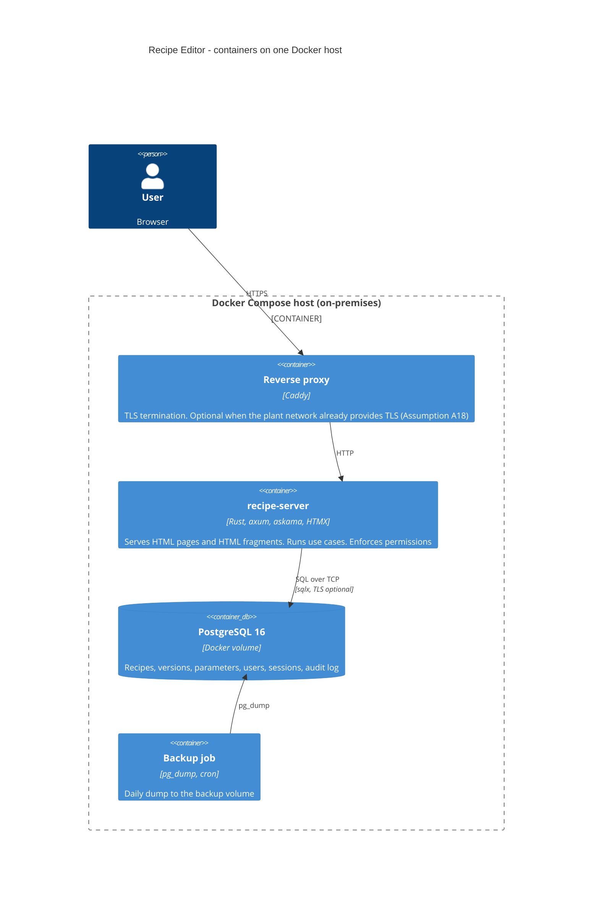
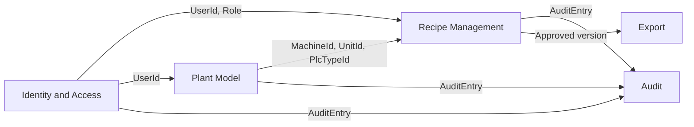
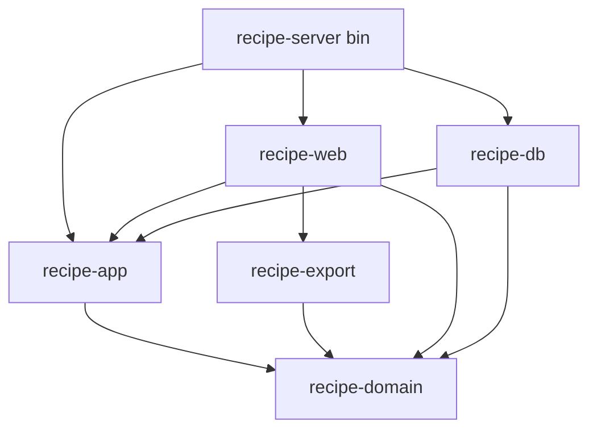

# Architecture Overview

Status: Accepted (design stage, 2026-10-12)
Source of requirements: `general-draft.txt`
Related: `domain-model.md`, `data-model.md`, `api.md`, `reliability.md`, `../adr/`

## 1. Purpose

The system edits and manages recipes for machines of an industrial production line. A recipe is a versioned set of typed parameters with process limits. The system stores recipe data only. It does not communicate with a PLC. An approved version can be exported as a JSON file for a separate transfer system (ADR-0002).

The system must run 24/7 on one on-premises host. Data safety and reliability have priority over performance.

## 2. System context (C4 level 1)



## 3. Container view (C4 level 2)



There is one application process. There is no message broker, no cache, and no second database. Each container has a healthcheck and `restart: always` (ADR-0003).

## 4. Bounded contexts

The contexts are defined in `domain-model.md` section 1. The relations between them:



Rules:

- A context exposes identifier types and commands. It does not expose its entities to another context.
- Recipe Management reads the Plant Model through a read-only port (`TypeCatalog`, `UnitLookup`). It never writes to it.
- Audit is write-only for all contexts. Only the Audit context reads audit rows.

## 5. Cargo workspace

```text
Cargo.toml                 workspace root, shared [workspace.dependencies] and lints
crates/
  recipe-domain/           lib. Entities, value objects, invariants, validation. No I/O.
  recipe-app/              lib. Use cases, ports (traits), permission checks, audit contract.
  recipe-db/               lib. PostgreSQL adapters (sqlx), migrations, unit of work.
  recipe-export/           lib. Export JSON schema (versioned) and serializer.
  recipe-web/              lib. axum routers, askama templates, HTMX fragments, sessions, i18n.
  recipe-server/           bin. Configuration, wiring, graceful shutdown, main().
```

Dependency rule (an arrow means "depends on"):



| Crate | Error type | Allowed dependencies (examples) | Forbidden |
|---|---|---|---|
| `recipe-domain` | `thiserror` enums per context | `uuid`, `rust_decimal`, `serde`, `serde_json`, `time` | `sqlx`, `axum`, `tokio`, any I/O |
| `recipe-app` | `thiserror`, wraps domain errors | `recipe-domain`, `async-trait`, `tracing` | `sqlx`, `axum` |
| `recipe-db` | `thiserror`, maps `sqlx::Error` | `sqlx` (postgres, runtime-tokio, tls-rustls), `recipe-app` | `axum` |
| `recipe-export` | `thiserror` | `serde`, `serde_json`, `recipe-domain` | `sqlx`, `axum` |
| `recipe-web` | `thiserror` for handler errors, mapped to HTTP | `axum`, `askama`, `tower-sessions`, `fluent`, `recipe-app` | `sqlx` |
| `recipe-server` | `anyhow` (binary only) | all crates above, `tokio`, `tracing-subscriber`, `figment` or `config` | - |

The workspace sets `#![forbid(unsafe_code)]` in every crate and the lints `clippy::unwrap_used`, `clippy::expect_used`, `clippy::panic`, `clippy::indexing_slicing` to `deny` (R32). `reliability.md` section 2 lists the full lint set.

## 6. Request flow (one mutating operation)

1. The browser sends a form or an HTMX request with the session cookie and the `row_version` of the draft.
2. `recipe-web` validates the HTTP input (shape, lengths, encodings) and builds a command.
3. `recipe-web` calls the use case in `recipe-app` with the `CurrentUser` from the session.
4. The use case checks the permission (ADR-0013). It returns `Err(Forbidden)` when the role does not allow the operation.
5. The use case opens one transaction through the `UnitOfWork` port.
6. The use case loads the aggregate, calls the domain method, and gets a `Result`.
7. The use case saves the aggregate with `row_version` check (ADR-0008) and records the `AuditEntry` (ADR-0005).
8. `UnitOfWork::commit` writes everything or nothing (R29).
9. `recipe-web` renders an HTML fragment or an error fragment with a unique error code (R36).

## 7. Requirement to mechanism

Each row is one requirement sentence from `general-draft.txt`. "Mechanism" names the design element that satisfies it. "Where" names the document that specifies the element.

| # | Requirement (draft) | Mechanism | Where |
|---|---|---|---|
| R01 | Web based application in Rust | axum server-side rendering with askama and HTMX. No JavaScript build chain | ADR-0001 |
| R02 | Edits and manages recipes for a production line | Recipe Management context, `Recipe` aggregate with versions and parameters | domain-model.md 2.2 |
| R03 | Edits recipe data only. No machine communication | No PLC driver in any crate. Export is a JSON file. Transfer is out of scope | ADR-0002 |
| R04 | PostgreSQL and backend service in Docker (N1) | Docker Compose with `recipe-server`, `postgres:16`, backup job | ADR-0003, reliability.md 7 |
| R05 | Machines `M1` to `M9999999` | `MachineCode` value object. `CHECK (code ~ '^M[1-9][0-9]{0,6}$')` | domain-model.md 2.1, data-model.md |
| R06 | One or more units `U1` to `U64` per machine | `Unit` entity. `CHECK` on first segment range. `CreateMachine` creates the first unit | domain-model.md 2.1, I9 |
| R07 | Sub-unit hierarchy up to five levels, example `U1.2.4.5.6` (N2) | `UnitPath` with 1 to 6 segments. Parent FK inside the same machine. `CHECK` on depth | I9, I10, data-model.md |
| R08 | Parameter has type, name, description, unique identifier, process limits | `Parameter` fields `plc_type`, `name_en`, `description_en`, `key`, `limits`. `NOT NULL` on all but limits | domain-model.md 2.2 |
| R09 | Process engineer defines limits. Limits describe the process, not only the type | `ProcessLimit` per leaf. Validation: limit inside type range, value inside limit. Permission `ParameterEdit` for ProcessEngineer and Administrator | ADR-0007, api.md 3 |
| R10 | English names and descriptions. Translations permitted. Polish default UI | `name_en`/`description_en` base columns. `parameter_translation` table. `fluent` UI bundles with `pl` default and `en` fallback | ADR-0012 |
| R11 | IEC data types of CODESYS and TwinCAT 3 | Seeded primitive `plc_type` rows with `platforms` containing `CodesysIec`, `TwinCat3` | ADR-0006, data-model.md seed list |
| R12 | Siemens S7-1200, S7-1500, S7-300 data types | Same catalog with `S7_1200`, `S7_1500`, `S7_300` availability (Assumption A3) | ADR-0006 |
| R13 | One-dimensional and multidimensional arrays, UDTs, nested structures | `PlcType.kind` in `Array`, `Struct`. `dimensions` list. `plc_type_member` ordered rows. Recursive `TypeTree` | ADR-0006, I8 |
| R14 | Each S7-300 parameter has a PLC memory address such as `DB1.DBD0` | `S7Address` value object. `CHECK (plc_platform <> 'S7_300' OR s7_address IS NOT NULL)` with platform propagated by composite FK | I5, data-model.md |
| R15 | Machines use different PLC types. One PLC controller per machine | `Machine.plc_platform` is one `NOT NULL` column. Platform cannot change after the first recipe | domain-model.md 2.1 |
| R16 | Recipe has an alphanumeric reference number and a readable name | `ReferenceNumber` value object. `UNIQUE (reference_number)`. `name NOT NULL` | I11 |
| R17 | Multiple versions with status `Draft`, `Approved`, `Retired` | `RecipeVersion.status` enum. State machine in domain-model.md 4 | domain-model.md 4 |
| R18 | No more than one approved version at a time | Partial unique index `WHERE status = 'approved'`. `Recipe::approve()` | I1 |
| R19 | Change of type, limit, or UDT creates a new version | Approved and Retired versions are immutable (domain error and trigger). Edits happen in a new `Draft` copied from a version | ADR-0009, I3, I4 |
| R20 | Record all changes | `audit_log` written in the same transaction by every command. Append-only grants | ADR-0005, I13 |
| R21 | Logins and password hashes in the same database | `app_user` table with `login`, `password_hash` (Argon2id). Sessions in `session` table | ADR-0004, data-model.md |
| R22 | Three roles: administrator, process engineer, operator | `Role` enum. `CHECK (role IN (...))` | ADR-0013 |
| R23 | Administrator or process engineer can create, edit, delete recipes when permissions allow | Permission matrix. `RecipeDelete` for ProcessEngineer only when no approved version exists, for Administrator always | api.md 3 |
| R24 | Operator can view recipes and versions. Operator cannot change them | Operator has only `RecipeView`, `VersionExport`. Every command checks the permission first | api.md 3, ADR-0013 |
| R25 | Process engineer can create and edit recipes and versions | Permissions `RecipeCreate`, `RecipeEdit`, `VersionCreate`, `ParameterEdit` for ProcessEngineer | api.md 3 |
| R26 | Administrator has full recipe management rights | Administrator holds every permission in the matrix | api.md 3 |
| R27 | Authorized user approves. New `Approved` retires the previous one | Permission `VersionApprove` (Administrator, ProcessEngineer). `ApproveVersion` use case does both status changes in one transaction | I1, I2, data-model.md transactions |
| R28 | Enforce permissions for every recipe management operation | Permission check is the first statement of every use case. HTTP layer has no business authorization. Integration test per (operation, role) pair | ADR-0013, reliability.md 6 |
| R29 | Critical operations atomic | `UnitOfWork` port. One transaction per command. List of transactional operations in data-model.md | data-model.md 6 |
| R30 | Reliable and stable 24/7. No crash, no hang | No panic lints. Timeouts on every request and query. Connection pool with health checks. Graceful shutdown. `restart: always`. Healthcheck endpoint | reliability.md |
| R31 | Data safety over performance | `synchronous_commit = on`, `fsync = on`. Daily `pg_dump`. No denormalized write paths. Serializable isolation for approval | reliability.md 7, data-model.md 6 |
| R32 | No panic paths. `Result<T>`. Safe Rust | `#![forbid(unsafe_code)]`. Clippy `deny` on `unwrap_used`, `expect_used`, `panic`, `indexing_slicing`. Iterators instead of indexing | reliability.md 2 |
| R33 | `anyhow` for application errors, `thiserror` for libraries | `anyhow` only in `recipe-server`. `thiserror` enums in every lib crate | overview.md 5, reliability.md 1 |
| R34 | Design for safety, reliability, long-term operation, easy maintenance | Clean architecture with ports. Small crates. Migrations are forward-only and versioned. Dependency pins in `Cargo.lock` | overview.md 5, reliability.md 5 |
| R35 | Handle and record errors and unexpected behaviour, including edge cases | Every `Err` is logged once at the HTTP boundary with `request_id`. Domain errors list the edge cases per command | reliability.md 1, 3 |
| R36 | Clear, unique error messages that identify the source | Each error variant has a stable code `E-<context>-<nnn>` and a message template. Code is shown to the user and written to the log | reliability.md 1 |
| R37 | Structured, detailed event logs for debugging | `tracing` with JSON output. Span per request with `request_id`, `user_id`, `route`. Span per use case and per SQL statement | reliability.md 3 |
| R38 | Validate all external input | Value object constructors (`parse`, not `new`). HTTP extractors reject unknown fields and over-long bodies. `CHECK` constraints as second line | reliability.md 4 |
| R39 | Clear and reliable UI and UX | Server-rendered forms. Every action gives a visible result or an error fragment. No client state that can diverge from the server | ADR-0001 |
| R40 | ASD-STE100 for technical English | All documents, UI English strings, and error messages follow the structural STE rules | this document set |
| R41 | Apply principles only when they solve a problem | Section 8 lists the principles in use and the problem each one solves | overview.md 8 |
| R42 | English for code comments | Workspace rule in `CONTRIBUTING.md`. Reviewed in pull requests | reliability.md 8 |

## 8. Design principles in use

Only principles that solve a named problem in this project are listed.

| Principle | Problem it solves here |
|---|---|
| Dependency inversion (ports and adapters) | Use cases must be tested without PostgreSQL. `recipe-app` defines `RecipeRepository`, `UnitOfWork`, `Clock`, `PasswordHasher` traits. `recipe-db` implements them. Tests use in-memory implementations |
| Immutability | An `Approved` version is a legal record. Snapshot rows never change after approval (I3, I4). `PlcType` revisions never change (ADR-0006) |
| Idempotency | A double click on "Approve" or a retried HTMX request must not create two audit entries or two state changes. `ApproveVersion` returns `Ok(AlreadyApproved)` when the version is already approved and the `row_version` matches |
| Tell, do not ask | The approval rule (retire the previous version) lives in `Recipe::approve()`. The use case does not read statuses and decide. This keeps I1 and I2 in one place |
| Separation of concerns | HTTP parsing, permission checks, domain rules, and SQL live in four crates. A change of the UI library does not touch the domain |
| Principle of least astonishment | The version number never changes and is never reused. A deleted recipe stays visible in history with a "deleted" mark. The UI shows the same status words as the database |
| Parse, do not validate (type-driven design) | `UnitPath`, `S7Address`, `ReferenceNumber`, `MachineCode` exist only as valid values. Invalid input cannot reach a use case |

## 9. Assumptions

Requirements that are not in the draft. Each one is a decision from the analysis stage. The ADR gives the alternatives.

| # | Assumption | Source |
|---|---|---|
| A1 | Deployment is Docker Compose on one on-premises host. No high availability cluster | ADR-0003 |
| A2 | The export format is a versioned JSON document. The transfer to the PLC is out of scope | ADR-0002 |
| A3 | The list of supported data types per platform is the matrix in `data-model.md` section 7. The draft says "required" without a list | ADR-0006 |
| A4 | An Operator can export an `Approved` version. Export is a read operation | api.md 3 |
| A5 | Administrator and ProcessEngineer can approve a version. No four-eyes rule | ADR-0013 |
| A6 | Every unit path segment is in `1..=64`. A path has at most 6 segments | domain-model.md 2.1 |
| A7 | A recipe has at most one `Draft` at a time. A second draft would make "which draft gets approved" ambiguous | domain-model.md 5 |
| A8 | An export is written to the audit log with the user and the version | domain-model.md 5 |
| A9 | Administrator and ProcessEngineer manage machines, units, and UDTs. Only Administrator manages users | api.md 3 |
| A10 | A recipe belongs to exactly one machine | ADR-0010 |
| A11 | A recipe version stores parameter values, not only definitions | domain-model.md 2.2 |
| A12 | `Retired` is terminal. A version cannot return to `Approved` | domain-model.md 4 |
| A13 | A recipe with an `Approved` version cannot be deleted | I14 |
| A14 | Delete is a soft delete for recipes, versions, machines, and users | ADR-0011 |
| A15 | Technology versions: Rust stable (edition 2024), PostgreSQL 16, axum 0.8, sqlx 0.8, askama, HTMX 2 | ADR-0001 |
| A16 | Backup is a daily `pg_dump` to a Docker volume. Restore is a manual procedure | reliability.md 7 |
| A17 | The UI supports `pl` and `en`. Parameter translations accept any BCP 47 language code | ADR-0012 |
| A18 | TLS is terminated by a reverse proxy container (Caddy) unless the plant network provides TLS | ADR-0003 |
| A19 | Expected scale: fewer than 100 users, fewer than 10 000 recipes, fewer than 1 000 parameters per version. No partitioning | data-model.md |
| A20 | Audit visibility: Administrator reads the full audit log. ProcessEngineer reads only entries about recipes, versions, and parameters. Operator reads none. The recipe history page stays visible to all roles | api.md 3 |
| A21 | Session timeouts are configuration values. Defaults: 30 minutes idle, 12 hours absolute | api.md 7, ADR-0004 |
| A22 | Login rate limit: 5 failed logins per login value in 15 minutes, then HTTP 429. The counter is in the `login_attempt` table | api.md 7, data-model.md 3.6a |
| A23 | Password policy: minimum 12 and maximum 128 characters. No composition rules | api.md 7 |
| A24 | When free space on the data volume is below 5 %, commands return 503 and queries and exports keep working. The mode ends above 10 % | reliability.md 7.9 |
