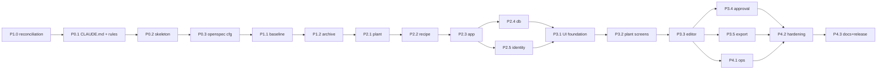

# Plan realizacji — prompty do Claude Code (OpenSpec)

Status: Draft, 2026-10-12
Źródła: `general-draft.txt`, `docs/architecture/*.md`, `docs/adr/*.md`, `openspec/config.yaml`

Ten plik jest instrukcją operatora. Prompty są po polsku (czat). Wszystkie artefakty, które prompty wytwarzają (specyfikacje, kod, komentarze, dokumenty), są po angielsku wg ASD-STE100.

## Zasady wspólne dla każdego promptu

Każdy prompt zaczyna się od stałej preambuły (kopiuj ją na początek):

```text
<preambuła>
Pracujemy w D:\editor-web-cc. Przeczytaj CLAUDE.md i .claude/rules/*.md.
Źródło prawdy: docs/architecture/*.md i docs/adr/*.md. Nie zmieniaj ich bez ADR.
Czat: polski. Artefakty (specs, kod, komentarze, docs): angielski, ASD-STE100 (skill asd-ste100).
Modele: subagent Haiku do zadań mechanicznych (szkielety, konwersje, testy z tabel),
Sonnet do implementacji, Opus do projektowania i przeglądów. Podaj model w każdym Agent().
Nie zaczynaj implementacji bez zatwierdzonych artefaktów OpenSpec (tasks.md).
</preambuła>
```

Cykl dla każdej zmiany (faza 2 i 3):

| Krok | Skill | Model | Wynik |
|---|---|---|---|
| 1. Propose | `openspec-propose` | Opus (sam) | `openspec/changes/<name>/{proposal,design,tasks}.md` + delta `specs/` |
| 2. Review planu | `plan-eng-review` (gstack) | Opus | Poprawki artefaktów przez `openspec-update-change` |
| 3. Apply | `openspec-apply-change` + `superpowers:test-driven-development` | Sonnet, Haiku dla mechanicznych tasków | Kod + testy, `tasks.md` odhaczone |
| 4. Review kodu | `code-review` + agent `rust-skills:…` / `comprehensive-review:security-auditor` | Opus | Lista CRITICAL/HIGH naprawiona |
| 5. Verify | `superpowers:verification-before-completion` | Sonnet | `cargo clippy`, `cargo test`, `cargo fmt --check` zielone |
| 6. Archive | `openspec-archive-change` | Sonnet | Delta zsynchronizowana do `openspec/specs/` |

Kryterium gotowości zmiany: wszystkie taski odhaczone, `openspec validate` zielone, CI zielone, ADR dla każdej decyzji podjętej w trakcie.

---

## Faza 0 — Fundament projektu (bez OpenSpec change)

### P0.1 — CLAUDE.md i reguły projektu

```text
<preambuła>
Użyj skilla `init`, aby utworzyć CLAUDE.md dla tego repo. Zanim go napiszesz,
przeczytaj: general-draft.txt, docs/architecture/overview.md (sekcje 5, 8, 9),
docs/architecture/reliability.md (sekcje 1, 2, 8), docs/adr/README.md.

CLAUDE.md ma zawierać (angielski, ASD-STE100, max 150 linii):
1. Purpose (3 zdania) i link do docs/architecture/overview.md.
2. Language rules: chat Polish, artifacts English STE.
3. Workspace map: 6 crate'ów z overview.md §5 i reguła zależności.
4. Hard rules: no panic paths, no unsafe, thiserror w lib / anyhow w bin,
   każda komenda w jednej transakcji, audit w tej samej transakcji,
   permission check jako pierwsza instrukcja use case'u.
5. Workflow: OpenSpec (propose → apply → archive), TDD, code review przed commitem.
6. Commands: cargo clippy --all-targets -- -D warnings, cargo test, cargo fmt --check,
   docker compose up, openspec validate.
7. Where to look: tabela "pytanie → dokument".

Następnie utwórz .claude/rules/ z plikami (każdy ≤ 60 linii, angielski STE):
- rust.md — lints z reliability.md §2, idiomatic-rust, naming (idiomatic-rust/NAMING.md),
  newtypes dla ID, parse-don't-validate.
- sql.md — konwencje z data-model.md §1, migracje forward-only, każdy FK ma indeks,
  każdy trigger ma test.
- web.md — SSR + HTMX, fragmenty HTML, brak JS poza vendored htmx.min.js i ≤ 50 linii
  dla drzewa, CSRF token w każdym POST, kody błędów E-<CTX>-<nnn> w każdym fragmencie błędu.
- docs.md — ASD-STE100 structural rules, Diátaxis dla docs/, ADR dla każdej decyzji.
- openspec.md — kiedy nowy change, nazewnictwo capability (plant-model,
  recipe-management, identity-access, audit, export, web-ui, operations),
  SHALL/MUST w specach.
Użyj skilla `update-config`, aby dodać do .claude/settings.json permissions dla
cargo, docker compose, openspec (read-only polecenia bez pytania).
Na końcu pokaż drzewo .claude/ i poproś o akceptację. Nie twórz kodu.
```

Skille: `init`, `update-config`, `asd-ste100`, `idiomatic-rust`. Model: Opus. Subagenci: brak.

Uwaga: po utworzeniu CLAUDE.md dodaj przez `update-config` hook PreToolUse, który przed `openspec archive` uruchamia `cargo test`. To jedyna automatyzacja, której prompty nie wymuszają same.

### P0.2 — Struktura repozytorium i git

```text
<preambuła>
Zainicjuj git (gałąź main) i utwórz strukturę katalogów bez kodu aplikacji:
crates/{recipe-domain,recipe-app,recipe-db,recipe-export,recipe-web,recipe-server}/
(tylko Cargo.toml + src/lib.rs lub main.rs z komentarzem doc i #![forbid(unsafe_code)]),
migrations/, deploy/ (compose, Caddyfile placeholder), docs/{architecture,adr,plan,ops,user}/,
.github/workflows/ci.yml (clippy -D warnings, fmt --check, test, cargo deny, cargo audit),
deny.toml, rustfmt.toml, rust-toolchain.toml (stable, edition 2024), .gitignore, CONTRIBUTING.md
(z reliability.md §8, angielski STE), README.md (3 akapity + linki).
Workspace Cargo.toml: [workspace.lints] z reliability.md §2, [workspace.dependencies]
z wersjami sprawdzonymi przez skill `rust-skills:docs` (axum, sqlx, askama,
tokio, tracing, thiserror, anyhow, uuid, rust_decimal, serde_json z arbitrary_precision,
argon2, fluent). Podaj powody każdej wersji w jednym zdaniu.
Subagent Haiku: wygeneruj szkielety crate'ów i CI. Ty: workspace Cargo.toml i README.
Sprawdź: cargo build, cargo clippy --all-targets -- -D warnings, cargo fmt --check.
Commit: "chore: workspace skeleton and CI".
```

Skille: `rust-skills:docs`, `docker-project-foundations`, `superpowers:verification-before-completion`. Model: Sonnet + Haiku (subagent). 

### P0.3 — Konfiguracja OpenSpec

```text
<preambuła>
Użyj skilla `openspec-explore`, aby ocenić openspec/config.yaml wobec docs/architecture.
Następnie uzupełnij openspec/config.yaml:
- context: dodaj 5 linii o domenie (recipe editor, Rust, PostgreSQL, SSR+HTMX,
  24/7 on-prem) i link do docs/architecture/overview.md.
- rules.proposal: max 400 słów, sekcja "Out of scope", odwołanie do R-numerów z overview.md §7.
- rules.specs: każde wymaganie ma ≥ 1 scenariusz, każde wymaganie cytuje R-numer
  lub Assumption A-numer, SHALL/MUST, STE.
- rules.design: odwołanie do ADR; nowa decyzja = nowy ADR w tym samym change.
- rules.tasks: każdy task ≤ 2 h, zaczyna się od testu (TDD), nazwa crate'u w nawiasie.
- operations.apply.guidance: run cargo clippy/test po każdym tasku, TDD, Haiku do
  tasków oznaczonych [mechanical].
- operations.archive.guidance: przed archive uruchom openspec validate --specs i cargo test.
Uruchom openspec validate i openspec doctor. Pokaż diff config.yaml i czekaj na akceptację.
```

Skille: `openspec-explore`. Model: Sonnet. Subagenci: brak.

---

## Faza 1 — Specyfikacja bazowa (jeden change, bez kodu)

### P1.0 — Rekoncyliacja projektu (wynik przeglądu 2026-10-12) — WYKONANE

Status: wykonane 2026-10-12 w siedmiu rundach (commity `97a5ea2` … ostatni z tej daty). Historia bramek: `docs/plan/review/2026-10-12-consolidated.md` §6a. Prompt poniżej zostaje jako wzorzec dla przyszłych rekoncyliacji po większych zmianach projektu.

```text
<preambuła>
Przeczytaj docs/plan/review/2026-10-12-consolidated.md i cztery raporty obok niego.
Moje odpowiedzi na decyzje D1–D12: <wpisz>.
Wykonaj plan z sekcji 6 raportu skonsolidowanego jako zmianę "design-reconciliation"
(tylko dokumenty, bez kodu, bez OpenSpec change):
1. Nowe ADR 0014–0022 (skill architecture-decision-records), stare oznacz Superseded.
2. Subagent A (Opus, skill postgresql-table-design): przepisz data-model.md §3–§6
   przetestowanym SQL z raportu PostgreSQL (K2–K5, K9, I5, I10, I12), 5 segmentów ścieżki.
3. Subagent B (Opus): domain-model.md — agregat Draft, podział komend, AuditAction, I15,
   jedna gramatyka per value object, N-notatki → Assumptions, tabela nazw Rust ↔ SQL.
4. Subagent C (Sonnet): api.md + reliability.md — jedna tabela kodów/statusów, jedna tabela
   ustawień, polityka panic wg D10, Argon2 + semafor, statvfs, CSP, health na osobnym listenerze.
5. Ty: overview.md (12 wierszy R, R43–R45, A25+, C4 z migrate) i implementation-prompts.md.
6. Subagent D (Haiku): mechaniczne poprawki z raportu traceability Pass B i C (~90 pozycji),
   potem scripts/ste-lint.py do zera twardych naruszeń.
7. Świeży agent (Opus) powtarza przegląd traceability. Bramka do P1.1: zero sprzeczności w Pass B.
Commit "docs: design reconciliation after review".
```

Skille: `architecture-decision-records`, `postgresql-table-design`, `asd-ste100`. Modele: Opus (ADR, SQL, domena, przegląd), Sonnet (api/reliability), Haiku (mechaniczne).

### P1.1 — Baseline specs z dokumentów architektury

```text
<preambuła>
Użyj skilla `openspec-propose` dla change "baseline-specs".
Cel: przenieść wymagania R01–R42 (overview.md §7) i inwarianty I1–I14 (domain-model.md §3)
do delta specs OpenSpec. Nie projektuj niczego nowego.
Capabilities (katalogi w specs/): plant-model, recipe-management, identity-access,
audit, export, web-ui, operations.
Dla każdego wymagania: nagłówek "### Requirement: <name>", zdanie SHALL z cytatem
R-numeru/A-numeru, ≥ 1 scenariusz Given/When/Then wyprowadzony z invariantu lub z tabeli
transakcji data-model.md §6. web-ui: tylko wymagania z R10, R39, api.md §4–§5, §8.
proposal.md: "why" = zamrożenie wymagań przed implementacją. design.md: odsyła do
docs/architecture, bez powtarzania. tasks.md: 1 task = "review and archive".
Subagenci (Haiku, równolegle, jeden na capability): konwersja tabel na spec.md wg
wzorca, który najpierw napiszesz dla plant-model i zatwierdzisz ze mną.
Po wygenerowaniu uruchom openspec validate --specs. Zatrzymaj się przed apply.
```

Skille: `openspec-propose`, `asd-ste100`. Model: Opus (wzorzec), Haiku ×7 (konwersja). 

### P1.2 — Przegląd i archiwizacja baseline

```text
<preambuła>
Uruchom 3 subagentów-recenzentów (Opus, równolegle, read-only) na openspec/changes/baseline-specs:
1. Factual reviewer: każde wymaganie ma źródło w general-draft.txt lub w Assumptions A1–A24.
   Lista wymagań bez źródła.
2. Consistency reviewer: te same nazwy co w domain-model.md §7 (glossary) i api.md §3 (permissions).
3. Redundancy checker: wymagania zduplikowane między capabilities.
Napraw znaleziska przez `openspec-update-change`. Potem `openspec-archive-change`:
delta → openspec/specs/<capability>/spec.md. Pokaż openspec list i drzewo openspec/specs.
Commit: "docs: baseline OpenSpec specs from architecture".
```

Skille: `openspec-update-change`, `openspec-archive-change`. Model: Opus (recenzenci), Sonnet (archiwizacja).

---

## Faza 2 — Rdzeń (domena → baza → tożsamość)

Każdy prompt poniżej to jeden OpenSpec change wykonywany w cyklu z tabeli na górze. Prompt podaje tylko to, co jest specyficzne.

### P2.1 — Change `domain-plant-model`

```text
<preambuła>
`openspec-propose` dla change "domain-plant-model" (crate recipe-domain, moduł plant).
Zakres: MachineCode, UnitPath (1–6 segmentów, 1..=64), Machine + Unit tree (archive),
PlcPlatform, PlcType (Primitive/Array/Struct, revision, supersedes, platforms, size_bytes,
string_length), TypeTree::resolve (cykle → TypeCycle), parsery LeafPath, TypeExpr (`ARRAY[1..8] OF ST_Zone@3`) i IecLiteral (`T#1d2h3m4s5ms`, `DT#2026-10-12-12:30:00`, konwersja do liczby jednostek bazowych, A43), klasy liści numeric/string/bool/char/duration/instant, S7Address parser
+ width check, PlantError z kodami E-PLT-001..007 (reliability.md §1.2).
Bez I/O, bez sqlx. Testy: unit + proptest dla UnitPath, S7Address, LeafPath (skill proptest-testing).
design.md: ≤ 20 linii sygnatur. tasks.md: TDD, taski parserów oznacz [mechanical].
Po akceptacji artefaktów: `openspec-apply-change`. Subagent Haiku: testy proptest
z tabel gramatyk (domain-model.md §2.1). Ty (Sonnet): typy i TypeTree.
Code review: agent systems-programming:rust-pro (Opus) + skill rust-code-review.
```

Skille: `openspec-propose`, `openspec-apply-change`, `superpowers:test-driven-development`, `idiomatic-rust`, `rust-errors`, `proptest-testing`, `rust-skills:m05-type-driven`. Modele: Sonnet (impl), Haiku (testy mechaniczne), Opus (review).

### P2.2 — Change `domain-recipe`

```text
<preambuła>
`openspec-propose` dla change "domain-recipe" (recipe-domain, moduł recipe).
Zakres: ReferenceNumber, ParameterTag, Recipe, RecipeVersion (status, row_version,
based_on, deleted_at), Parameter (snapshot), ProcessLimit per LeafPath,
ParameterValue::validate(&TypeTree, &[ProcessLimit]) z arbitrary_precision,
Recipe::approve() z ApprovalOutcome (I1, I2), VersionNotEditable (I3/I4),
S7AddressRequired (I5), DraftAlreadyExists (A7), RecipeHasApprovedVersion (I14),
RecipeError z kodami E-RCP-001..014. Maszyna stanów z domain-model.md §4 jako typ
(stany jako enum, przejścia jako metody zwracające Result).
Testy: tabela przejść stanów (każda zabroniona krawędź = test), proptest dla
ParameterValue vs losowe TypeTree (generator z P2.1).
Subagent Haiku: testy przejść z tabeli §4 [mechanical]. Ty (Sonnet): walidacja wartości.
Review: rust-pro (Opus) z pytaniem "czy można skonstruować nieprawidłowy stan przez API publiczne?".
```

Skille: jak P2.1 + `rust-skills:m03-mutability`, `rust-skills:m06-error-handling`. Modele: Sonnet / Haiku / Opus.

### P2.3 — Change `app-use-cases-and-ports`

```text
<preambuła>
`openspec-propose` dla change "app-use-cases-and-ports" (recipe-app).
Zakres: porty (traits): RecipeRepository (root + Draft osobno, ADR-0016), PlantRepository,
UserRepository, SessionRepository, TypeCatalog, UnitOfWork (commit przyjmuje NonEmpty<AuditEntry>
— I13; blokady recipe FOR UPDATE → version FOR UPDATE, ADR-0015), Clock, PasswordHasher
(z semaforem), SecurityEventSink, LoginAttemptStore, MaintenanceStore (ścieżki commitu wg ADR-0015). CurrentUser (rola i session_epoch przeładowane per request,
ADR-0014), Permission enum z recipe-domain, matrix z api.md §3 jako dane w kodzie,
AppError (Forbidden, NotFound, ConcurrentEdit, Unauthenticated, Storage + domain errors).
Use case'y z domain-model.md §5 (wszystkie 33, w tym zapytania, plus operacja wewnętrzna EnsureDerivedType bez uprawnienia) jako struktury z execute().
Permission check = pierwsza instrukcja (ADR-0013). Polityka zatwierdzania (ADR-0022):
separation_of_duties, kompletność limitów, content_sha256. In-memory adaptery dla testów.
Testy: każdy use case ma test happy path + każdy błąd z tabeli §5; test macierzy uprawnień
generowany z api.md §3 (operacja × rola, także zapytania) [mechanical]; test że SetParameterValue
nie zmienia limitów i tłumaczeń; test idempotentnego approve (AlreadyApproved).
Subagent Haiku: in-memory adaptery i test macierzy. Ty (Sonnet): Approve, SetParameterValue,
CreateVersion, RebindTypeRevision.
Review: comprehensive-review:architect-review (Opus) — zależności crate'ów zgodne z overview.md §5.
```

Skille: `architecture-patterns`, `rust-api-design`, `async-rust`, `rust-skills:domain-web` (Send+Sync bounds portów). Modele: Sonnet / Haiku / Opus.

### P2.4 — Change `db-schema-and-adapters`

```text
<preambuła>
`openspec-propose` dla change "db-schema-and-adapters" (recipe-db + migrations/).
Zakres: deploy/db/initdb/01-roles.sh (role i baza jako superuser z Docker secrets, ADR-0020),
migracje 0001_schema (DDL z data-model.md §3 bez zmian), 0002_triggers (§4, wszystkie),
0003_grants (§5, granty kolumnowe, ALTER DEFAULT PRIVILEGES), 0004_seed_plc_types (§7).
Podkomenda `recipe-server create-admin` (hasło ze stdin/secret, must_change_password).
Adaptery sqlx dla portów z P2.3, własny SessionRepository (tabela session z user_id i epoch, bez tower-sessions, ADR-0014),
UnitOfWork = transakcja + blokady recipe→version (ADR-0015) + zapis audit_log z łańcuchem hashy,
mapowanie sqlx::Error → StorageError z recipe-app (recipe-db bez publicznego typu błędu) (23505, 23503, 23514 z kodem triggera, 40P01, 55P03, 57014;
bez retry 40001). row_version: UPDATE ... WHERE row_version = $n, 0 rows → ConcurrentEdit.
Testy integracyjne (testcontainers, PostgreSQL 16): każdy trigger ma test pozytywny i
negatywny, każdy constraint CHECK/UNIQUE ma test, każde zabronione przejście stanu jako
recipe_app, lista grantów kolumnowych vs plik wzorcowy, każda komenda z data-model.md §6 ma
test atomowości (błąd w środku → brak wierszy), wyścig "dwa approve tego samego draftu", wyścig ArchiveUnit vs AddParameter z nowym typem pochodnym (kolejność blokad machine → recipe → version → unit, ADR-0015),
RemoveParameter z limitami i tłumaczeniami. Skill postgres + pg:postgres-database-migration.
Subagent Haiku: testy constraintów z tabel DDL [mechanical]. Ty (Sonnet): UnitOfWork i mapowanie błędów.
Subagent sql-reviewer (Opus, skill postgresql-table-design): przegląd migracji vs data-model.md;
różnice = błąd w kodzie, nie w dokumencie, chyba że ADR.
```

Skille: `postgres`, `postgresql-table-design`, `pg:postgres-database-migration`, `sql-optimization-patterns`, `rust-skills:m02-resource`. Modele: Sonnet / Haiku / Opus.

### P2.5 — Change `identity-and-sessions`

```text
<preambuła>
`openspec-propose` dla change "identity-and-sessions" (recipe-app + recipe-db + recipe-web szkielet).
Zakres: Argon2id PasswordHasher (parametry OWASP; wersję i API crate argon2 sprawdź skillem
rust-skills:docs), Login/Logout/ChangeOwnPassword/ResetPassword/Deactivate/Activate/SetUserRole,
UnlockLogin (CreateUser i ResetPassword generują hasło jednorazowe, must_change_password), LastAdministrator, throttling logowania (progresywne opóźnienie per login+IP,
budżet per IP, licznik w osobnej zatwierdzonej transakcji pod advisory lock, A22), semafor
Argon2, własna tabela session (token hashowany, cycle na login, session_epoch, ADR-0014),
CSRF (pre-session token dla /login i /lang, Origin/Sec-Fetch-Site), nagłówki bezpieczeństwa
i CSP (api.md §9), must_change_password, security_event. Middleware CurrentUser przeładowuje
rolę, is_active i session_epoch z app_user per request.
Minimalne strony: /login, /logout, /me/password (askama, bez stylów — style w P3.1).
Testy: axum oneshot dla każdego endpointu × rola, throttling z zegarem testowym, flood logowań
(semafor), test że hash i token nigdy nie trafiają do logów (tracing test subscriber),
test że zmiana roli i dezaktywacja kończą sesję.
Review: comprehensive-review:security-auditor (Opus) — OWASP ASVS V2/V3/V4 checklist.
```

Skille: `rust-skills:domain-web`, `htmx`, `security-review`. Modele: Sonnet / Haiku (testy endpoint × rola) / Opus (security).

---

## Faza 3 — UI/UX i ekrany

### P3.1 — Design system i szkielet UI (change `web-ui-foundation`)

```text
<preambuła>
Najpierw skill `ux-research` + `ux-strategy` (krótko, ≤ 1 strona): 3 persony z draftu
(administrator, process engineer, operator), 5 kluczowych zadań (journey-mapping):
edycja parametru w drafcie, zatwierdzenie wersji, porównanie wersji, dodanie UDT, eksport.
Następnie skill `design-consultation` (gstack) → propozycja systemu: paleta industrialna
o wysokim kontraście (WCAG 2.2 AA, praca przy maszynie, ekrany dotykowe), typografia
czytelna dla liczb (tabular figures), siatka tabel, stany Draft/Approved/Retired jako
spójne kolory + ikona + tekst (nigdy sam kolor). Potem `impeccable` + `frontend-design`:
DESIGN.md, base.html (askama), components/ (table, form, tree, status-badge, error-fragment,
toast), CSS bez frameworka (jeden plik, zmienne), htmx.min.js vendored, fluent bundles pl/en
(ux-writing: teksty UI po angielsku STE, polskie tłumaczenie w pl.ftl).
`openspec-propose` dla change "web-ui-foundation": wymagania web-ui z baseline + DESIGN.md
jako design.md. Apply: Ty (Sonnet) layout i komponenty, subagent Haiku: pl.ftl/en.ftl
z tabeli tekstów. Review: skill `design-review` + `accessibility-audit` (Opus) na stronach
/login i pustym /recipes.
```

Skille: `ux-research`, `ux-strategy`, `journey-mapping`, `design-consultation`, `impeccable`, `frontend-design`, `ui-ux-pro-max`, `ux-writing`, `htmx`, `accessibility-audit`, `web-design-guidelines`. Modele: Opus (design), Sonnet (impl), Haiku (ftl).

### P3.2 — Change `web-plant-model`

```text
<preambuła>
`openspec-propose` dla change "web-plant-model" (recipe-web): endpointy z api.md §2
dla machines, units, types. Drzewo jednostek jako fragmenty HTMX (hx-get na rozwinięcie,
hx-post na dodanie, hx-swap outerHTML), edytor UDT: lista członków z wyborem typu
(select filtrowany po platformie maszyny), podgląd TypeTree, tworzenie rewizji.
Każdy POST: CSRF, kod błędu w fragmencie, HX-Retarget do kontenera błędu.
Testy: axum oneshot per endpoint × rola (Haiku, z macierzy), snapshot testy fragmentów
(insta) dla stanów: pusty, 6 poziomów, UDT z cyklem (błąd E-PLT-005).
Review: `design-review` (Opus) na ekranie drzewa z 6 poziomami i 64 jednostkami;
`qa` (gstack, przeglądarka) ścieżka: utwórz maszynę S7-300 → dodaj U1.2.4.5.6 → UDT.
```

Skille: `htmx`, `interaction-design`, `rust-testing`, `playwright-cli` lub `browse`. Modele: Sonnet / Haiku / Opus.

### P3.3 — Change `web-recipe-editor`

```text
<preambuła>
`openspec-propose` dla change "web-recipe-editor" (recipe-web): recipes, versions,
parameters (api.md §2), edytor parametru: typ z katalogu, limity per liść (formularz
generowany z TypeTree — tabela liść/min/max/max_length), wartość jako formularz
drzewiasty generowany z TypeTree (tablice jako wiersze, struktury jako sekcje),
adres S7 widoczny tylko dla maszyn S7-300, row_version w hidden input, 409 → fragment
z różnicami (api.md §4), tłumaczenia name/description (pl + inne).
To najtrudniejszy ekran: najpierw `design-shotgun` (gstack) na 3 warianty edytora
UDT/tablicy, wybierz ze mną, potem implementacja. Limit JS: ≤ 50 linii (rozwijanie drzewa).
Testy: snapshot fragmentów dla: primitive, array[1..8] OF INT, struct w struct, tablica struktur;
test 409 (dwie sesje, Haiku); test że 1 000 parametrów renderuje się < 500 ms (A19).
Review: `design-review` + `accessibility-audit` (klawiatura przez całe drzewo) + rust-pro.
```

Skille: `design-shotgun`, `htmx`, `interaction-design`, `accessibility-audit`, `rust-performance`. Modele: Opus (warianty, review), Sonnet (impl), Haiku (testy).

### P3.4 — Change `approval-audit-history`

```text
<preambuła>
`openspec-propose` dla change "approval-audit-history": akcje approve/retire/discard/delete
z potwierdzeniem (dialog HTML, nie JS confirm), widok historii receptury (/recipes/{ref}/history)
dla wszystkich ról, widok audit (/audit) wg A20 z filtrami, porównanie dwóch wersji
(diff parametrów: dodane/usunięte/zmienione pola, limity, wartości) — czytelne dla operatora;
ten sam diff na stronie zatwierdzania z podświetlonymi zmianami limitów (ADR-0022).
Idempotencja: podwójne kliknięcie approve (row_version == expected + 1) → AlreadyApproved,
jeden wpis audytu, hx-sync na przycisku. Reguły rozdziału obowiązków, kompletności limitów i flagi allow_outdated (E-RCP-024, ADR-0018)
w UI (E-RCP-015, E-RCP-016). Akcja restore dla administratora.
Testy: scenariusz pełny approve→retire w testcontainers z asercją na audit_log (1 transakcja,
content_sha256 ustawiony, łańcuch hashy spójny), snapshot diffu, approve przez edytora draftu → 409.
Review: security-auditor (operator wywołuje POST approve → 403 + security_event).
```

Skille: `htmx`, `ux-writing` (teksty potwierdzeń STE), `security-review`. Modele: Sonnet / Haiku / Opus.

### P3.5 — Change `export-v1`

```text
<preambuła>
`openspec-propose` dla change "export-v1" (recipe-domain::export dla ciała, kanonizacji i hasha; recipe-export dla schematu JSON i zapisu HTTP; endpointy api.md §2.7, dokument §6).
JSON Schema (draft 2020-12) w crates/recipe-export/schema/export-v1.schema.json, serializer
z rozwiązanymi TypeTree (types[].revision, długości stringów członków), content_sha256 po
kanonizacji RFC 8785 ciała bez pól zmiennych (nazwy, status, exported_*), liczby i limity jako stringi dziesiętne (liczony w ApproveVersion, sprawdzany w ExportVersion, ADR-0019),
flaga loadable, Content-Disposition (prefiks RETIRED_), audyt eksportu (A8), 404 E-EXP-001,
przycisk w UI dla Approved; Retired tylko Admin/PE. Testy: walidacja schematem (crate jsonschema),
golden file dla przykładu z api.md §6, test że hash jest stabilny między eksportami i zmienia się
po zmianie statusu, test że mismatch daje E-EXP-002.
Dodatkowo: docs/user/export-format.md (Diátaxis reference, STE) dla autorów systemu transferu.
Subagent Haiku: golden files i docs reference z tabeli pól. Review: api-design-principles (Opus).
```

Skille: `rust-serde`, `api-design-principles`, `documentation-writer`. Modele: Sonnet / Haiku / Opus.

---

## Faza 4 — Operacje, hardening, dokumentacja

### P4.1 — Change `operations-compose`

```text
<preambuła>
`openspec-propose` dla change "operations-compose" (deploy/): compose.yaml wg reliability.md §7
(proxy Caddy obowiązkowy, backup-premigrate, migrate, app, db z data-checksums i kolacją C,
backup z backup-now i pg_dumpall --globals-only, walarchive na drugi dysk z rolą recipe_replicator i wpisem pg_hba — ADR-0020),
Dockerfile wielostopniowy (docker-build-strategies: distroless/static, non-root, healthcheck),
Docker secrets *_FILE (bez env-file), Caddyfile z HSTS i nagłówkami, skrypty backup + restore
z manifestem SHA-256, wewnętrzny listener /healthz i /readyz (port 9000), graceful shutdown,
timeouty, statvfs i tryb read-only (A24), tracing JSON (reliability.md §3), CatchPanicLayer +
watchdog (D10), nadzorowane joby w app: alerts, cleanup (purge security_event), audit chain check; tabela app_setting z audytem zmian ustawień przy starcie (ADR-0022). docs/ops/runbook.md (Diátaxis how-to, STE): start, backup,
restore, upgrade, rollback, major upgrade PostgreSQL, alarmy. Testy: compose up w CI
(healthchecki zielone ≤ 60 s), test restore z dumpu + WAL, test SIGTERM (drain), test że panic
w handlerze daje 500 i proces żyje. Skille docker-compose-patterns, docker-destructive-guardrails.
Review: performance-engineer (Opus) — limity zasobów i pool.
```

Skille: `docker-compose-patterns`, `docker-build-strategies`, `docker-destructive-guardrails`, `rust-observability`, `documentation-writer`. Modele: Sonnet / Haiku (runbook z tabel) / Opus.

### P4.2 — Hardening i soak

```text
<preambuła>
Bez nowego change (naprawy wchodzą jako change "hardening-round-1" tylko, gdy zmieniają spec).
1. Skill `cso` (gstack) + agent security-auditor (Opus): pełny audyt; CRITICAL/HIGH naprawione.
2. Skill `health` (gstack): dashboard jakości; funkcje > 50 linii i pliki > 800 linii → refactor
   (skill rust-skills:rust-refactor-helper, Sonnet).
3. Nightly soak (reliability.md §6): skrypt k6 lub oha z miksem żądań 24 h (w tym flood
   logowań), pułap pamięci 384 MiB przy limicie kontenera 512 MiB, raport do
   docs/ops/soak-<date>.md. Uruchom 2 h lokalnie, pokaż wykres RSS.
4. `accessibility-audit` na wszystkich ekranach (WCAG 2.2 AA) → lista i naprawy.
5. Pokrycie: cargo llvm-cov ≥ 80 % per crate; luki uzupełnia subagent Haiku testami z tabel.
Zakończ `superpowers:verification-before-completion` z wyjściem komend.
```

Skille: `cso`, `health`, `accessibility-audit`, `rust-performance`, `rust-testing`. Modele: Opus (audyty), Sonnet (naprawy), Haiku (testy).

### P4.3 — Dokumentacja i release

```text
<preambuła>
Skill `documentation-writer` (Diátaxis) + `asd-ste100` (strict dla instrukcji):
docs/user/ — tutorial "First recipe in 15 minutes", how-to per zadanie z P3.1 (5 zadań),
reference ekranów i uprawnień (z api.md §3), explanation "Why versions are immutable".
docs/ops/ — uzupełnij runbook. README — aktualny. CHANGELOG (changelog-automation).
Uruchom tools/ste-lint/ste-lint.py na zakresie z ADR-0023 — zero hard violations.
Skill `document-release` (gstack), potem `ship` (gstack): wersja 0.1.0, PR z planem testów.
Subagent Haiku: reference screens z szablonów askama. Ty (Sonnet): tutorial i how-to.
Review: documentation-generation:docs-architect (Opus) — spójność z docs/architecture.
```

Skille: `documentation-writer`, `asd-ste100`, `changelog-automation`, `document-release`, `ship`. Modele: Sonnet / Haiku / Opus.

---

## Kolejność i zależności



P1.0 (rekoncyliacja dokumentów) jest pierwsza, bo CLAUDE.md i reguły projektu (P0.1) cytują
dokumenty architektury. Równolegle można prowadzić: P2.4 z P2.5 (po P2.3), P3.4 z P3.5 i P4.1 (po P3.3).

## Dobór modeli — reguła

| Zadanie | Model | Dlaczego |
|---|---|---|
| Konwersja tabel na testy/specy/ftl, szkielety, golden files, runbook z tabel | Haiku | Mechaniczne, wzorzec zadany, tanie w powtórzeniu |
| Implementacja use case'ów, adapterów, ekranów, naprawy | Sonnet | Główna praca kodowa |
| Propose (design.md), przegląd architektury, security, design review, warianty UI | Opus | Decyzje i wychwytywanie błędów projektowych |

## Definicja ukończenia całości

- `openspec list` pokazuje 0 aktywnych changes, `openspec/specs/` ma 7 capabilities.
- Każde wymaganie R01–R42 ma test lub scenariusz w spec z tym samym numerem.
- `docker compose up` od zera → `/readyz` 200 w ≤ 60 s, pierwszy admin z env.
- Soak 24 h bez restartu, RSS stabilny.
- Zakres z ADR-0023 przechodzi `tools/ste-lint/ste-lint.py`, `docs/adr/README.md` zawiera każdą decyzję z fazy 2–4.
